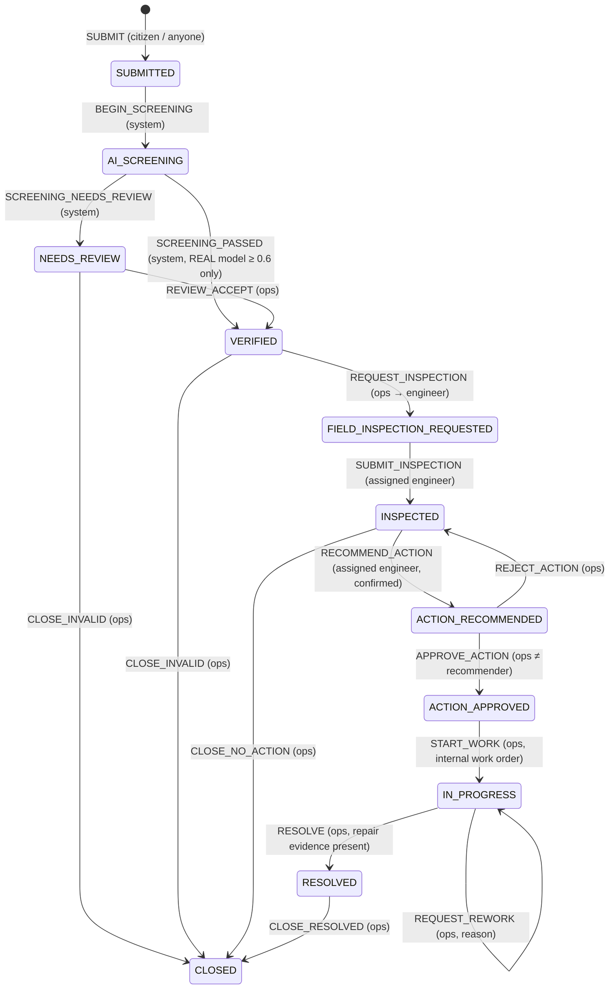

# Report Workflow State Machine

Source of truth: `src/domain/workflow/stateMachine.ts` (transition table `TRANSITIONS`),
tested in `tests/unit/workflow.test.ts` and over HTTP in
`tests/integration/workflow-api.test.ts`. Spec v2.2 §24.

## Invariants (all tested)

1. Only transitions in the table are accepted; anything else is `INVALID_TRANSITION`.
2. The actor's role must be listed for the action; assignment and separation-of-duty
   guards apply (assigned engineer only; recommender cannot approve; resolve needs a
   completed work order; recommend needs a confirmed inspection).
3. Staff decisions require a non-empty reason (≤ 1000 chars).
4. `expectedVersion` must equal the stored version; every accepted change increments it.
5. Every accepted change appends a `TransitionRecord` (actor, time, action, from, to,
   reason, public note) and an audit event.
6. Changes are committed before success is reported; a failed commit changes nothing.
7. AI screening never makes a human decision; the DEMO classifier always routes to
   `NEEDS_REVIEW`.
8. Report resolution (`RESOLVED`) is distinct from work-order completion. The assigned
   engineer sends repair evidence (`COMPLETE_WORK_ORDER`, new after-photo required); M.O
   verifies it (`RESOLVE`) or asks for rework (`REQUEST_REWORK`, reason required). Every
   evidence submission is kept in `workOrder.submissions` (D-041).

## Display status mapping (existing screens)

| Workflow state | `DamageReport.status` |
|---|---|
| SUBMITTED, AI_SCREENING, NEEDS_REVIEW, VERIFIED, FIELD_INSPECTION_REQUESTED | PENDING |
| INSPECTED, ACTION_RECOMMENDED | VERIFIED_BY_ENGINEER |
| ACTION_APPROVED, IN_PROGRESS | SCHEDULED_FOR_REPAIR |
| RESOLVED, CLOSED after RESOLVE | REPAIRED |
| CLOSED without repair | CLOSED |

## What each audience sees

| | Staff (FE/OM/PM) | Citizen / anonymous |
|---|---|---|
| Report content, photo, state | yes | yes |
| Screening result, assignment, inspection notes, recommendation, approvals, work order | yes | no |
| History | actor id, role, reason | public note per step only |
| Audit trail | yes (`/api/workflow/audit`) | no (403) |
