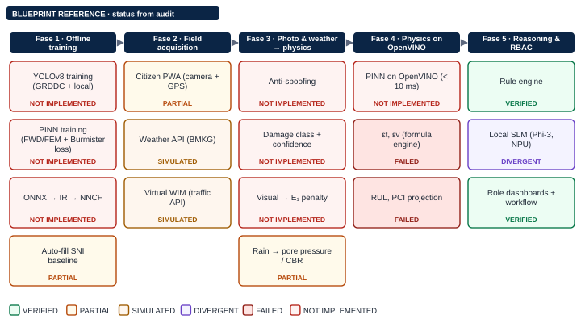
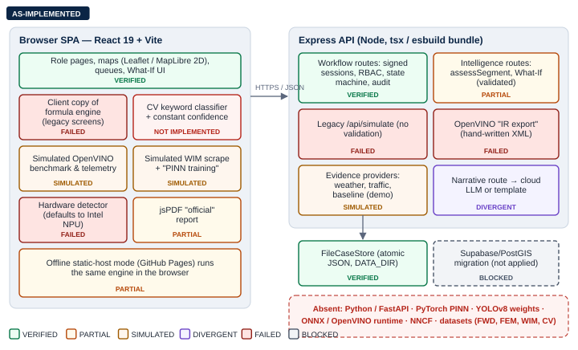
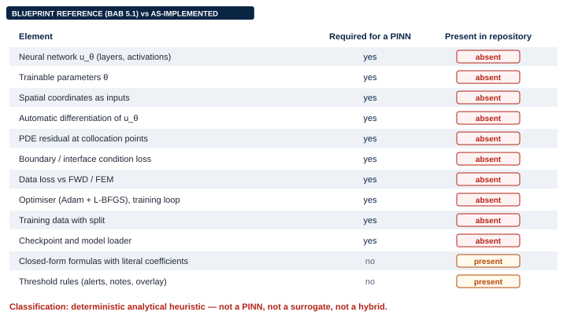
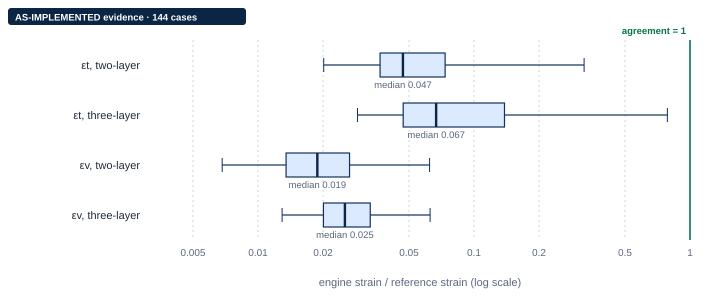
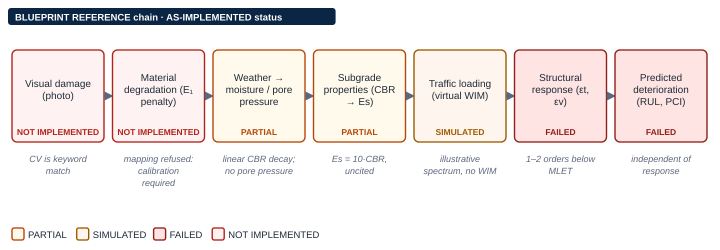
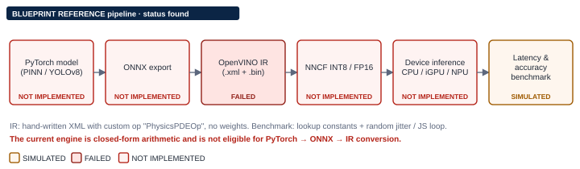
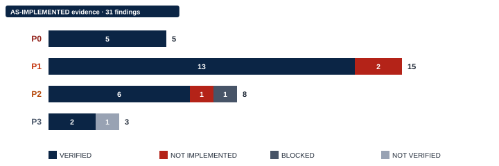
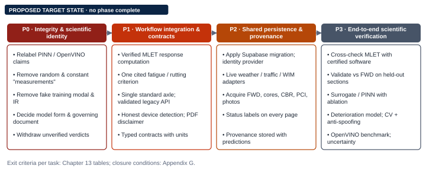
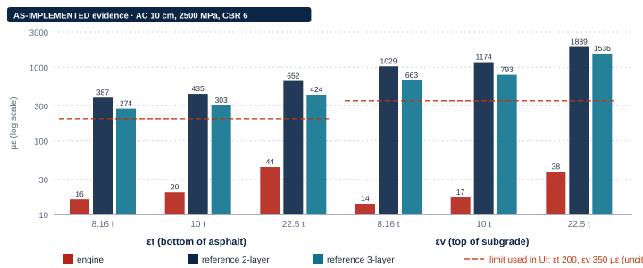

<!-- GENERATED FILE: assembled by _build/build.mjs from _build/report-body.md and the four companion registers. Edit the sources, not this file. -->

**PAVEMENT-PINN**

**Comprehensive Forensic Technical Audit Report**

*Scientific Validity, PINN Mathematics, Software Architecture, Data Integrity, and Intel Edge AI Readiness*

Physics-Informed Neural Networks for Intelligent Pavement Infrastructure Management · Intel AI Global Impact Festival 2026 — AI Changemakers

Document ID PAVEMENT-PINN-AUDIT-001 · Version 1.0 · Audit date 2026-10-14 · Commit `4a9b4fc` · Branch `feature/m1-report-ownership` · Status: Issued for review — overall audit status: FAIL (5 open P0 findings)

Reference: *Master Blueprint & Kanvas Arsitektur Lengkap PAVEMENT-PINN (Versi Final Terbaru)*. Companion files: findings register, mathematical verification register, test and benchmark evidence, blueprint traceability matrix, QA summary (same folder).

# Document Control

Table 0.1 — Document metadata

| Field | Value |
|---|---|
| Document ID | PAVEMENT-PINN-AUDIT-001 |
| Title | PAVEMENT-PINN — Comprehensive Forensic Technical Audit Report: Scientific Validity, PINN Mathematics, Software Architecture, Data Integrity, and Intel Edge AI Readiness |
| Version | 1.0 (initial issue) |
| Audit date | 2026-10-14 |
| Repository | `pavement-pinn` (local working copy) |
| Commit audited | `4a9b4fc49ec6e1d583648b2eaaa26293577add2e` — "feat: persist What-If runs; label legacy illustrative screens (G-SW-01, G-SW-04)" |
| Branch | `feature/m1-report-ownership` (local; not pushed per project notes) |
| Working-tree state | Uncommitted work of another session: 24 modified, 1 deleted, 10 untracked paths (demo-login and authentication rework: `server/auth/demoLogin.ts`, `src/features/authentication/*`, `tests/integration/auth-api.test.ts`, `tests/unit/demo-auth.test.ts`, docs). Not modified, staged or reverted by this audit. Code inspection and tests reflect this working tree. |
| Reference document | *Berikut adalah Master Blueprint & Kanvas Arsitektur Lengkap PAVEMENT-PINN (Versi Final Terbaru)*, 25 pages (BAB 1–10) |
| Other project sources consulted | `docs/SOURCE_INVENTORY.md` (spec v2.2, not available to this audit), `docs/validation/PINN_VALIDATION_GAP.md`, `docs/FINAL_AUDIT.md`, `docs/AI.md`, `docs/GAP_REGISTER.md`, `PROGRESS.md` |
| Classification | Internal engineering review — project team and mentors |
| Report status | Issued for review. Audit-only phase: no application code, formula, threshold, schema, data or configuration was changed. |
| Overall status | **[FAIL]** against the claim "validated PINN-based pavement engineering platform" (criteria below) |
| Prepared by | Automated audit session (Claude Code) at the request of the repository owner. No organisation, approval or endorsement is implied. |

Table 0.2 — Revision history

| Version | Date | Description |
|---|---|---|
| 1.0 | 2026-10-14 | Initial forensic audit: blueprint traceability, PINN identity, mathematical verification with an independent layered-elastic reference, data, tests, OpenVINO readiness, findings and roadmap |

**Audit scope.** All tracked source under `src/`, `server/`, `tests/`, `scripts/`, `supabase/`, project documentation, and the uncommitted working tree as found; the master blueprint as the statement of intended requirements. Out of scope: sibling repositories in the parent folder, deployment hosts, external services, and the confidential contents of `docs/POST_STRUCTURE_AUDIT.md` (it locates credentials in other repositories and is deliberately not reproduced).

**Audit limitations.** (1) No Python runtime, model weights, datasets or OpenVINO installation exist on the audit machine, so training, CV evaluation and hardware benchmarks are [BLOCKED]. (2) The blueprint PDF could be read only through its text layer; some mathematical glyphs and the page design could not be inspected visually, so the report's layout is reference-inspired, not a replica. (3) Spec v2.2, which the code follows, was not available to the audit. (4) The reference solver used for numerical verification was written during the audit and is verified against closed forms only. (5) The user's development server was not called; HTTP behaviour of legacy endpoints is inferred from code and function-level tests.

**Evidence classification.** [VERIFIED] directly demonstrated by inspection or a reproducible test; [PARTIALLY VERIFIED] partly demonstrated; [NOT IMPLEMENTED] absent from the inspected scope (the whole repository was searched unless stated); [NOT VERIFIED] insufficient evidence either way; [FAILED] a defined check was executed and failed; [BLOCKED] verification impossible because of a named dependency. Diagrams carry [AS-IMPLEMENTED], [BLUEPRINT REFERENCE] or [PROPOSED TARGET STATE]. Implementation evidence, test evidence, scientific validation and deployment evidence are reported separately throughout.

**Overall status criteria.** [PASS]: no open P0 or P1; a trained physics-informed model with held-out validation; measured edge benchmarks. [CONDITIONAL PASS]: no open P0; every P1 has an accepted plan; every displayed AI, telemetry or engineering figure is either measured or adjacently labelled; the engine is either physically verified or explicitly positioned as a screening heuristic. [FAIL]: any open P0. **Rationale:** five P0 findings are open (F-01 to F-05): the engine is not a PINN, model and hardware telemetry are fabricated, strain responses contradict layered-elastic theory by one to two orders of magnitude, a fake training run is presented, and CV confidence is invented. Build and test success (226/226, clean type check) does not change this status.

<!-- pagebreak -->

# Abbreviations and Terminology

Table 0.3 — Abbreviations used in this report

| Term | Meaning |
|---|---|
| AC-WC / AC-BC / AC-Base | Asphalt Concrete Wearing / Binder / Base Course (Bina Marga) |
| BP-x | Blueprint requirement identifier (Appendix D) |
| CBR | California Bearing Ratio (%) |
| CV | Computer vision |
| ESAL / LEF | Equivalent Single Axle Load / Load Equivalency Factor |
| FEM | Finite Element Method |
| FWD | Falling Weight Deflectometer |
| IR | OpenVINO Intermediate Representation (.xml + .bin) |
| MLET | Multilayer linear-elastic theory (Burmister) |
| NNCF | Neural Network Compression Framework |
| NPU / iGPU | Neural Processing Unit / integrated GPU |
| ODOL | Over Dimension Over Loading |
| PCI | Pavement Condition Index (0–100) |
| PINN | Physics-Informed Neural Network |
| PMA / SMA / HRS | Polymer Modified Asphalt / Stone Matrix Asphalt / Hot Rolled Sheet |
| RBAC | Role-Based Access Control |
| RUL | Remaining Useful Life |
| SLM | Small Language Model |
| WIM | Weigh-In-Motion |
| εt / εv | Horizontal tensile strain at the bottom of the asphalt / vertical compressive strain at the top of the subgrade (µε) |
| F-xx / S-xx / R-xx / T-xx | Finding / strength / remediation task / test identifiers |

<!-- pagebreak -->

# Executive Summary

**1. Implementation maturity.** PAVEMENT-PINN is a working web prototype (React 19 + Vite, Express API, JSON file store) with a well-engineered, test-covered multi-stakeholder workflow: anonymous citizen reporting, operations review and assignment, field inspection, recommendation, approval with separation of duties, internal work orders, verification and an audit trail (226 automated tests pass; type check clean). The scientific and AI components that give the project its name are not implemented: there is no neural network, no training, no CV model, no OpenVINO runtime and no measured benchmark.

**2. Scientific validity of the physics engine.** The engine (`src/engines/pinn/core/pinnEngine.ts`) is a set of independent power-law formulas with literal coefficients. An independent multilayer linear-elastic reference solver written for this audit (verified against the Boussinesq closed form to ≈ 1e-12 and against Burmister two-layer chart values) shows the engine's tensile strains at a median of about 5–7 % and compressive strains at about 2–2.5 % of elastic theory across the documented input range. For the blueprint's default segment (AC-WC 10 cm, 2500 MPa, CBR 6) under a 10 t axle the engine gives εt = 20 µε and εv = 17 µε where the reference gives about 300–435 µε and 790–1170 µε. The engine therefore reports typical structures as "STABIL … dalam batas elastis aman" when elastic theory places them well above common fatigue and rutting limits.

**3. Engine identity.** Deterministic analytical heuristic. It is not a trained PINN, not a surrogate of any reference model, and not a hybrid. The newer domain layer already labels it `RULE_BASED`; several legacy screens, the README title and the exported PDF still present it as a PINN running on OpenVINO.

**4. Physics equations.** Equilibrium, constitutive law, boundary conditions and interface continuity (BAB 5.1) are not implemented or enforced anywhere in executable code. The engine fails the elastic-similarity test that every layered-elastic solution satisfies (exponents −0.4/−0.75/−0.6 instead of −1).

**5. Reference data.** None. No FWD, FEM, WIM, core, CV image or longitudinal PCI data is in the repository; segment attributes are hand-authored synthetic values, and some screens contradict that with "FWD Validated" and WIM-station badges.

**6. Integration status.** Workflow, RBAC (demo identity), persistence (local atomic file store) and What-If persistence: implemented and tested. CV: keyword matching with constant confidence (DEMO; human review always required on the server). Weather and traffic: deterministic demo providers, honestly labelled on new surfaces. Supabase: migration written, not applied. Pilot corridor: Karawang (spec v2.2), not the blueprint's Jalan Raya Narogong.

**7. Edge inference.** No verified capability. All latency, power, NPU utilisation, quantisation-accuracy and loss figures in the UI are constants or random numbers; the "OpenVINO IR export" is a hand-written XML without weights; the hardware detector claims an Intel NPU by default.

**8. Critical blockers.** (a) The identity and telemetry misrepresentations (F-01, F-02, F-04, F-05); (b) the physically inconsistent response model (F-03) and its downstream life and threshold logic (F-06, F-07); (c) the absence of any empirical dataset (F-16); (d) no Python/ML toolchain (G-PY-01); (e) an unresolved conflict between the blueprint and the spec the code follows (F-15).

**9. Remediation priorities.** First remove or relabel every unsupported claim and every random or constant "measurement" (Phase P0, Chapter 13); then replace the response formulas with a verified layered-elastic computation and unify thresholds and the standard axle; then connect persistence and real data providers; only then train and validate a PINN or surrogate and benchmark it on Intel hardware.

Table 0.4 — Executive summary by domain

| Domain | Blueprint requirement | Actual evidence | Status | Risk | Next action |
|---|---|---|---|---|---|
| PINN identity | Trained PINN with data, physics, BC and IC losses (BAB 5.1) | One closed-form function; no network, weights, optimiser or residual | [NOT IMPLEMENTED] | Critical | Relabel (R-P0-01); decide model form (R-P0-04) |
| Physics consistency | Burmister multilayer elasticity | Strains 1–2 orders below MLET reference; similarity test fails | [FAILED] | Critical | Verified MLET computation (R-P1-01) |
| Thresholds and failure | εt, εv limits leading to life prediction | 180/200/250/350 µε uncited and inconsistent; no transfer functions | [FAILED] | High | Threshold register + one criterion (R-P1-02) |
| RUL / PCI / recommendation | Days to failure, PCI trend, PMA vs AC-WC | Heuristics independent of structure; overlay = PCI look-up | [FAILED] | High | Deterioration model (R-P3-04) |
| Data | FWD/FEM data loss; GRDDC + local CV data; SNI baseline | No empirical data; synthetic attributes | [NOT IMPLEMENTED] | Critical | Data acquisition (R-P2-04) |
| Computer vision | YOLOv8 + anti-spoofing | Keyword match, constant confidence; no anti-spoofing | [NOT IMPLEMENTED] | Critical | Remove claims (R-P0-02); model (R-P3-05) |
| Weather / traffic | BMKG weather; virtual WIM from traffic API | Deterministic demo providers; illustrative axle spectrum | [PARTIALLY VERIFIED] | Medium | Live adapters (R-P2-03) |
| Workflow and RBAC | Four roles, approvals, repair verification | Server-enforced state machine, audit trail, tests pass | [VERIFIED] (demo identity) | Low | Real identity provider (R-P2-02) |
| Persistence | Supabase PostgreSQL + Storage + Realtime | Local JSON store; migration not applied | [BLOCKED] | Medium | Apply migration (R-P2-01) |
| OpenVINO / edge | ONNX → IR → NNCF; < 10 ms on CPU/iGPU/NPU | Simulated telemetry; illustrative IR; no runtime | [NOT IMPLEMENTED] | Critical (claim) | Remove figures (R-P0-02); benchmark after model (R-P3-06) |
| Geospatial twin / UI | 3D isometric map, Three.js cross-section, realtime pins | 2D maps, 2D cross-section, no realtime | [PARTIALLY VERIFIED] | Medium | Decide scope (R-P0-05) |
| GenAI | On-device Phi-3/Llama-3.2 on NPU | Cloud Gemini call + template fallback | [DIVERGENT] | Medium | Decide and document (R-P0-05) |

<!-- pagebreak -->

# Chapter 1 — Project Context and Blueprint Traceability

## 1.1 Problem definition, pilot corridor and SDGs

The blueprint (BAB 1) motivates the system with national road-condition and budget statistics, the ODOL problem and the fourth-power law, and selects **Jalan Raya Narogong (Bekasi–Bogor)** as the Phase 1 pilot, with Karawang (Klari–Simpang Jomin) and Semarang as Phase 2 expansion. The implementation follows a later specification, *PAVEMENT-PINN v2.2* (`docs/SOURCE_INVENTORY.md`), whose pilot is **Karawang Pantura Klari → Jatisari → Simpang Jomin** (`src/data/reference/karawangPilot.ts`, KRW-001..004). The string "Narogong" does not occur in `src/`; a report near Narogong (approximately −6.38, 107.00, an audit approximation) is flagged `OUT_OF_SCOPE: di luar koridor pilot Klari–Jatisari` by `screenReport` (`src/domain/workflow/screening.ts:40,83`) [VERIFIED]. The statistics in BAB 1.1 were not re-verified (no source documents supplied); several of them reappear in policy screens as constants (F-22). SDG alignment (BAB 1.3) is narrative [N/A].

> **Source-of-truth conflict (F-15).** The audit reference ("Versi Final Terbaru") and the specification implemented in code disagree on the pilot corridor, the technology stack, the 3D twin and the on-device SLM. Until the team records which document governs, every traceability row marked [DIVERGENT] is a decision, not a defect.

## 1.2 Research gap and ten dimensions of novelty

Of the ten novelty dimensions (BAB 2.2), one is implemented and verified at software level (N6, one computation feeding three role views), one is verified for a demo identity model (N7, RBAC), two are partially present (N1, N3), and six are not implemented (N2 PINN losses, N4 virtual WIM and anti-spoofing, N5 recommender and quality audit, N8 heterogeneous Intel execution, N9 NNCF quantisation, N10 on-device SLM — the last implemented differently, via a cloud model). Rows BP-2.2-N1 to N10 in Appendix D give the evidence.

## 1.3 End-to-end pipeline (BAB 3) and system flow (BAB 9)



Phase 1 (offline training and compression) is entirely absent. Phase 2 (field acquisition) is present for the citizen report only; weather and traffic are demo providers. Phase 3 (translation from photo and weather to physics) is deliberately not implemented in the new domain layer — correctly, because no calibration exists — while the legacy engine applies uncited linear moisture and temperature factors. Phase 4 runs the formula engine instead of a PINN on OpenVINO. Phase 5 has a rule engine and a deterministic explanation layer but no local SLM.

## 1.4 Chapters 4–8 and 10 of the blueprint

Material catalogue, ageing, recommender and sub-standard audit (BAB 4): catalogue present as static reference text only; the others are not implemented (F-18, F-26). PINN and OpenVINO (BAB 5): not implemented (Chapters 3 and 10). Stakeholder roles (BAB 6): implemented with one deliberate divergence — the Field Engineer recommends and the Operations Manager approves, and the "SPK" is an internal work order explicitly marked as not an official document; the audit regards this separation of duties as an improvement that should be written back into the blueprint. 3D twin (BAB 7): 2D maps (Leaflet, MapLibre without pitch), a 2D stacked-`div` cross-section, no Three.js. Architecture and schema (BAB 8): different stack; the Supabase schema normalises the blueprint tables into `report_cases`, `damage_detections`, `pinn_predictions` and `simulations`, which is defensible but unapplied. Evaluation (BAB 10.1): none of the accuracy, latency or usability metrics has been measured.

## 1.5 Requirements traceability summary

The full matrix (67 requirements) is in Appendix D. Counted totals: 3 [VERIFIED], 24 [PARTIALLY VERIFIED], 7 [DIVERGENT], 26 [NOT IMPLEMENTED], 4 [NOT VERIFIED], 3 [N/A]. Every [VERIFIED] row concerns workflow software; no scientific or AI requirement is verified.

Table 1.1 — Representative traceability rows (full matrix in Appendix D)

| Requirement ID | Blueprint reference | Expected behaviour | Implementation location | Evidence | Status | Gap |
|---|---|---|---|---|---|---|
| BP-1.2a | BAB 1.2 | Pilot Jalan Raya Narogong | `karawangPilot.ts`; `screening.ts:40` | Narogong report OUT_OF_SCOPE | [DIVERGENT] | F-15 |
| BP-3.F1b | BAB 3 Fase 1 | PINN trained on FWD/FEM + Burmister loss | — | No training code | [NOT IMPLEMENTED] | F-01 |
| BP-3.F3b | BAB 3 Fase 3 | YOLOv8 class + confidence | `cvDamageClasses.ts:216-244` | Keyword match | [NOT IMPLEMENTED] | F-05 |
| BP-3.F4a | BAB 3 Fase 4 | εt, εv from PINN on OpenVINO | `pinnEngine.ts:58-69` | Formula, 1-2 orders low | [PARTIALLY VERIFIED] | F-03 |
| BP-6.0 | BAB 6 | Four roles with RBAC | `domain/workflow`, `features/rbac` | Tests pass | [VERIFIED] | IdP [BLOCKED] |
| BP-7.2d | BAB 7.2 | Three.js 3D cross-section | `SimulationPanel.tsx:460-517` | 2D divs | [NOT IMPLEMENTED] | F-15 |
| BP-10.1a | BAB 10.1 | RMSE/MAE/R² > 0.90 vs FWD/FEM | — | No evaluation | [NOT IMPLEMENTED] | F-16 |

<!-- pagebreak -->

# Chapter 2 — Repository and Software Architecture Audit

## 2.1 Repository inventory

222 tracked files (excluding lock files: about 58 000 lines, of which the golden fixture is 9 885). Main areas: `src/app` (shell, providers, layouts; `ModernAppLayout.tsx` alone 2 820 lines), `src/features` (role views, maps, policy, WIM, work orders), `src/domain` (workflow state machine, intelligence: assessment, ESAL, evidence providers, What-If, Road Story), `src/engines` (the formula engine and the CV class table), `src/runtime` (simulated hardware detection and benchmark), `server` (Express app, routes, controllers, services, file store), `supabase/migrations` (one migration, not applied), `tests` (24 files, 226 tests). There is no Python code, no notebook, no model file and no dataset other than TypeScript constants.



## 2.2 Critical execution paths

Table 2.1 — Classification of critical features

| Feature | Path (input → output) | Classification | Evidence |
|---|---|---|---|
| Citizen report submission | UI form → `POST /api/workflow/reports` → `checkPhotoReference` → `screenReport` (DEMO CV) → `FileCaseStore.commit` | 1. Fully implemented (demo identity) | workflow tests; `photoValidation.ts`; `fileCaseStore.ts:44-45` |
| Review → assign → inspect → recommend → approve → work order → verify → close | `applyCommand` with role and version guards | 1. Fully implemented | "cross-role golden path" test |
| Engineering assessment | `GET /api/intelligence/...` → `assessSegment` → `runPinnSimulation` (clamped) | 4. Deterministic calculation presented, on new surfaces, honestly as RULE_BASED | `assessment.ts:114-196` |
| Legacy simulation | `POST /api/simulate` → `runPinnSimulation` (no validation) | 4. Deterministic calculation presented as PINN + OpenVINO | `simulationController.ts`; F-01, F-11 |
| What-If | `POST` simulation route → `runWhatIf` → persisted SIMULATED record | 2. Implemented with limitations (engine F-03) | `intelligence.routes.ts:95-125` |
| CV damage classification (UI) | photo URL/data URL → `analyzeImageDamageClass` → constant confidence | 3. Mocked | `cvDamageClasses.ts:216-244` |
| Weather, traffic → load | `DEMO_WEATHER_PROVIDER`, `estimateTrafficLoad` | 3. Mocked (labelled DEMO / INFERRED) | `evidence.ts` |
| OpenVINO telemetry and benchmark | constants + `Math.random` / JS loop | 3. Mocked, displayed as measurement | F-02 |
| WIM scraping + PINN training modal | `Math.random` records → fixed loss multiples | 3. Mocked, displayed as real | F-04 |
| GenAI narrative | `POST` narrative route → cloud model or template | 2. Implemented with limitations; not verified at runtime | `narrativeService.ts` |
| PDF report | `generateOfficialReportPdf` (jsPDF, client) | 2. Implemented; content inherits F-02/F-03 | F-19 |
| Supabase persistence | migration only | 6. Not verified (not applied) | F-24 |

## 2.3 Code-quality observations

Dead or disconnected code: `src/data/mock/auditLogs.ts` (`INITIAL_AUDIT_LOGS`, not imported; contains "Regangan Tarik 245 µε"). Duplicate implementations: two strain-limit charts (`FieldEngineerTools.tsx`, `FieldEngineerDashboard.tsx`) with different legends for the same field; two fourth-power bases (F-08). Fallback behaviour that produces plausible numbers when no result exists: strain placeholders 245/380 µε, loss placeholders 0.00342/0.00185/0.00157, latency "6.8 ms". Swallowed errors: the hardware detector's `catch { webGlSupported = false }` keeps the Intel defaults (F-12). Misleading UI state: a hard-coded "MELEBIHI AMBANG BATAS (+22.5%)" banner (F-06). Discrepancy between tests and runtime: tests pin the formulas' current output; nothing tests their physics. Strengths are listed as S-01 to S-08 in Appendix A.3.

## 2.4 Authentication, authorisation and security (summary)

Server-signed session tokens; actor derived from the token, never the body; role, assignment, ownership and separation-of-duty rules enforced in the domain service; official-only audit access; public projection hides staff identities; magic-byte upload validation; rate limiting in process. Gaps: no identity provider (demo accounts, [BLOCKED] on credentials), no EXIF/GPS stripping, the six original endpoints (`/api/simulate`, `/api/roads`, `/api/openvino/*`, narrative, health) are unauthenticated, and `/api/simulate` is unvalidated (F-11). The uncommitted demo-login rework was observed but not audited in depth because it is in progress in another session.

<!-- pagebreak -->

# Chapter 3 — Forensic PINN Identity and Training Audit

## 3.1 Method

The audit searched the whole repository for every element a PINN requires: model definitions (classes, layer arrays, weight tensors), automatic differentiation, residual computation, loss terms, optimisers, training loops, datasets, checkpoints and model loaders, plus dependencies (`package.json`) and non-TypeScript sources. It then traced every call site of the engine (`runPinnSimulation` is called from eight production modules: `AppStateProvider`, `ModernAppLayout`, `SimulationPanel`, `ExecutivePolicyView`, `StrategicPolicyMapView`, `MyTasksView`, `server/services/simulationService` and `domain/intelligence/assessment`).

## 3.2 Model identity

Table 3.1 — Model identity register

| Property | Required evidence | Observed implementation | Finding |
|---|---|---|---|
| Neural architecture | Model definition (layers, activations) | None. `src/engines/pinn/core/pinnEngine.ts` is one exported function of 296 lines | [NOT IMPLEMENTED] |
| Trainable parameters | Parameter inventory | None; every coefficient is a literal (120, 1.75, 0.4, 210, 1.4, 0.75, 45, 0.6, 0.5, 0.0018, …) | [NOT IMPLEMENTED] |
| Forward pass | Network evaluation | Closed-form expressions EQ-4 to EQ-11 | Deterministic formula |
| Automatic differentiation | Gradient of outputs w.r.t. coordinates | None; no spatial coordinates are inputs | [NOT IMPLEMENTED] |
| Physics residual | PDE residual at collocation points | None. `physicsLossValue` = `0.0018 + Math.random()*0.0006` | [NOT IMPLEMENTED]; displayed value fabricated (F-02) |
| Data loss | Comparison with FWD/FEM data | None. `dataLossValue` = `0.0011 + Math.random()*0.0004` | [NOT IMPLEMENTED]; fabricated (F-02) |
| Boundary / initial-condition loss | BC and IC terms | None (the WIM modal derives a "boundaryLoss" as `dataLoss × 0.42 + 0.00085`) | [NOT IMPLEMENTED]; fabricated (F-04) |
| Loss weighting, optimiser | λ weights; Adam + L-BFGS | None; the text "Konvergensi Adam Optimizer epoch 1500." is a constant | [NOT IMPLEMENTED] |
| Training loop | Gradient updates over data | None in code; the "training" modal runs three `setTimeout` steps | [NOT IMPLEMENTED] |
| Training data and splits | Dataset with provenance, train/val/test | None | [NOT IMPLEMENTED] |
| Checkpoint | Reproducible trained weights | None in repository or `dist/` | [NOT IMPLEMENTED] |
| Serialisation / loading | Model file and loader | None; the IR "export" is hand-written text | [NOT IMPLEMENTED] (F-13) |
| Inference | Loaded model execution | Function call with clamped inputs (new layer) or raw inputs (legacy) | Deterministic |
| Reproducibility | Same input → same output | Strains yes; telemetry and ids no | [PARTIALLY VERIFIED] (F-21) |
| Provenance | Model version recorded with outputs | New layer: `pinnEngine-formula@1 (deterministic, no trained weights)` | [VERIFIED] (new layer only) |



## 3.3 Conclusion on identity

The engine is a **deterministic analytical heuristic**. It is not a PINN (no network, no physics residual), not a surrogate (it was not fitted to any reference solution present in the repository, and it disagrees with layered-elastic theory by one to two orders of magnitude), and not a hybrid. Training has not occurred: no artifact, log, dataset or code demonstrates it, and the existence of words such as "PINN", "training" or "loss" in UI text is not evidence of training. A deterministic engine can be a legitimate screening tool, but only if it is physically consistent and described as what it is; neither condition holds today for the legacy screens (F-01, F-03).

<!-- pagebreak -->

# Chapter 4 — Mathematical Audit of Pavement Physics

## 4.1 Multilayer elastic theory

The blueprint specifies Burmister multilayer elasticity with equilibrium and an isotropic constitutive law:

```math EQ-2 | Equilibrium (BLUEPRINT REFERENCE, BAB 5.1).
\nabla \cdot \boldsymbol{\sigma} + \mathbf{b} = 0
```

```math EQ-3 | Constitutive law (BLUEPRINT REFERENCE, BAB 5.1).
\boldsymbol{\sigma} = \mathsf{C} : \boldsymbol{\varepsilon}
```

Neither relation is evaluated in code, and the engine's inputs cannot support them: there is no field variable, no spatial coordinate, no Poisson ratio, no contact pressure or radius, and only one structural layer plus a subgrade (Table 4.1). An equilibrium residual alone would also not close the problem: Burmister's solution additionally needs the constitutive law for each layer, strain–displacement compatibility, the surface traction condition under the tyre, interface continuity (bonded or frictionless) and decay at depth and distance — the boundary-value problem solved by the audit's reference (EQ-12, Appendix B.4).

Table 4.1 — Mechanical-model elements required by MLET vs present in the engine

| Element | Required by MLET | Present in engine | Status |
|---|---|---|---|
| Equilibrium | yes | no | [NOT IMPLEMENTED] |
| Stress–strain law per layer (E, ν) | yes | E only, no ν | [NOT IMPLEMENTED] |
| Strain–displacement compatibility | yes | no | [NOT IMPLEMENTED] |
| Layer geometry | all layers incl. base, sub-base | asphalt thickness; a hidden "+15 cm" in εv | [PARTIALLY VERIFIED] |
| Surface load | pressure q over radius a, wheel configuration | axle tonnes only; "surface stress" $0.65P/10$ MPa | [FAILED] (F-09) |
| Interface conditions | continuity of $u_z, u_r, \sigma_z, \tau_{rz}$ | none; responses read one layer each | [FAILED] |
| Conditions at depth / distance | decay | basin $w_0e^{-0.0018r}$ fixed for every structure | [FAILED] |
| Assumptions (linear, isotropic, homogeneous layers, quasi-static) | stated | implicit, not stated | [NOT VERIFIED] |

The engine's responses are:

```math EQ-4 | Engine tensile strain (AS-IMPLEMENTED, pinnEngine.ts:58-62).
\varepsilon_t = \mathrm{round}\left(\frac{120 P}{h^{1.75} (E_1'/2000)^{0.4}}\right)
```

```math EQ-5 | Engine compressive strain (AS-IMPLEMENTED, pinnEngine.ts:65-69).
\varepsilon_v = \mathrm{round}\left(\frac{210 P}{(h + 15)^{1.4} (E_s/40)^{0.75}}\right)
```

Because every linear-elastic layered solution satisfies the similarity property (EQ-14), multiplying all moduli by $k$ must divide all strains and displacements by $k$. Applying the same scaling to EQ-4 to EQ-6 gives exponents −0.4, −0.75 and −0.6 (EQ-15). The engine therefore cannot be a layered-elastic solution or an approximation of one with uniform accuracy [FAILED].

## 4.2 Numerical comparison with an independent reference

The audit implemented an axisymmetric MLET solver (Love strain function, Hankel transform, bonded interfaces; `evidence/mlet.mjs`) and verified it before use (Table B.2): a homogeneous three-layer system reproduces the Boussinesq closed form to ≈ 1e-12 relative error at all tested depths; strains from displacement and stress kernels agree to 1e-14 in a strongly layered system; and Burmister two-layer interface stresses match published chart values (0.646, 0.291, 0.081 for modular ratios 1, 10, 100). It was then compared with the engine over 144 in-range cases.



Results (Tables B.3–B.5): median ratios 0.047 (εt, two-layer), 0.067 (εt, three-layer), 0.019 and 0.025 (εv). Sensitivities differ qualitatively: in the engine εt does not depend on subgrade stiffness and εv does not depend on asphalt stiffness; in the reference both do. Load enters linearly in the engine but with exponent ≈ 0.6 in the reference at constant tyre pressure. The finding is robust to the loading assumptions (B.4) and classified [VERIFIED] against the reference; empirical accuracy of both remains [NOT VERIFIED] for lack of field data.

## 4.3 Dimensional analysis

EQ-4 to EQ-6 combine tonnes, centimetres and megapascals through fractional exponents, so their coefficients carry hidden units (for EQ-4, µε·cm^1.75·t⁻¹) and the expressions are not dimensionally homogeneous; their correctness could only come from calibration, and no calibration record exists. Specific issues: axle load is never converted to force or to a wheel load; "surface stress" scales with axle load instead of being set by tyre pressure; the εv formula adds an unexplained 15 cm; $E_s = 10\,$CBR MPa is an uncited correlation applied for CBR 3–10 %; strain is rounded to integer microstrain; rainfall intensity (mm/h) is used directly as a moisture state; the three time quantities (PCI horizon "per year", RUL years, pothole horizon days) are not linked by a common time model; PCI is used as a projection variable although it is defined by distress surveys. Full unit trace: Table B.8.

## 4.4 Boundary and edge cases

Function-level tests (Table B.7) show non-finite results for zero load (RUL and horizon ∞, Zero-ODOL impact −∞), zero thickness, zero modulus and zero or negative CBR; negative strains for negative loads; silent `NaN` propagation with a GREEN alert; string coercion; negative Zero-ODOL percentages below 10 t; unbounded linear stiffening below 25 °C; and saturation that masks absurd inputs (1000 mm/h). The new `assessSegment` path clamps inputs to the documented ranges and flags them (F-28); the legacy `/api/simulate` path performs no validation (F-11). No equation was modified.

<!-- pagebreak -->

# Chapter 5 — Strain Thresholds and Failure-Criterion Audit

Every strain-related threshold was traced (Table B.6). Four numeric limits exist for two quantities — 180, 200 and 250 µε for εt, 350 µε for εv — plus fabricated placeholder values (245, 380 µε) and a hard-coded "+22.5 %" exceedance banner. None cites a document, clause, table or calibration; the same field is labelled "AASHTO" in one chart and "Bina Marga" in another; and the engine's KRITIS rule triggers at 250 µε while its message cites a 200 µε limit [FAILED].

Table 5.1 — Strain thresholds (abridged from Table B.6)

| Parameter | Source location | Current value | Physical meaning | Source/standard | Verification status | Risk |
|---|---|---|---|---|---|---|
| εt warning | `pinnEngine.ts:130` | 180 µε | approaching fatigue | none | [UNVERIFIED] | Medium |
| εt limit | `pinnEngine.ts:129`, `FieldEngineerTools.tsx:198`, `pdfGenerator.ts:111` | 200 µε | fatigue limit | "AASHTO" / "Bina Marga" (uncited, inconsistent) | [UNVERIFIED] | High |
| εt critical | `pinnEngine.ts:128` | 250 µε | exceeds limit | none; contradicts own text | [FAILED] | High |
| εv limit | `FieldEngineerTools.tsx:203` | 350 µε | rutting limit | none | [UNVERIFIED] | High |

Engineering distinctions the implementation does not make:

- **Tensile strain at the bottom of the asphalt** governs bottom-up fatigue cracking; **vertical compressive strain at the top of the subgrade** governs structural rutting. The code computes both but evaluates neither against a number of load repetitions.
- **Elastic response versus accumulated permanent deformation**: all outputs are single-load elastic responses; no accumulation model exists.
- **Fatigue life versus rutting life**: no life is computed from strain at all — RUL and pothole horizon come from load factor and rain only (EQ-10).
- **Structural failure versus visible pothole formation**: the "pothole horizon" is a rule, not a failure criterion, and potholes also depend on surface ravelling, water ingress and patch quality, which no input describes.

Reachability: on the 144-case grid the engine exceeds 200 µε in 3 cases and never exceeds 350 µε (maximum 98 µε), whereas the reference exceeds them in 111–123 and 126–134 cases respectively. The thresholds and the response scale are therefore mutually inconsistent; with a physically consistent response model, the fixed limits would be exceeded in most cases, which shows that a fixed limit without design traffic is not meaningful either. Required to close: the governing standard and clause for each limit chosen by the team (the audit does not substitute one), or transfer functions of the form EQ-16 with coefficients from that standard, evaluated with design ESAL (R-P1-02).

<!-- pagebreak -->

# Chapter 6 — Physics-to-Application Translation Audit



Table 6.1 — Status of each translation step

| Step (blueprint) | Implementation | Nature of output | Assessment |
|---|---|---|---|
| Visual damage → material degradation (E₁ penalty 40–60 % for severe alligator cracking) | New layer refuses the mapping (`translateSurfaceEvidence`, status CALIBRATION_REQUIRED); legacy engine ignores damage class | Surface indicator only | Correct refusal. A CV label is not a modulus measurement; a back-calculated modulus needs FWD or laboratory data |
| Weather → moisture effect → pore-water pressure | Rain intensity and flood hours reduce CBR linearly (floor 0.4); no pore pressure | Assumed | [UNVERIFIED]. Rainfall is not pore-water pressure; saturation depends on drainage, duration, permeability and groundwater |
| Moisture → subgrade properties (CBR 6 → 2.5 %) | $E_s=10\,$CBR·$f_w$ | Assumed | [UNVERIFIED]. A soaked/unsoaked CBR pair from tests would be the minimum calibration |
| Traffic speed / congestion → axle load (virtual WIM) | Not implemented; traffic volume × heavy share × illustrative spectrum × 3 axles | Inferred, labelled | Congestion is correctly **not** treated as truck weight (`evidence.ts` note). The blueprint's speed-to-ODOL rule has no validation and should not be implemented without WIM data |
| Road age → ageing | Not implemented | — | Requires installation-year data and a mix-specific ageing model |
| Traffic loading → structural response | Engine EQ-4/5 | Calculated (inconsistent with MLET) | [FAILED] (F-03) |
| Structural response → predicted deterioration | Not linked: life uses load factor and rain only | Assumed | [FAILED] (F-07) |
| Visible pothole → future structural failure | Pothole horizon rule | Assumed | Not a valid inference; potholes have several mechanisms (identifiability limitation) |

Undocumented constants in the chain: 0.004 per mm/h, 0.015 per flood hour, floor 0.4; 1.2 % per °C, floor 0.5; the +12 °C air-to-surface assumption (`assessment.ts:86`); 3 axles per heavy vehicle; the illustrative axle spectrum; ±35 % traffic spread. The new layer propagates provenance labels and caps confidence at LOW, which is appropriate; it does not propagate numerical uncertainty through the engine.

**Identifiability.** From a photo, a rainfall value and a traffic count, the system cannot uniquely identify whether damage results from overload, moisture, a thin or weak structure, poor mix quality or poor drainage; several mechanisms produce the same surface distress. Any feature that attributes a cause — the "PINN contribution" percentages (F-20) or the planned sub-standard material alert — must present alternatives and treat its output as a hypothesis for investigation.

<!-- pagebreak -->

# Chapter 7 — RUL, PCI, and Material Recommendation Audit

```math EQ-10 | Engine deterioration rules (AS-IMPLEMENTED, pinnEngine.ts:92-112).
\Delta_{PCI} = \min\left(35, \frac{2.5 LF}{f_w}\right), \quad PCI' = \max(10, PCI_0 - 0.8\Delta_{PCI}) \\ RUL = \max\left(0.3, \frac{PCI'}{1.2\Delta_{PCI}}\right), \quad H_{pothole} = \max\left(3, \frac{1800 f_w}{LF}\right)
```

**RUL and pothole horizon.** Not a time-dependent deterioration process: there is no traffic accumulation, no damage summation and no calibration. Neither quantity depends on asphalt thickness, modulus, CBR or temperature (verified at 18 t across the full range: PCI′ 59, RUL 1.9 years, horizon 171 days in every case). The three time-to-failure quantities contradict each other (1.9 years of life, 171 days to pothole, PCI at the floor of 10 within two years). At zero load RUL and horizon are infinite.

**PCI.** PCI (as defined by distress-survey standards such as ASTM D6433) is a 0–100 index computed from observed distress types, severities and extents. The engine instead subtracts a load-and-rain term from a stored value, with an undefined horizon ("predicted PCI"), and the five-year "preventive" curve rises 2.5 points a year regardless of inputs and starts 5 points *below* the no-action curve. The scale is valid; the definition and dynamics are not documented [FAILED].

**Material and overlay recommendation.** Overlay thickness is $\max(4, 0.22(75-PCI'))$ cm when PCI′ < 70 (EQ-11), independent of strain, structure, traffic and material; the type is chosen by thickness bands and one band reads "AC-BC + AC-WC Poly-Modified Asphalt", conflating products. The blueprint's cross-simulation (AC-WC vs PMA under local rain and load, BAB 4.3) and its "PMA ≥ 8.5 cm" directive are not implemented; "8.5 cm" appears only as a UI constant. Recommendations must not be presented as construction-ready designs: an overlay design needs measured deflections or a structural evaluation, design traffic, material properties and a design method (F-18).

**Structural anomaly alert.** Not implemented (F-26). If built, it must be an investigation trigger (e.g. "response inconsistent with recorded age, traffic and rainfall; core sampling recommended"), never evidence of contractor misconduct; the blueprint's own wording rule (BAB 4.4) is consistent with this.

**Predictive accuracy.** No accuracy can be claimed: no independent reference observations exist (two dated PCI surveys per segment would be the minimum to begin calibrating a deterioration model).

<!-- pagebreak -->

# Chapter 8 — Data Integrity and Validation Dataset Audit

## 8.1 Computer vision data

Table 8.1 — CV data inventory

| Item | Availability | Source / provenance | Status | Training suitability | Validation suitability |
|---|---|---|---|---|---|
| Road-damage images | None in repository; sample photos are Unsplash URLs | Unsplash (stock), not annotated | Illustrative | No | No |
| Labels and severities | Constants per class (`cvDamageClasses.ts`) | Authored | Synthetic | No | No |
| External notebook (YOLOv8n-seg, Roboflow pothole set, CC BY 4.0, 720/60 images, single class) | Outside repository (`FILES/Docs/…ipynb`, audited in `docs/AI.md`) | Third-party Kaggle run; weights not included | Candidate only | Possible starting point for the pothole class | Not for Indonesian roads without local data |
| Train/val/test split, leakage checks, anti-spoofing data, class balance | None | — | [NOT IMPLEMENTED] | — | — |

## 8.2 Pavement-engineering and PINN data

Table 8.2 — Pavement data inventory

| Data | Availability | Provenance | Authentic or synthetic | Units / completeness | Suitable for training | Suitable for validation |
|---|---|---|---|---|---|---|
| FWD deflection basins | None | — | — | — | — | — |
| FEM / MLET reference solutions | None in repository (audit reference generated in `evidence/`, not committed as data) | Audit | Computed | Two/three-layer, on-axis only | Only as physics pre-training; never as sole validation | Only for numerical verification |
| Layer geometry and materials | Segment defaults (thickness, CBR) + reference baseline (base 20 cm, sub-base 25 cm, modulus 1800–3200 MPa) | Hand-authored; `karawangPilot.ts` header: SYNTHETIC | Synthetic | No ν, no base/sub-base moduli | No | No |
| Elastic modulus / Poisson ratio | Ranges only; no ν | Authored | Synthetic | Incomplete | No | No |
| CBR / subgrade | Per-segment defaults (3–6.2 %) | Authored | Synthetic | No soaked/unsoaked pairs | No | No |
| Traffic / ESAL / WIM | Volumes and heavy shares per segment; illustrative spectrum; legacy "WIM stations" (13) | Authored; pipeline modal uses `Math.random` | Synthetic | No axle spectra | No | No |
| Weather / rainfall / drainage | Deterministic demo values | Hash of segment id | Synthetic | No drainage data | No | No |
| Longitudinal condition, maintenance history | One "survey date" (DATA REQUIRED) per pilot segment; illustrative histories in legacy views | Authored | Synthetic | No time series | No | No |

**Synthetic is not ground truth.** All segment attributes are synthetic. If MLET or FEM solutions are later generated to train a surrogate, the same generator must not be used as the sole independent validation, because agreement would then measure only the surrogate's fit to its own generator. Independent validation needs field measurements (FWD basins with layer data from cores or as-built records, strain-gauge or instrumented-section data, dated PCI surveys).

**Missing data and plausible sources (not verified as accessible).** Bina Marga / BBPJN FWD and IRMS survey records for the pilot corridor; as-built drawings and core logs; WIM records (Kemenhub/BPTD or toll operators); BMKG rainfall station series; laboratory soaked/unsoaked CBR; local road-damage photographs with annotation protocol and consent. The audit has no evidence of access to any of these; access requests are a remediation task (R-P2-04). Licensing: Unsplash images are free to use under the Unsplash licence but carry no annotations; the Roboflow dataset is CC BY 4.0 (attribution required).

<!-- pagebreak -->

# Chapter 9 — Numerical Verification and Test Audit

The existing suite (226 tests, all passing; Table C.3) is strong for software behaviour and weak for science: 144 unit and 49 integration tests cover workflow, RBAC, API contracts, maps and module boundaries; 33 physics-validation tests prove that the code equals its documented formulas, pin 76 golden scenarios at zero tolerance and characterise threshold reachability. Their own header states that they are "not evidence of physical accuracy". No test compares the engine with an analytical or trusted reference, with FEM or with FWD data; none tests generalisation to unseen segments; there is no CV test and no browser end-to-end test.

Table 9.1 — Coverage of verification objectives

| Objective | Existing tests | This audit | Status |
|---|---|---|---|
| Correctness of individual equations (code = formula) | yes (400 random inputs, exact) | re-derived EQ-4..11 | [VERIFIED] |
| Dimensional consistency | no | analysed (4.3, B.8) | [FAILED] |
| Boundary-condition satisfaction | n/a (no BVP in engine) | reference solver: surface traction, interface continuity | engine [NOT IMPLEMENTED]; reference [VERIFIED] |
| Physical limiting behaviour | partial (linearity, monotonicity) | similarity, Boussinesq limit | engine [FAILED] |
| Numerical stability | finite outputs in documented ranges | non-finite outside (Table B.7) | [PARTIALLY VERIFIED] |
| Comparison with analytical/trusted reference | no | MLET reference, 144 cases | [FAILED] |
| Comparison with independent FEM / FWD | no | no data | [BLOCKED] |
| Generalisation to unseen segments / loads | no | — | [NOT VERIFIED] |
| Reproducibility | golden fixture | non-deterministic telemetry found | [PARTIALLY VERIFIED] |
| End-to-end application correctness | HTTP golden path | — | [PARTIALLY VERIFIED] (no browser automation) |

Executed commands, exit codes and limitations are listed in Appendix C (T-01 to T-10); deliberately skipped operations in Table C.2. A passing software test is not proof of scientific validity, and a reference that satisfies its own boundary-value problem is not proof that the model, parameters or predictions are correct for real roads: empirical accuracy remains [NOT VERIFIED].

<!-- pagebreak -->

# Chapter 10 — Intel OpenVINO and Edge Hardware Audit



Table 10.1 — Deployment pipeline status

| Stage | Expected artifact | Found | Status |
|---|---|---|---|
| PyTorch model | `.pt` / training code | none; no Python | [NOT IMPLEMENTED] |
| ONNX export | `.onnx` | none | [NOT IMPLEMENTED] |
| OpenVINO IR | `.xml` + `.bin` | hand-written XML with custom op `PhysicsPDEOp`, no `.bin` (`openvinoExportService.ts:15-42`) | [FAILED] as an artifact (F-13) |
| NNCF quantisation | config, calibration set, INT8/FP16 IR | JSON template claiming `nncf_quantization` | [NOT IMPLEMENTED] |
| Runtime usage | `openvino` package, `core.compile_model` | none (code samples inside a JSON string only) | [NOT IMPLEMENTED] |
| Device availability (CPU/iGPU/NPU) | `available_devices` query | browser heuristic defaulting to "Intel Core Ultra with NPU" (`deviceDetector.ts:14-15,46`) | [FAILED] (F-12) |
| Device selection and fallback | AUTO/MULTI policies | UI selector feeding lookup constants | [SIMULATED] |
| Precision support | FP32/FP16/INT8/INT4 runs | constant multipliers 1.4/1.0/0.8 | [SIMULATED] |
| Quantisation deviation | measured output deltas | constants 99.4/99.8/100 % | [SIMULATED] |
| Latency (cold/warm), batch, memory, utilisation | measured distributions | constants + random jitter; JS `tanh` loop | [SIMULATED] (F-02) |
| < 10 ms target | measured p95 on target device | not measured; "8.4 ms" hard-coded from the blueprint | [NOT VERIFIED] |

**Eligibility for the OpenVINO workflow.** The current engine is ~40 floating-point operations of closed-form arithmetic. It is not a neural network and cannot be exported through PyTorch → ONNX → IR; it also needs no accelerator (its evaluation time in JavaScript is far below a millisecond by inspection; not timed by the audit). OpenVINO becomes relevant only for (a) a trained CV model, (b) a trained PINN or MLET surrogate, or (c) a local SLM. For (b), the benchmark must also report numerical deviation of the accelerated, quantised model from its FP32 version **and** from the MLET reference, since quantisation error in strain directly changes fatigue life through the steep transfer functions (EQ-16).

No benchmark number in the application is a hardware measurement. The protocol required before any latency claim is in Appendix F; the benchmark register (Table C.4) is empty by necessity.

<!-- pagebreak -->

# Chapter 11 — End-to-End Architecture and Operational Integrity

The intended flow — Public Reporter → Operations Manager → Field Engineer → Physics and Rule Engine → Policy Maker → Repair Execution and Verification — is the strongest part of the implementation.

Table 11.1 — Operational integrity checks

| Step | Implementation | Persisted / authorised | Status |
|---|---|---|---|
| Report creation and validation | server identity, photo magic bytes ≤ 5 MB, coordinates plausibility, duplicate hint (30 m / 7 days) | yes / server-side | [VERIFIED] (tests) |
| Coordinate and segment association | nearest-segment logic; pilot bounding box approximate (G-01) | yes | [PARTIALLY VERIFIED] |
| Evidence image storage | inside the report JSON (≤ 5 MB); no object storage; no EXIF stripping | yes (file store) | [PARTIALLY VERIFIED] |
| Weather and traffic provenance | DEMO / SYNTHETIC / INFERRED labels attached | yes | [VERIFIED] (labels); data [NOT IMPLEMENTED] |
| Physics-engine invocation | `assessSegment` on demand; snapshot stored with the recommendation | yes | [VERIFIED] (software); physics [FAILED] |
| Error propagation | 400/422/409/503 on workflow and intelligence routes; legacy `/api/simulate` returns 500 or non-finite values | — | [PARTIALLY VERIFIED] |
| Recommendation generation | engineer-entered treatment + engine snapshot | yes | [VERIFIED] |
| Shared persistence | local atomic JSON store; Supabase not applied | single instance only | [BLOCKED] |
| Real-time updates | none (no push channel) | — | [NOT IMPLEMENTED] |
| RBAC enforcement | domain + route guards; recommender ≠ approver | yes | [VERIFIED] (demo identity) |
| Approval and assignment transitions | legal-transition table; stale-version rejection; serialised writes | yes | [VERIFIED] |
| Audit trail | every transition with actor, time, reason; official-only access | yes | [VERIFIED] |
| Report generation | client-side jsPDF "official" report | not persisted | [PARTIALLY VERIFIED] (F-19) |
| Final repair verification | engineer verifies after work-order completion; OM closes | yes | [VERIFIED] |

**UI-only versus backend.** The Road detail, What-If, workflow queues and Road Story consume backend engine outputs (rule-based, labelled). The policy dashboards, WIM/ODOL enforcement views, OpenVINO diagnostics, the WIM training modal, many map popups and the classic layout consume constants, random values or a client-side engine call, and several of them carry no status label (F-23). The "3D cross-section" is a 2D drawing whose base layer (15 cm, 300 MPa) is not used by the engine (F-29). No production system was touched and no work order left the application; the internal work order is explicitly not an SPK.

<!-- pagebreak -->

# Chapter 12 — Findings, Severity, and Remediation

Thirty-one findings were raised: 5 P0, 15 P1, 8 P2 and 3 P3, together with eight verified strengths. The complete register with all twelve fields per P0/P1 finding is Appendix A; Table 12.1 lists the P0 and P1 findings.



Table 12.1 — Critical and high findings

| Finding ID | Severity | Component | Evidence | Impact | Required action | Acceptance criteria |
|---|---|---|---|---|---|---|
| F-01 | [P0] | Engine identity | [VERIFIED] | False PINN claim | Relabel or build a real model | No unsupported "PINN/neural" text; or model artifact + metrics |
| F-02 | [P0] | Telemetry | [VERIFIED] | Fabricated AI and Intel figures | Remove random/constant measurements | No `Math.random` in telemetry; figures trace to measurement records |
| F-03 | [P0] | Strain model | [VERIFIED] | Unsafe "safe" verdicts | Verified MLET computation | ≤ 15 % vs verified reference; similarity exponent −1 |
| F-04 | [P0] | WIM training modal | [VERIFIED] | Fabricated official data and training | Remove or mock-up label | No epochs/losses/official wording without real run |
| F-05 | [P0] | CV display | [VERIFIED] | Invented model confidence | Remove model name/confidence | Confidence only from versioned REAL model |
| F-06 | [P1] | Thresholds | [VERIFIED] | Untraceable verdicts | One cited criterion per mode | Threshold register sourced; single constant module |
| F-07 | [P1] | RUL/PCI | [VERIFIED] | Baseless life figures | Documented deterioration model | Structural inputs affect life; one failure definition |
| F-08 | [P1] | Standard axle | [VERIFIED] | 2.255× inconsistency | Single cited axle | Modules agree (test) |
| F-09 | [P1] | Load model / units | [VERIFIED] | Non-physical load scaling | Full load contract | Units and dimensions documented |
| F-10 | [P1] | Moisture/temperature | [VERIFIED] | Uncalibrated effects | Cite or calibrate | Each relation sourced with validity range |
| F-11 | [P1] | Legacy API | [VERIFIED] | Non-finite outputs | Input validation | 400/422 for invalid input; no non-finite output |
| F-12 | [P1] | Device detector | [VERIFIED] | False NPU claim | Honest detection | NPU only from device query |
| F-13 | [P1] | IR export | [VERIFIED] | Fake model artifact | Remove or template label | Real IR only from converted model |
| F-14 | [P1] | OpenVINO pipeline | [NOT IMPLEMENTED] | Edge claims unsupported | Build after model exists | Reproducible benchmark register |
| F-15 | [P1] | Blueprint vs spec | [VERIFIED] | Conflicting requirements | Governance decision | No unexplained DIVERGENT rows |
| F-16 | [P1] | Data | [VERIFIED] | No validation basis | Data acquisition | Inventory with provenance; no unsupported badges |
| F-17 | [P1] | Anti-spoofing | [NOT IMPLEMENTED] | Spam/spoof risk | Implement and measure | FAR/FRR on held-out set |
| F-18 | [P1] | Recommender | [VERIFIED] | Non-design presented as design | Design-method based, advisory | Inputs listed; "not for construction" |
| F-19 | [P1] | PDF export | [VERIFIED] | Unlabelled "official" output | Status on every page | Disclaimer; no unauthorised institution names |
| F-20 | [P1] | Attribution % | [VERIFIED] | Random causal claims | Remove | No attribution without decomposition |

<!-- pagebreak -->

# Chapter 13 — Phased Remediation Roadmap



No remediation was implemented during this audit, and no phase is complete until its exit criteria are demonstrated.

<!-- landscape-start -->

Table 13.1 — Phase P0: integrity and scientific identity

| Task ID | Priority | Prerequisite | Required change | Acceptance test | Expected evidence | Exit criteria |
|---|---|---|---|---|---|---|
| R-P0-01 | [P0] | — | Replace "PINN / neural / Burmister solver / OpenVINO inference" wording on legacy screens, README and PDF with the engine's actual status | grep test over `src/`, README, PDF template | CI test listing allowed phrases | F-01 closed |
| R-P0-02 | [P0] | — | Remove `Math.random` and constants from telemetry, loss, benchmark, CV confidence and attribution displays; show "not measured" | unit test: identical inputs → identical payload; grep for `Math.random` in listed files | test output | F-02, F-05, F-20, F-21 closed |
| R-P0-03 | [P0] | — | Remove or relabel the WIM scraping/training modal and IR export | manual review + route test | screenshots, test | F-04, F-13 closed |
| R-P0-04 | [P0] | — | Decide model form: (a) MLET screening engine, (b) MLET-trained surrogate, (c) true PINN; record in DECISION_LOG | decision record exists | DECISION_LOG entry | decision approved by team and mentor |
| R-P0-05 | [P0] | — | Decide governing document (blueprint vs spec v2.2): pilot corridor, stack, 3D, SLM | traceability matrix re-run | updated Appendix D | no unexplained DIVERGENT rows |
| R-P0-06 | [P0] | R-P0-01 | Withdraw engineering verdict text ("STABIL… aman", "MELEBIHI AMBANG") until F-03/F-06 close | grep test | test | no verdicts from unverified responses |

Table 13.2 — Phase P1: workflow integration and contracts

| Task ID | Priority | Prerequisite | Required change | Acceptance test | Expected evidence | Exit criteria |
|---|---|---|---|---|---|---|
| R-P1-01 | [P1] | R-P0-04 | Implement MLET response computation (or adopt a certified library) with full layer inputs, ν, wheel load, pressure, configuration | comparison test vs verified reference (≤ 15 %); Boussinesq limit; similarity | CI test with stored reference grid | F-03, F-09 closed |
| R-P1-02 | [P1] | R-P1-01 | One cited fatigue and one cited rutting criterion with design traffic; single constants module | consistency test across engine, UI, PDF | threshold register with sources | F-06 closed |
| R-P1-03 | [P1] | — | Single standard axle constant with citation | cross-module test | test | F-08 closed |
| R-P1-04 | [P1] | — | Validate `/api/simulate` (or retire it in favour of intelligence routes) | contract tests for invalid classes | test output | F-11 closed |
| R-P1-05 | [P1] | — | Honest device detection; unknown = unknown | unit test with no WebGL info | test | F-12 closed |
| R-P1-06 | [P1] | R-P0-01 | PDF status block and disclaimer on every page; remove institution names | PDF snapshot test | sample PDF | F-19 closed |
| R-P1-07 | [P1] | — | Typed input/output contract with units for every engine call | schema test | contract doc | contracts versioned |

Table 13.3 — Phase P2: shared persistence and provenance

| Task ID | Priority | Prerequisite | Required change | Acceptance test | Expected evidence | Exit criteria |
|---|---|---|---|---|---|---|
| R-P2-01 | [P2] | credentials | Apply Supabase migration; implement `CaseStore` on PostgreSQL; RLS tests | integration tests against database | CI logs | F-24 closed |
| R-P2-02 | [P2] | credentials | Identity provider; retire demo accounts in production | auth tests | config record | REQ-AUTH-002 PASS |
| R-P2-03 | [P2] | API keys | Live weather adapter; traffic counts; WIM adapter when data exists | provider contract tests | provenance records | F-25 closed or labelled |
| R-P2-04 | [P2] | institutional contact | Data acquisition plan executed: FWD, cores, CBR, WIM, PCI surveys, local photos | data inventory review | Appendix E updated with provenance and licences | F-16 closed |
| R-P2-05 | [P2] | R-P0-02 | Status label on every page showing model or telemetry output | lint-style UI test | test | F-23 closed |
| R-P2-06 | [P2] | R-P1-01 | Persist model version, inputs, units and provenance with every prediction | schema test | stored records | provenance complete |

Table 13.4 — Phase P3: end-to-end scientific verification

| Task ID | Priority | Prerequisite | Required change | Acceptance test | Expected evidence | Exit criteria |
|---|---|---|---|---|---|---|
| R-P3-01 | [P3] | R-P1-01 | Cross-check the MLET implementation against a certified program (KENLAYER, WESLEA, BISAR or PyMastic) | agreement within stated tolerance on ≥ 20 structures | comparison table | reference accepted |
| R-P3-02 | [P3] | R-P2-04 | Validate against FWD basins (back-calculation) on held-out sections | RMSE, MAE, bias per sensor offset | validation report | blueprint BAB 10.1 metrics reported honestly |
| R-P3-03 | [P3] | R-P0-04, R-P2-04 | If (b)/(c): build surrogate or PINN with physics residual, data loss, documented split; ablation (data-only vs data+physics) | held-out metrics; out-of-range behaviour | training logs, checkpoints, model card | F-01 closed in the strong sense |
| R-P3-04 | [P3] | R-P1-02, R-P2-04 | Deterioration and RUL model from transfer functions and/or calibrated PCI curves with traffic growth | calibration and validation on dated surveys | model report | F-07, F-18 closed |
| R-P3-05 | [P3] | R-P2-04 | CV model trained and evaluated on local annotated photos; anti-spoofing with FAR/FRR | mAP, per-class metrics, leakage checks | model card | F-05, F-17 closed |
| R-P3-06 | [P3] | R-P3-03 or R-P3-05 | OpenVINO conversion, NNCF quantisation and benchmark on named Intel hardware | Appendix F protocol | benchmark register filled | F-14 closed |
| R-P3-07 | [P3] | all | Uncertainty quantification and limitation statement for every output | review | model cards | claims register updated |

<!-- landscape-end -->

<!-- pagebreak -->

# Chapter 14 — Final Scientific Readiness Assessment

Table 14.1 — Readiness by dimension

| Dimension | Current status | Supporting evidence | Critical limitation | Required next step | Public claim now? |
|---|---|---|---|---|---|
| Genuine PINN implementation | [NOT IMPLEMENTED] | Table 3.1 | No network, residual, data or training | R-P0-04, R-P3-03 | No |
| Mathematical correctness (code = formula) | [VERIFIED] | existing tests; EQ-4..11 | formulas themselves unvalidated | — | Only as "formula engine" |
| Physics consistency | [FAILED] | Tables B.3–B.5; similarity | 1–2 orders below MLET | R-P1-01 | No |
| Strain and failure-threshold traceability | [FAILED] | Table B.6 | no sources; inconsistent | R-P1-02 | No |
| Training-data readiness | [NOT IMPLEMENTED] | Tables 8.1–8.2 | no empirical data | R-P2-04 | No |
| Independent numerical verification | [PARTIALLY VERIFIED] | audit reference (closed-form verified) | not yet cross-checked with certified software; not in CI | R-P3-01, R-P1-01 | Engine: no |
| Empirical validation | [NOT VERIFIED] | — | no FWD/PCI data | R-P3-02 | No |
| RUL and PCI credibility | [FAILED] | EQ-10, Table B.7 | decoupled, inconsistent | R-P3-04 | No |
| Application integration | [VERIFIED] (workflow) / [PARTIALLY VERIFIED] (AI stages) | 226 tests; Table 11.1 | demo identity; local store | R-P2-01, R-P2-02 | Yes, as a workflow prototype |
| OpenVINO readiness | [NOT IMPLEMENTED] | Table 10.1 | no model, no runtime | R-P3-06 | No |
| Reproducibility | [PARTIALLY VERIFIED] | golden fixture; non-deterministic telemetry | random payload fields | R-P0-02 | Partially |
| Competition-claim readiness | [FAIL] | Chapters 3, 4, 10 | five open P0 | Phase P0 | Only claims in list 1 |

## 14.1 Claims supported by current evidence

1. A working multi-stakeholder road-damage reporting and maintenance workflow with four roles, server-enforced permissions, separation of duties, persistence and a complete audit trail (demo identity, local storage).
2. Anonymous citizen reporting with server-issued identity and validated photo uploads.
3. A deterministic, rule-based pavement screening calculation whose outputs are labelled RULE_BASED with LOW confidence on the newer screens, with input provenance and out-of-range flags.
4. A correct ESAL / fourth-power load-equivalency calculation (with the 8.16 t standard axle).
5. Persisted What-If scenario comparisons labelled as simulations.
6. An honest internal validation-gap analysis and this independent audit, including a closed-form-verified layered-elastic reference implementation.

## 14.2 Claims requiring further verification

1. That the formula engine can serve as a screening tool after its responses are replaced or recalibrated against a verified MLET computation (R-P1-01).
2. That fixed strain limits or transfer functions from a named standard apply to the pilot corridor (R-P1-02).
3. Camera and GPS reporting on real phones within the blueprint's 15-second target.
4. Weather, traffic and WIM integration once data sources are connected.
5. Any CV accuracy figure, after a model is trained on local data.
6. Any latency, throughput or power figure, after a model exists and is benchmarked on named Intel hardware.

## 14.3 Claims that must not yet be made

1. That PAVEMENT-PINN contains, trains or runs a Physics-Informed Neural Network.
2. That predictions obey Burmister / multilayer elastic theory or are "equivalent to FEM".
3. That any physics loss, data loss, training epoch or convergence value has been observed.
4. That inference runs on Intel OpenVINO, on an NPU or iGPU, in INT8/FP16, or in under 10 ms (including "8.4 ms").
5. That YOLOv8 or any model classifies damage, with any confidence value, or that photos are screened for spoofing.
6. That remaining useful life, pothole horizon, PCI projections, overlay thickness, material choice, economic loss or budget savings are predictions of a validated model.
7. That data are scraped from, validated by or endorsed by Bina Marga, PUPR, Kemenhub, BMKG or Intel.
8. That a road segment is structurally "safe" or "exceeds the permitted limit" on the basis of the current engine.
9. That the system has been validated with FWD, WIM or field data.

<!-- pagebreak -->

# Appendix A — Findings Register (Artifact B)

Document PAVEMENT-PINN-AUDIT-001 · Version 1.0 · Audit date 2026-10-14 · Commit `4a9b4fc` (branch `feature/m1-report-ownership`, working tree with uncommitted demo-authentication changes from another session; see Document Control).

Severity: [P0] critical, [P1] high, [P2] medium, [P3] low. Evidence classes: [VERIFIED], [PARTIALLY VERIFIED], [NOT IMPLEMENTED], [NOT VERIFIED], [FAILED], [BLOCKED]. Line numbers refer to the working tree at the audit date. "Reference solver" means the audit's independent multilayer linear-elastic solver (`evidence/mlet.mjs`), itself verified only against closed-form limits (Appendix B).

## A.1 Summary register

<!-- landscape-start -->

Table A.1 — Findings register summary (31 findings: 5 P0, 15 P1, 8 P2, 3 P3)

| ID | Sev. | Title | Component | Evidence | Acceptance criterion (abridged) |
|---|---|---|---|---|---|
| F-01 | [P0] | Deterministic closed-form engine presented as a trained PINN | `src/engines/pinn/core/pinnEngine.ts`; UI titles; README | [VERIFIED] | Every user-facing "PINN"/"neural" claim either backed by a trained model artifact or replaced by "rule-based formula engine" |
| F-02 | [P0] | Fabricated model and runtime telemetry (losses, latency, power, NPU use) | `pinnEngine.ts:203-240`; `FieldEngineerTools.tsx:563-583`; `Navbar.tsx:225-229`; `PavementPinnDashboard.tsx:186-189`; `pdfGenerator.ts:90` | [VERIFIED] | No numeric loss, latency, power or utilisation shown unless measured; random generators removed from result payloads |
| F-03 | [P0] | Engine strains one to two orders of magnitude below layered-elastic theory; "safe" verdicts unsupported | `pinnEngine.ts:58-76,127-132` | [VERIFIED] | Engine within an agreed tolerance (e.g. ±15 %) of a verified multilayer reference over the stated input domain, or engine withdrawn from engineering verdicts |
| F-04 | [P0] | Simulated "Bina Marga WIM scraping + PINN training" with synthetic epoch-loss curve | `BinaMargaWimPipelineModal.tsx`; `binaMargaWimScraper.ts:70-155` | [VERIFIED] | Modal removed, or relabelled as a mock-up inside the modal itself, with no epochs, losses or official-source wording |
| F-05 | [P0] | "YOLOv8 Edge AI" damage class and confidence are keyword matches and constants | `cvDamageClasses.ts:24-244`; `ReportRoadIssueCard.tsx:1051-1093` | [VERIFIED] | No model name or confidence shown to citizens unless produced by a versioned model run |
| F-06 | [P1] | Strain limits 180/200/250/350 µε untraceable, mutually inconsistent, and partly hard-coded as "exceeded" | `pinnEngine.ts:128-132`; `FieldEngineerTools.tsx:193-209,397`; `pdfGenerator.ts:111` | [VERIFIED] | One cited criterion per quantity, tied to load repetitions, used consistently in engine, UI and PDF |
| F-07 | [P1] | RUL, pothole horizon and PCI projection are heuristics decoupled from structural response and mutually inconsistent | `pinnEngine.ts:90-112,173-186` | [VERIFIED] | Single documented deterioration model; thickness, modulus and CBR affect life; one time-to-failure definition |
| F-08 | [P1] | Two different fourth-power reference axles (10 t vs 8.16 t) in one application | `pinnEngine.ts:54`; `esal.ts:12` | [VERIFIED] | One standard axle used throughout, with cited source |
| F-09 | [P1] | Load model lacks contact pressure, radius, wheel configuration and Poisson ratios; dimensionally inhomogeneous fits | `pinnEngine.ts:56-80`; `types/simulation.ts` | [VERIFIED] | Load defined as wheel load + contact pressure (or radius) + configuration; all inputs with units; dimension check documented |
| F-10 | [P1] | Moisture, temperature and subgrade relations are undocumented linear heuristics; no pore-water pressure anywhere | `pinnEngine.ts:35-50` | [VERIFIED] | Each relation cited or calibrated, with stated validity range and uncertainty |
| F-11 | [P1] | Legacy `/api/simulate` accepts any input; returns non-finite, negative or coerced results | `simulationController.ts`; `pinnEngine.ts` | [VERIFIED] (function level) | Schema validation with ranges; 400/422 for invalid input; no non-finite value in any response |
| F-12 | [P1] | Hardware detector defaults to "Intel Core Ultra with NPU" and infers an NPU from core count | `deviceDetector.ts:14-15,46` | [VERIFIED] | Unknown hardware reported as unknown; NPU only from a positive device query |
| F-13 | [P1] | "OpenVINO IR export" is a hand-written XML with a custom op and no weights | `openvinoExportService.ts:15-42,53` | [VERIFIED] | Endpoint removed or relabelled as a template; real IR only from a converted trained model |
| F-14 | [P1] | No OpenVINO runtime, model, quantisation or benchmark; "< 10 ms" and "8.4 ms" unsupported | repository-wide; `simulatedBenchmark.ts` | [NOT IMPLEMENTED] | Measured latency distribution and accuracy deltas on named hardware, reproducible script |
| F-15 | [P1] | Blueprint vs implementation source-of-truth conflict (pilot corridor, stack, 3D twin, on-device SLM) | `karawangPilot.ts`; `screening.ts:40,83`; `package.json`; `narrativeService.ts:9` | [VERIFIED] | Written decision on which document governs; blueprint or code updated so they agree |
| F-16 | [P1] | No empirical dataset in the repository; contradictory provenance badges ("FWD Validated", WIM stations) | `indonesianRoads.ts`; `LeafletMap.tsx:757,988`; `karawangPilot.ts` | [VERIFIED] | Data inventory with source, licence, status per dataset; badges removed where no data exists |
| F-17 | [P1] | Anti-spoofing (photo authenticity) not implemented | repository-wide | [NOT IMPLEMENTED] | Implemented check with measured false-accept/false-reject rates on a held-out set |
| F-18 | [P1] | Overlay thickness and material type are PCI look-ups, not structural designs | `pinnEngine.ts:115-125` | [VERIFIED] | Recommendation derived from a design method with traffic, structure and material constraints, labelled advisory |
| F-19 | [P1] | Exported "official" PDF carries simulated telemetry and heuristic verdicts without a disclaimer | `pdfGenerator.ts:78-163` | [VERIFIED] | PDF states engine status, data status and "not for construction" on every page |
| F-20 | [P1] | Random "PINN contribution" percentages attributed to damage causes | `CommunityReportsDashboard.tsx:259-261`; `LeafletMap.tsx:360-361` | [VERIFIED] | No attribution percentage without a decomposition method; random calls removed |
| F-21 | [P2] | Non-deterministic result payloads (same input, different output) | `pinnEngine.ts:217,238-239,284` | [VERIFIED] | Identical inputs give identical outputs (except explicit ids/timestamps) |
| F-22 | [P2] | Economic loss, savings, Zero-ODOL impact and life-extension figures are invented constants | `pinnEngine.ts:188-201`; policy views | [VERIFIED] | Each figure tied to a cost model and data source, or removed |
| F-23 | [P2] | Simulation/illustration labels missing on several pages and the classic layout | pages listed in A.2 | [VERIFIED] | Every page showing engine, CV or telemetry output carries an adjacent status label |
| F-24 | [P2] | Shared persistence not connected; schema diverges from blueprint | `supabase/migrations/…sql`; `fileCaseStore.ts` | [BLOCKED] | Migration applied to a project; integration tests against it; schema decision recorded |
| F-25 | [P2] | Weather and traffic inputs are deterministic demo providers | `evidence.ts:56-153` | [VERIFIED] | Live provider with provenance, or demo label retained everywhere it appears |
| F-26 | [P2] | Ageing curve, sub-standard material alert and AC-WC/PMA cross-simulation not implemented | repository-wide | [NOT IMPLEMENTED] | Implemented with documented logic; alert framed as investigation trigger |
| F-27 | [P2] | Test suite has no independent-reference, empirical, CV or browser E2E tests | `tests/` | [VERIFIED] | Reference-comparison test in CI; E2E golden path automated |
| F-28 | [P2] | `assessSegment` clamps out-of-range inputs and reports outputs for the clamped inputs | `assessment.ts:120-141` | [VERIFIED] | Out-of-range request refused, or outputs explicitly tagged as computed for the clamped values |
| F-29 | [P3] | 2D cross-section shows a base layer (15 cm, 300 MPa) that the engine never uses; total thickness label inconsistent | `SimulationPanel.tsx:468,495` | [VERIFIED] | Drawing reflects engine inputs exactly |
| F-30 | [P3] | Stale or contradictory documentation and labels | `README.md:1,262`; `SimulationPanel.tsx:704`; `package.json` | [VERIFIED] | README test count, title and model names match the code |
| F-31 | [P3] | Export filename built from an unsanitised query parameter | `openvinoController.ts` | [NOT VERIFIED] | Parameter whitelisted to known devices/precisions |

<!-- landscape-end -->

## A.2 Detailed findings

### F-01 — Deterministic closed-form engine presented as a trained PINN

| Field | Content |
|---|---|
| Severity / class | [P0] · [VERIFIED] |
| Affected | `src/engines/pinn/core/pinnEngine.ts` (`runPinnSimulation`, 296 lines; doc comment l.14-18 "Runs the Physics-Informed Neural Network (PINN) simulation"); `src/pages/engine/SimulationPage.tsx:23`; `src/app/layouts/Navbar.tsx:91`; `src/components/simulation-viewer/SimulationPanel.tsx:154,164,452,516`; `README.md:1` |
| Blueprint requirement | BAB 3 Fase 1 and BAB 5.1: neural network trained with $\mathcal{L}_{total}$ (data, physics, boundary, initial-condition loss), Adam + L-BFGS |
| Observed | One pure function of 9 scalars. No network definition, no weights, no optimiser, no automatic differentiation, no residual, no dataset, no checkpoint. `package.json` has no ML dependency; no Python in the repository. The newer domain layer labels it honestly (`assessment.ts:17` "deterministic, no trained weights"; `pages/engine/PinnPage.tsx:35-37` "PLANNED"), but legacy screens still present it as a PINN/OpenVINO solver. |
| Explanation | A PINN is a parameterised function $u_\theta$ trained so that a PDE residual evaluated by differentiation of $u_\theta$ is small. None of these elements exists; the outputs are power-law expressions with literal coefficients (EQ-4 to EQ-6). |
| Impact | Competition and stakeholder claims of a "PINN" would be factually false for the current build. |
| Corrective action | Rename the engine in all user-facing text ("formula-based screening engine"), keep the PINN as roadmap; or build and train a real model (Chapter 13, R-P3-03). |
| Acceptance criteria | (1) grep of `src/` and README for "Physics-Informed Neural Network", "PINN Solver", "neural" returns only roadmap or labelled-status text; or (2) a versioned model artifact, training script, data split and held-out metrics exist and the UI loads that model. |
| Dependencies | Product decision (F-15). |
| Verification | Code inspection; `npm test` suite `pinn-mathematical-audit.test.ts` (code equals closed-form formulas). |

### F-02 — Fabricated model and runtime telemetry

| Field | Content |
|---|---|
| Severity / class | [P0] · [VERIFIED] |
| Affected | `pinnEngine.ts:204-239` (latency = per-device constant × precision factor + `Math.random()*0.8-0.4`; power, CPU/NPU utilisation constants; `physicsLossValue = 0.0018 + Math.random()*0.0006`; `dataLossValue = 0.0011 + Math.random()*0.0004`). Displays: `FieldEngineerTools.tsx:563-583` ("Loss Fisika PDE (Burmister)", "Konvergensi Adam Optimizer epoch 1500.", "Kesesuaian dengan sensor regangan WIM & FWD"); `Navbar.tsx:225-229`; `PavementPinnDashboard.tsx:186-189` (hard-coded "Intel NPU • 8.4 ms", comment "From PDF"); `OperationsHomeView.tsx:615`, `OperationsManagerAppView.tsx:480-484` ("6.2 ms"); `OpenVINOModelDiagnosticsModal.tsx:257-277` ("Hasil Benchmark 50-Pass Inference Pada Perangkat Ini", "Akurasi Quantization NNCF" 99.4 %); `runtime/openvino/simulatedBenchmark.ts:29-76`; `pdfGenerator.ts:78,90` |
| Blueprint requirement | BAB 5.2, BAB 7.2 telemetry badge "Intel OpenVINO INT8 · NPU + iGPU · Latency 8.4 ms" — described in the blueprint as a benchmark result of a model that does not exist yet |
| Observed | Loss values and latencies change between identical calls (edge test: 34.1 vs 34.2 ms; physics loss 0.00185 vs 0.00227). The diagnostics modal reports a "benchmark on this device" computed from a lookup table blended with a JavaScript `tanh` loop. |
| Explanation | These are not measurements of any model or device. A loss value implies a training or residual evaluation; none occurs. |
| Impact | Directly misrepresents AI behaviour and Intel hardware performance — the two claims most visible to competition judges. |
| Corrective action | Remove random generators from result payloads; show "not measured" until real measurements exist; label the diagnostics modal as a mock-up inside the modal. |
| Acceptance criteria | No `Math.random` in any engine or telemetry path (`grep -rn "Math.random" src server` returns none in these files); every latency/loss figure in the UI traces to a stored measurement record with device, runtime version and date. |
| Dependencies | F-14 for real measurements. |
| Verification | Code inspection; `evidence/edge.mjs` (non-determinism); subagent UI sweep spot-checked at the cited lines. |

### F-03 — Strain responses inconsistent with layered-elastic theory; unsafe "STABIL" verdicts

| Field | Content |
|---|---|
| Severity / class | [P0] · [VERIFIED] (against the audit reference solver; the solver itself is verified against Boussinesq and Burmister two-layer chart values only) |
| Affected | `pinnEngine.ts:58-76` (EQ-4 to EQ-6), `pinnEngine.ts:127-132` (engineering notes "STABIL … dalam batas elastis aman") |
| Blueprint requirement | BAB 5.1: responses governed by Burmister multilayer elastic theory |
| Observed | Over 144 in-range dry cases (P 10-25 t, h 5-25 cm, E₁ 1200-3500 MPa, CBR 3-10), engine/reference ratios: εt median 0.047 (two-layer) and 0.067 (three-layer with 15 cm base), maximum 0.79; εv median 0.019 and 0.025, maximum 0.063. Blueprint default segment (AC 10 cm, 2500 MPa, CBR 6) at 10 t: engine εt = 20 µε, εv = 17 µε; reference 303-435 µε and 793-1174 µε. Elastic similarity fails (engine exponents −0.4/−0.75/−0.6 instead of −1); local sensitivities differ in sign pattern (engine εt independent of CBR, εv independent of E₁). |
| Explanation | Any linear-elastic layered solution scales as $1/k$ when every modulus is multiplied by $k$ (EQ-14) and couples all layers. The engine's independent power laws cannot satisfy either condition. Under any plausible single-axle loading, the responses are far below elastic predictions, so the engine labels typical structures as safe. |
| Impact | Engineering verdicts and every downstream quantity that uses the strains are not physically meaningful; a "safe" message can be produced for a structure that elastic theory places well above common fatigue limits. |
| Corrective action | Replace the response formulas with a verified multilayer elastic computation (or a surrogate trained on one), with full layer inputs; until then remove verdict language. |
| Acceptance criteria | Automated comparison test: engine vs verified reference on a documented grid, relative error ≤ 15 % (or a tolerance agreed and justified by the team) for εt, εv and w₀; elastic-similarity test passes with exponent −1 ± 0.01. |
| Dependencies | F-09 (load definition), F-16 (structure data). |
| Verification | `evidence/compare.mjs`, `evidence/evidence-run.log`; Appendix B.4. |

### F-04 — Simulated WIM scraping and "PINN training"

| Field | Content |
|---|---|
| Severity / class | [P0] · [VERIFIED] |
| Affected | `src/features/wim/BinaMargaWimPipelineModal.tsx` (buttons l.155-159 "Jalankan Scraper & PINN Training"; l.245 "…untuk melatih Physics-Informed Neural Network (PINN)"; l.313-331 "Progres Minimisasi Loss Jaringan (100 Epochs)"); `src/services/wim/binaMargaWimScraper.ts:70-115` (28 records from `Math.random`), `:121-155` (losses are fixed multiples of a mean, epoch history = total loss × 4.2/2.8/1.9/1.3/1.0) |
| Blueprint requirement | BAB 3 Fase 1-2 (training, WIM data) |
| Observed | No HTTP request is made to `binamarga.pu.go.id`; no training occurs; the "loss curve" is a fixed geometric pattern. The modal offers a download named `BinaMarga_WIM_PINN_Training_Dataset.json` (l.81). Status label exists only on `PinnPage.tsx:45-47,114`, not inside the modal or on the Navbar entry. |
| Impact | Presents fabricated official data and a fabricated training run. Also implies scraping of a government portal, which the blueprint itself does not specify. |
| Corrective action | Remove, or replace with a clearly labelled design mock-up without numbers. |
| Acceptance criteria | Modal contains no epoch counts, losses, record counts or official-source wording unless backed by a real run log. |
| Verification | Code inspection (spot-checked lines 121-155 and 238-246). |

### F-05 — CV classification is a keyword match with constant confidence

| Field | Content |
|---|---|
| Severity / class | [P0] · [VERIFIED] |
| Affected | `src/engines/computer-vision/classification/cvDamageClasses.ts:216-244` (`analyzeImageDamageClass`: substring tests on the image URL/filename such as `'alligator'`, `'retak'`, Unsplash photo ids; default `pothole`), constants `defaultConfidence` 87-95 (l.38-200); display `ReportRoadIssueCard.tsx:1051,1068,1093` ("Model Engine: YOLOv8 Edge AI", "Confidence: 94%") |
| Blueprint requirement | BAB 3 Fase 3 (YOLOv8 classification with confidence and severity) |
| Observed | For an uploaded camera photo (a `data:` URL) the function matches substrings against base64 text — almost always the default "Pothole, 94 %". Mitigation that works: the server-side screening treats the classifier as `DEMO` and always routes to human review (`screening.ts:27-34,88-97`; test "the DEMO classifier always routes to human review" passes). |
| Impact | Citizens see a model name and a confidence that no model produced. |
| Corrective action | Show "classification not available (demo)" until a versioned model runs server-side. |
| Acceptance criteria | Confidence shown only when `modelStatus = REAL` with `modelVersion`; mAP and per-class metrics on a held-out local set documented. |
| Dependencies | F-16 (dataset), F-17. |
| Verification | Code inspection; unit tests in `tests/unit/workflow.test.ts`. |

### F-06 — Strain thresholds untraceable and inconsistent

| Field | Content |
|---|---|
| Severity / class | [P1] · [VERIFIED] |
| Affected | `pinnEngine.ts:128-132` (KRITIS if εt > 250, text cites "batas ijin Bina Marga (200 µε)"; WASPADA if > 180); `FieldEngineerTools.tsx:193-209` (`BatasIjinAashto` 200 and 350, fallback values 245 and 380), `:397` (hard-coded "MELEBIHI AMBANG BATAS (+22.5%)"), legends "Batas Ijin AASHTO" (l.391) vs "Batas Ijin Bina Marga" (`FieldEngineerDashboard.tsx:199`) for the same field; `SimulationPanel.tsx:563-571`; `pdfGenerator.ts:111` ("AMBANG LELEH (>200 µε)") |
| Blueprint requirement | BAB 3 Fase 4, BAB 4.3 (failure prediction from εt, εv) |
| Observed | No document, clause, table or calibration is cited for any value. Engine output exceeds 200 µε in 3 of 144 grid points and never exceeds 350 µε; the reference solver exceeds them in 77-85 % and 88-93 % of the same points (Appendix B.5). The "+22.5 %" banner is displayed whatever the result. "Ambang leleh" (yield threshold) is not a concept of linear-elastic fatigue design. |
| Explanation | Mechanistic-empirical criteria relate an allowable strain to a number of load repetitions through a transfer function (EQ-16 form); a single fixed strain presupposes an unstated design traffic. |
| Impact | Exceedance messages are both unreachable (engine scale) and, where shown, partly hard-coded. |
| Corrective action | Choose one criterion per failure mode (fatigue: εt at bottom of asphalt; rutting: εv at top of subgrade), cite it, and evaluate it with design traffic. |
| Acceptance criteria | Threshold register (Appendix B.5) has a source for each value; one constant module used by engine, UI and PDF; test asserts consistency. |
| Verification | Code inspection; `compare.mjs` reachability counts. |

### F-07 — RUL, pothole horizon and PCI projection decoupled from structure and mutually inconsistent

| Field | Content |
|---|---|
| Severity / class | [P1] · [VERIFIED] |
| Affected | `pinnEngine.ts:90-112` (annual drop, predicted PCI, remaining years, pothole horizon), `:173-186` (5-year projection) |
| Observed | At 18 t (dry): predicted PCI 59, remaining life 1.9 years, pothole horizon 171 days, no-action PCI reaching the floor of 10 in 2028 — for every asphalt thickness 5-25 cm, modulus 1200-3500 MPa, CBR 3-10 and temperature (edge test). "Preventive" PCI in the first year is 5 points below "no action". Zero load gives remaining life and pothole horizon = ∞ (serialised as `null`). |
| Explanation | PCI (ASTM D6433 sense) is a distress-survey index; a projection needs an observed deterioration model. Here life depends only on load factor and rain, not on any structural response. |
| Impact | Life and horizon numbers presented to engineers and policy makers have no structural basis and contradict each other. |
| Corrective action | Define one deterioration model (e.g. damage accumulation from strain-based transfer functions with traffic growth, or a calibrated PCI curve), with time unit and horizon stated. |
| Acceptance criteria | Life metrics respond monotonically to structural inputs in documented directions; one definition of "failure"; finite outputs for all valid inputs; calibration evidence or explicit ILLUSTRATIVE label. |
| Verification | `evidence/edge.mjs` output. |

### F-08 — Inconsistent fourth-power reference axle

| Field | Content |
|---|---|
| Severity / class | [P1] · [VERIFIED] |
| Affected | `pinnEngine.ts:54` (`(axle/10)^4`, comment "legal single axle load = 10 Ton"); `src/domain/intelligence/esal.ts:12` (`STANDARD_AXLE_TON = 8.16`, 80 kN) |
| Observed | The same axle has load factors differing by $(10/8.16)^4 = 2.255$ between the two modules; UI text "mempercepat kerusakan N× lipat" uses the 10 t base. |
| Acceptance criteria | Single constant, cited; tests assert both modules agree. |

### F-09 — Load model and dimensional homogeneity

| Field | Content |
|---|---|
| Severity / class | [P1] · [VERIFIED] |
| Affected | `pinnEngine.ts:56-80`; `src/types/simulation.ts:6-19` |
| Observed | Load enters only as axle tonnes; no tyre pressure, contact radius, wheel/axle configuration, Poisson ratio, base or sub-base layer. `stressTopMpa = 0.65 × P/10` makes contact pressure proportional to axle load (physically, contact pressure ≈ tyre pressure and the contact area grows with load). Strains are linear in P (exponent 1) where the reference gives 0.56 (εt) and 0.64 (εv) at the blueprint point. Coefficients 120, 210, 45 carry hidden units (µε·cm^1.75/t etc.). |
| Acceptance criteria | Input contract lists wheel load (kN), contact pressure (kPa) or radius (mm), configuration, layer E (MPa), ν, h (mm); dimensional analysis note in the repository. |

### F-10 — Undocumented moisture, temperature and subgrade relations; no pore-water pressure

| Field | Content |
|---|---|
| Severity / class | [P1] · [VERIFIED] |
| Affected | `pinnEngine.ts:37-50` |
| Observed | CBR multiplied by $\max(0.4, 1 - 0.004 R - 0.015 t_f)$ with rain intensity R (mm/h) as a direct proxy for saturation; $E_s = 10\,\mathrm{CBR}$; asphalt modulus reduced 1.2 %/°C above 25 °C (floor 0.5). No pore-water-pressure quantity exists in code (blueprint BAB 3 Fase 3, BAB 8.2 `pore_water_pressure_kpa`). Blueprint's own mappings (modulus penalty 40-60 % for high-severity alligator cracking, CBR 6 → 2.5 % when saturated) are not implemented, and the newer translation layer deliberately refuses photo → modulus mapping (`assessment.ts:238-257`), which the audit regards as correct. |
| Explanation | Rain intensity is not soil moisture; saturation depends on drainage, duration, permeability and groundwater. Temperature effects on asphalt modulus are mix-specific and non-linear. |
| Acceptance criteria | Each relation documented with source or calibration data and validity range; outputs labelled INFERRED with uncertainty. |

### F-11 — Unvalidated legacy simulation endpoint

| Field | Content |
|---|---|
| Severity / class | [P1] · [VERIFIED] at function level; HTTP path [NOT VERIFIED] (the user's server on port 3000 was not called) |
| Affected | `server/controllers/simulationController.ts` (comment: "No input validation is performed"); `server/services/simulationService.ts` |
| Observed | Direct calls: zero load → remaining life ∞, pothole horizon ∞, Zero-ODOL −∞; negative load → negative strains (−10 µε) and a pothole horizon of 28 800 days; thickness 0 or modulus 0 → infinite strain; CBR ≤ 0 → infinite subgrade strain; `NaN` → `NaN` throughout; string `"12"` silently coerced. JSON serialises non-finite values as `null`. |
| Acceptance criteria | Validation mirroring the intelligence routes (`intelligence.routes.ts:95-110`); contract tests for each invalid class. |

### F-12 — Hardware detector asserts Intel NPU by default

| Field | Content |
|---|---|
| Severity / class | [P1] · [VERIFIED] |
| Affected | `src/runtime/intel-hardware/deviceDetector.ts:14-15` (defaults `'Intel Corporation'`, `'Intel® Core™ Ultra Processor with NPU & Intel® Graphics'` when WebGL renderer info is unavailable), `:46` (`hasNpuAccelerator` true for WebNN presence or any Intel renderer with ≥ 12 logical cores) |
| Acceptance criteria | Unknown hardware reported as unknown; NPU claimed only from an OpenVINO `available_devices` query on the host. |

### F-13 — Illustrative IR export

| Field | Content |
|---|---|
| Severity / class | [P1] · [VERIFIED] (content); loadability [BLOCKED] (no OpenVINO runtime available to attempt loading) |
| Affected | `server/services/openvinoExportService.ts:15-42` (hand-written `<net>` with `type="PhysicsPDEOp" version="custom"`, no `.bin`), `:53` (`openvino_version: "2024.5.0"`) |
| Observed | The file header comment states the artifacts are illustrative; the UI download does not. A MatMul layer without weights and an unknown custom op cannot form an executable OpenVINO model. |
| Acceptance criteria | Endpoint returns 404/“not available” until a converted model exists, or files are named and captioned as templates. |

### F-14 — OpenVINO deployment pipeline absent

| Field | Content |
|---|---|
| Severity / class | [P1] · [NOT IMPLEMENTED] / measurement [BLOCKED] |
| Observed | No PyTorch model, ONNX file, IR (.xml/.bin), NNCF config, OpenVINO runtime dependency, Python environment (`docs/GAP_REGISTER.md` G-PY-01; confirmed: `python` not installed on the audit machine) or benchmark script. Because the engine is a closed-form expression, the PyTorch→ONNX→IR path has no subject; a closed-form engine needs no accelerator (it evaluates in microseconds in JavaScript). |
| Acceptance criteria | Benchmark register (Appendix C.4) filled from a reproducible script: device, OpenVINO version, precision, batch, warm-up, ≥ 1000 timed runs, p50/p95/p99, cold start, peak memory, and max absolute/relative output deviation vs FP32. |

### F-15 — Blueprint vs implementation conflict

| Field | Content |
|---|---|
| Severity / class | [P1] · [VERIFIED] |
| Observed | (a) Pilot: blueprint BAB 1.2 names Jalan Raya Narogong (Bekasi–Bogor); the code implements Karawang Pantura Klari–Jatisari (`karawangPilot.ts`, from spec v2.2 per `docs/SOURCE_INVENTORY.md`). "Narogong" appears nowhere in `src/`; a report at approximately (−6.38, 107.00) is flagged `OUT_OF_SCOPE` (`screening.ts:40,83`; edge test). (b) Stack: blueprint Next.js + Supabase + FastAPI/PyTorch/OpenVINO; code Vite + React 19 + Express + JSON file store. (c) Blueprint 3D "Holographic Cross-Section" (Three.js) and isometric map (pitch 45-60°): no Three.js dependency, no map pitch setting; the cross-section is a 2D stack of `div`s. (d) Blueprint on-device SLM (Phi-3/Llama-3.2 INT4 on NPU, "tanpa membocorkan data … ke server pihak ketiga"): code calls a cloud model (`narrativeService.ts:9`, `gemini-3.7-flash`) with a template fallback. |
| Acceptance criteria | Recorded decision naming the governing document; traceability matrix (Appendix D) re-run with no unexplained DIVERGENT rows. |

### F-16 — No empirical data; contradictory provenance badges

| Field | Content |
|---|---|
| Severity / class | [P1] · [VERIFIED] |
| Observed | Repository contains no FWD basins, FEM solutions, CV images/weights, WIM records, cores or longitudinal PCI surveys. Segment attributes are hand-authored (`karawangPilot.ts` header: SYNTHETIC/ILLUSTRATIVE). The legacy dataset declares 13 "Stasiun WIM" records and `hasWimStation: true` (`indonesianRoads.ts:26,77,128…`) while the pilot declares no WIM; map popups show "FWD Validated" (`LeafletMap.tsx:757,988`). |
| Acceptance criteria | Data inventory (Appendix E) complete; no validation badge without a validation record. |

### F-17 — Anti-spoofing absent

| Field | Content |
|---|---|
| Severity / class | [P1] · [NOT IMPLEMENTED] |
| Observed | No code for screen-capture, blur, or non-road rejection. Photo checks are format/size only (`photoValidation.ts`, magic bytes, ≤ 5 MB). Human review is the only defence. |
| Acceptance criteria | Detector with documented false-accept/false-reject rates; rejected reports retained for audit, not silently discarded. |

### F-18 — Overlay and material recommendation are PCI look-ups

| Field | Content |
|---|---|
| Severity / class | [P1] · [VERIFIED] |
| Affected | `pinnEngine.ts:115-125` |
| Observed | Thickness $=\max(4, 0.22(75-\mathrm{PCI}))$ cm when predicted PCI < 70, independent of strain, structure, traffic and material (edge test: 8.1 cm for both 5 cm and 25 cm asphalt). Type string "AC-BC (Binder Course) + AC-WC (Wearing Course) Poly-Modified Asphalt" conflates three products. The blueprint's AC-WC vs PMA cross-simulation (BAB 4.3) is not implemented. |
| Acceptance criteria | Recommendation from a cited overlay design method, with inputs listed and "advisory, not a construction design" wording. |

### F-19 — Exported PDF without status disclaimer

| Field | Content |
|---|---|
| Severity / class | [P1] · [VERIFIED] |
| Affected | `src/services/reporting/pdfGenerator.ts:78-163` |
| Observed | "Official report" includes OpenVINO latency (l.90), threshold verdicts (l.111), savings and pothole horizon, and the footer "Dihasilkan secara otomatis oleh sistem kecerdasan buatan terpadu PUPR, Kemenhub, & Intel OpenVINO" (l.163), naming institutions that have not endorsed it. |
| Acceptance criteria | Every page carries engine status, data status and "not an official document"; institution names removed unless authorised. |

### F-20 — Random attribution percentages

| Field | Content |
|---|---|
| Severity / class | [P1] · [VERIFIED] |
| Affected | `CommunityReportsDashboard.tsx:259-261` (`estimatedPinnContributionPercent = 72 + Math.random()*20`; summary text "dipercepat hingga X%" uses a second, different random number); `LeafletMap.tsx:360-361` |
| Acceptance criteria | No contribution percentage without a decomposition method (`docs/AI.md` already states this rule for the new surfaces). |

### F-21 to F-31 — Medium and low findings

| ID | Sev. | Observation and evidence | Acceptance criterion |
|---|---|---|---|
| F-21 | [P2] | Telemetry jitter and `SIM-${Date.now()}` ids make the legacy result payload non-reproducible (edge test). The new assessment path is deterministic (hash id, `assessment.ts:67-74`). | Deterministic payload for identical inputs; test asserts equality. |
| F-22 | [P2] | Economic loss $=0.85 \cdot LF \cdot L/10$ (Rp bn), savings $=0.72\times$ loss, Zero-ODOL impact $= 1-1/LF$ (negative, e.g. −144 %, below 10 t), "+3.5 years" life extension (`pinnEngine.ts:188-201`); constant budgets in policy views; "Data PUPR 2025" badge on a constant table (`ExecutivePolicyDashboard.tsx:223`). Partially mitigated by the ILUSTRATIF notice on `/policy`. | Cost model with sources, or removal; no official-source badge on constants. |
| F-23 | [P2] | No status notice on `/engine/simulation`, `/engine/fwd`, `/engine/prediction`, `/engineering`, `/reports`, OperationsHome BERANDA/ALERTS branches, the classic layout and the global modals (subagent sweep; spot-checked). | Lint-style test that every page rendering engine/CV/telemetry output includes a status component. |
| F-24 | [P2] | Supabase migration (17 tables, RLS) written but not applied; server uses an atomic JSON file store (`fileCaseStore.ts:44-45`). Blueprint `damage_reports` columns (`tensile_strain_et`, `predicted_rul_days`, `pore_water_pressure_kpa`, `is_spoofed`, `substandard_material_flag`) are replaced by `report_cases` + `pinn_predictions` — a defensible normalisation, not recorded against the blueprint. [BLOCKED] (credentials). | Applied migration, integration tests against it, schema decision in DECISION_LOG. |
| F-25 | [P2] | Weather is a deterministic hash of the segment id (`evidence.ts:128-142`), labelled DEMO; traffic → load uses an illustrative axle spectrum and 3 axles/vehicle (`evidence.ts:60-69`); no BMKG/OpenWeather/TomTom/HERE integration; no "virtual WIM" regression. Labelling is honest on new surfaces. | Live adapters with provenance, or permanent DEMO labels. |
| F-26 | [P2] | No "installation year" input or ageing curve (BAB 4.2); no sub-standard material alert (BAB 4.4); no AC-WC/PMA cross-simulation (BAB 4.3). | Implemented with documented logic; alert framed as an investigation trigger, never as proof. |
| F-27 | [P2] | 226 tests pass; physics tests are regression/characterisation only; no independent-reference comparison, no CV model test, no browser E2E (G-SW-02). | Reference-comparison test (from `evidence/compare.mjs`) and a Playwright golden path in CI. |
| F-28 | [P2] | `assessSegment` clamps inputs (e.g. axle 0 → 10 t, h 0 → 5 cm) and reports strains for the clamped scenario while flagging `outOfRange` (edge test: 73 µε for a request of 0 t). | Refuse, or state "computed for clamped values" next to the numbers. |
| F-29 | [P3] | 2D cross-section draws a 15 cm, 300 MPa base the engine ignores and labels total thickness $h+25$ while drawing $h+15$ (`SimulationPanel.tsx:468,495`). | Drawing equals model inputs. |
| F-30 | [P3] | README title "Physics-Informed Neural Network Decision Support System" and "106 tes" (actual 226); UI "Gemini 2.5" (`SimulationPanel.tsx:704`) vs server `gemini-3.7-flash`; package name `react-example`; typo "Mebeg" (`ExecutivePolicyDashboard.tsx:124`). | Documentation matches code; checked in review. |
| F-31 | [P3] | `Content-Disposition` filename interpolates `req.query.device` without whitelist (`openvinoController.ts`). Node rejects CR/LF in headers, so response splitting is unlikely; quotes can still break the header. [NOT VERIFIED] by request. | Whitelist of devices and precisions. |

## A.3 Positive findings (verified strengths)

| ID | Strength | Evidence |
|---|---|---|
| S-01 | Server-enforced workflow state machine with role, assignment, ownership and separation-of-duty rules; audit trail; optimistic concurrency | `src/domain/workflow/*`, `server/routes/workflow.routes.ts`; tests "cross-role golden path", "wrong role, wrong assignee and self-approval are forbidden", "stale versions are rejected", "concurrent transitions are serialized" — all pass |
| S-02 | Honest status vocabulary on the newer surfaces (RULE_BASED, DEMO, SYNTHETIC, VALIDATION_REQUIRED; confidence capped LOW) | `assessment.ts:17,160-195`; `PinnPage.tsx:30-50`; `docs/AI.md`, `docs/validation/PINN_VALIDATION_GAP.md` |
| S-03 | CV → engineering boundary refuses to infer modulus, CBR or load from a photo | `assessment.ts:238-257` |
| S-04 | DEMO CV can never auto-verify a report | `screening.ts:88-97`; test passes |
| S-05 | ESAL arithmetic correct and input-validated | `esal.ts:30-51` |
| S-06 | What-If runs persisted with physical-direction sanity checks and provenance | `whatIf.ts`, `intelligence.routes.ts:95-125`; test "What-If runs are persisted as SIMULATED records" |
| S-07 | Atomic persistence (temp file + rename) and upload magic-byte checks | `fileCaseStore.ts:44-45`; `photoValidation.ts` |
| S-08 | Prior internal validation-gap report already identified the engine's deterministic identity and similarity failures; this audit independently reproduces and extends it with a reference solver | `docs/validation/PINN_VALIDATION_GAP.md` |


<!-- pagebreak -->

# Appendix B — Mathematical Verification Register (Artifact C)

Document PAVEMENT-PINN-AUDIT-001 · Version 1.0 · Commit `4a9b4fc`. Equation provenance codes: **BP** = specified in the master blueprint, **SRC** = found in source code, **AUD** = independently derived or implemented during this audit, **NUM** = numerically verified, **UNV** = validity unverified.

## B.1 Equation inventory

Table B.1 — Equation inventory and verification status

| Eq. | Relationship | Provenance | Location | Units | Verification method | Result |
|---|---|---|---|---|---|---|
| EQ-1 | PINN total loss (four weighted terms) | BP | Blueprint BAB 5.1 | dimensionless | Search for loss, optimiser, autodiff | [NOT IMPLEMENTED] |
| EQ-2 | Equilibrium $\nabla\cdot\boldsymbol{\sigma}+\mathbf{b}=0$ | BP; AUD | Blueprint BAB 5.1; satisfied by construction in `evidence/mlet.mjs` | MPa/m | Code search (engine); reference solver checks | Engine: [NOT IMPLEMENTED]; reference: [VERIFIED] |
| EQ-3 | Constitutive $\boldsymbol{\sigma}=\mathsf{C}:\boldsymbol{\varepsilon}$ (isotropic) | BP; AUD | Blueprint BAB 5.1; `mlet.mjs` strain recovery | MPa | Reference kernel consistency (B.4) | Engine: [NOT IMPLEMENTED]; reference: [VERIFIED] |
| EQ-4 | Engine tensile strain $\varepsilon_t$ | SRC | `pinnEngine.ts:58-62` | µε (integer); P in t, h in cm, E in MPa | Re-derivation; existing test; reference comparison | Arithmetic [VERIFIED]; physics [FAILED] |
| EQ-5 | Engine compressive strain $\varepsilon_v$ | SRC | `pinnEngine.ts:65-69` | µε | as EQ-4 | Arithmetic [VERIFIED]; physics [FAILED] |
| EQ-6 | Engine surface deflection $w_0$ and basin | SRC | `pinnEngine.ts:72-88` | µm | Similarity test; basin shape | Arithmetic [VERIFIED]; physics [FAILED] |
| EQ-7 | Moisture decay and $E_s=10\,\mathrm{CBR}$ | SRC | `pinnEngine.ts:37-43` | –, %, MPa | Source search | [UNVERIFIED] assumption |
| EQ-8 | Asphalt temperature softening | SRC | `pinnEngine.ts:46-50` | °C, MPa | Source search | [UNVERIFIED] assumption |
| EQ-9 | Load factor $(P/10)^4$ vs LEF $(P/8.16)^4$ | SRC | `pinnEngine.ts:54`; `esal.ts:12,30-35` | – | Arithmetic; cross-module comparison | Arithmetic [VERIFIED]; consistency [FAILED] |
| EQ-10 | PCI drop, predicted PCI, remaining life, pothole horizon | SRC | `pinnEngine.ts:92-112` | index, years, days | Edge cases; structural sensitivity | [FAILED] (decoupled, non-finite at P=0) |
| EQ-11 | Overlay thickness | SRC | `pinnEngine.ts:115-118` | cm | Structural sensitivity | [UNVERIFIED] heuristic |
| EQ-12 | Love strain function relations (axisymmetric) | AUD | `evidence/mlet.mjs` | – | Boussinesq limit, kernel consistency | [VERIFIED] (NUM) |
| EQ-13 | Boussinesq on-axis closed form | AUD (textbook) | `evidence/mlet.mjs` `boussinesq()` | MPa, m | Agreement with solver ≤ 1e-12 relative | [VERIFIED] (NUM) |
| EQ-14 | Elastic similarity $\varepsilon(kE)=\varepsilon(E)/k$ | AUD | B.4 | – | Reference: exact; engine: exponents | Reference [VERIFIED]; engine [FAILED] |
| EQ-15 | Engine similarity exponents | AUD | derived from EQ-4..6 | – | Analytical | [VERIFIED] (−0.4, −0.75, −0.6) |
| EQ-16 | Transfer-function form $N_f = k_1\varepsilon_t^{-k_2}E^{-k_3}$ | AUD (form only) | not in code | repetitions | Search for traffic-dependent criterion | [NOT IMPLEMENTED] |

## B.2 Equations specified in the blueprint (BLUEPRINT REFERENCE)

```math EQ-1 | Blueprint BAB 5.1 total loss. Not present in source code.
\mathcal{L}_{\mathrm{total}} = \lambda_d \mathcal{L}_{\mathrm{data}} + \lambda_p \mathcal{L}_{\mathrm{physics}} + \lambda_{bc} \mathcal{L}_{bc} + \lambda_{ic} \mathcal{L}_{ic}
```

```math EQ-2 | Mechanical equilibrium (quasi-static). Not evaluated by the engine.
\nabla \cdot \boldsymbol{\sigma} + \mathbf{b} = 0
```

```math EQ-3 | Linear elastic constitutive law. Not evaluated by the engine.
\boldsymbol{\sigma} = \mathsf{C} : \boldsymbol{\varepsilon}, \quad \boldsymbol{\varepsilon} = \frac{1}{2}\left(\nabla \mathbf{u} + \nabla \mathbf{u}^{T}\right)
```

The blueprint also names an initial-condition loss for "transient rain infiltration". The engine is quasi-static and time-independent, so no initial condition exists to enforce; a transient moisture model would need its own governing equation (e.g. Richards' equation or a consolidation model), which the blueprint does not specify.

## B.3 Equations found in source code (AS-IMPLEMENTED)

Inputs: axle load $P$ (t), asphalt thickness $h$ (cm), asphalt modulus $E_1$ (MPa), subgrade CBR (%), rain intensity $R$ (mm/h), flood duration $t_f$ (h), surface temperature $T$ (°C), current PCI of the segment.

```math EQ-7 | Moisture decay of CBR and subgrade modulus (pinnEngine.ts:37-43).
f_w = \max\left(0.4, 1 - 0.004 R - 0.015 t_f\right), \quad E_s = 10 \cdot \mathrm{CBR} \cdot f_w
```

```math EQ-8 | Temperature softening of asphalt modulus (pinnEngine.ts:46-50).
E_1' = E_1 \cdot \max\left(0.5, 1 - 0.012 (T - 25)\right)
```

```math EQ-4 | Tensile strain at the bottom of the asphalt, microstrain, rounded (pinnEngine.ts:58-62).
\varepsilon_t = \mathrm{round}\left(\frac{120 P}{h^{1.75} (E_1'/2000)^{0.4}}\right)
```

```math EQ-5 | Vertical compressive strain at the top of the subgrade, microstrain (pinnEngine.ts:65-69).
\varepsilon_v = \mathrm{round}\left(\frac{210 P}{(h + 15)^{1.4} (E_s/40)^{0.75}}\right)
```

```math EQ-6 | Surface deflection (µm) and fixed exponential basin, r in mm (pinnEngine.ts:72-88).
w_0 = \mathrm{round}\left(\frac{45 P}{(E_s/40)^{0.6} (h/10)^{0.5}}\right), \quad w(r) = w_0 e^{-0.0018 r}
```

```math EQ-9 | Engine load factor vs ESAL load equivalency factor (pinnEngine.ts:54; esal.ts:30-35).
LF = \left(\frac{P}{10}\right)^{4}, \quad LEF = \left(\frac{P}{8.16}\right)^{4} \\ \frac{LEF}{LF} = \left(\frac{10}{8.16}\right)^{4} = 2.255
```

```math EQ-10 | Deterioration rules (pinnEngine.ts:92-112).
\Delta_{PCI} = \min\left(35, \frac{2.5 LF}{f_w}\right), \quad PCI' = \max(10, PCI_0 - 0.8\Delta_{PCI}) \\ RUL = \max\left(0.3, \frac{PCI'}{1.2\Delta_{PCI}}\right), \quad H_{pothole} = \max\left(3, \frac{1800 f_w}{LF}\right)
```

```math EQ-11 | Overlay recommendation (pinnEngine.ts:115-118), applied when PCI' < 70.
h_{ov} = \max\left(4, 0.22 (75 - PCI')\right)
```

No equation in EQ-10 or EQ-11 contains $\varepsilon_t$, $\varepsilon_v$, $h$, $E_1$ or CBR: the structural response does not influence life, horizon or overlay (verified numerically, B.6).

## B.4 Independent reference solution (AUD, NUM)

**Formulation.** Axisymmetric multilayer linear elasticity with fully bonded interfaces, uniform circular pressure $q$ of radius $a$, half-space bottom layer, solved in the Hankel domain with Love's strain function $\phi(r,z)=J_0(mr)f(z)$, $f=(A+Bz)e^{mz}+(C+Dz)e^{-mz}$ in local per-layer coordinates. The relations used (Timoshenko & Goodier, Love strain function) are:

```math EQ-12 | Love strain-function relations used by the reference solver (tension positive, z downward).
2G u_z = 2(1-\nu)\nabla^2\phi - \frac{\partial^2 \phi}{\partial z^2} \\ \sigma_z = \frac{\partial}{\partial z}\left[(2-\nu)\nabla^2\phi - \frac{\partial^2 \phi}{\partial z^2}\right] \\ \tau_{rz} = \frac{\partial}{\partial r}\left[(1-\nu)\nabla^2\phi - \frac{\partial^2 \phi}{\partial z^2}\right]
```

Boundary conditions: $\sigma_z(r,0)=-q$ for $r\le a$ (Hankel amplitude $-qaJ_1(ma)$), $\tau_{rz}(r,0)=0$; continuity of $u_z, u_r, \sigma_z, \tau_{rz}$ at each interface; decay at depth. Strains are recovered from stresses by Hooke's law (EQ-3) and, independently, from the displacement kernel; both must agree.

```math EQ-13 | Boussinesq on-axis closed form (flexible circular load) used as the analytical limit.
\sigma_z = -q\left[1 - \frac{z^3}{(a^2+z^2)^{3/2}}\right], \quad w_0 = \frac{2(1-\nu^2) q a}{E}
```

```math EQ-14 | Elastic similarity: a necessary property of every linear-elastic layered solution.
\varepsilon(k E_1, k E_2, \ldots) = \frac{1}{k}\varepsilon(E_1, E_2, \ldots)
```

```math EQ-15 | Engine exponents under the same scaling (derived from EQ-4 to EQ-6).
\varepsilon_t \propto k^{-0.4}, \quad \varepsilon_v \propto k^{-0.75}, \quad w_0 \propto k^{-0.6}
```

Table B.2 — Verification of the reference solver

| Check | Expected | Result | Status |
|---|---|---|---|
| Bessel $J_0, J_1$ at tabulated points (x = 1, 10, first zero of $J_0$) | abs. error ≤ 1e-8 | met | [VERIFIED] |
| Homogeneous 3-layer system vs Boussinesq: $\sigma_z, \sigma_r, \varepsilon_z, \varepsilon_r, w$ at 6 depths on both sides of each interface | rel. error ≤ 2e-3 | max ≈ 2e-12 | [VERIFIED] |
| Surface deflection vs $2(1-\nu^2)qa/E$ | rel. error ≤ 5e-3 | 1.0e-5 | [VERIFIED] |
| Similarity: all moduli × 3 | strain ratio 3 | 3.0000000 | [VERIFIED] |
| Layered system (3000/250/50 MPa): strain from displacement kernel = strain from stress kernel | rel. ≤ 1e-6 | ≤ 2e-14 | [VERIFIED] |
| Continuity of $\sigma_z$, $w$, $\varepsilon_r$ across interfaces | equal | equal to 1e-9 | [VERIFIED] |
| Burmister two-layer interface stress $\sigma_z/q$, $h_1/a=1$, $\nu=0.5$: chart values ≈ 0.646 / 0.29 / 0.08 for $E_1/E_2$ = 1 / 10 / 100 | chart reading | 0.646 / 0.291 / 0.081 | [VERIFIED] (chart-reading accuracy) |
| Comparison with a certified program (KENLAYER, WESLEA, PyMastic, BISAR) | — | not available on the audit machine | [BLOCKED] |

Table B.3 — Engine vs reference over the in-range grid (144 points; P 10-25 t, h 5-25 cm, E₁ 1200-3500 MPa, CBR 3-10; dry, 25 °C; dual-tyre single axle as four isolated tyres at 0.55 MPa; ν = 0.35 asphalt and base, 0.45 subgrade; $E_s = 10\,$CBR as in the engine)

| Ratio engine / reference | min | p25 | median | p75 | max |
|---|---|---|---|---|---|
| εt, two-layer (asphalt on subgrade) | 0.020 | 0.036 | 0.047 | 0.073 | 0.323 |
| εt, three-layer (+15 cm base, 200 MPa) | 0.029 | 0.047 | 0.067 | 0.137 | 0.786 |
| εv, two-layer | 0.007 | 0.013 | 0.019 | 0.026 | 0.062 |
| εv, three-layer | 0.013 | 0.020 | 0.025 | 0.033 | 0.063 |

Table B.4 — Blueprint default segment (BAB 8.2: AC-WC 10 cm, E 2500 MPa, CBR 6), dry, 25 °C

| Axle | Loading assumption | Engine εt / εv (µε) | Reference 2-layer εt / εv | Reference 3-layer εt / εv |
|---|---|---|---|---|
| 8.16 t | 4 tyres, 0.55 MPa (a = 10.8 cm) | 16 / 14 | 387 / 1029 | 274 / 663 |
| 10 t | 4 tyres, 0.55 MPa (a = 11.9 cm) | 20 / 17 | 435 / 1174 | 303 / 793 |
| 10 t | 2 tyres, 0.70 MPa (a = 14.9 cm) | 20 / 17 | 703 / 1968 | 472 / 1475 |
| 22.5 t | 4 tyres, 0.55 MPa (a = 17.9 cm) | 44 / 38 | 652 / 1889 | 424 / 1536 |
| 22.5 t | 4 tyres, 0.70 MPa (a = 15.8 cm) | 44 / 38 | 744 / 2106 | 494 / 1622 |

Table B.5 — Local log-sensitivities $\partial\ln\varepsilon/\partial\ln x$ at the blueprint point (reference two-layer vs engine formula)

| Variable | εt reference | εt engine | εv reference | εv engine |
|---|---|---|---|---|
| Axle load P (constant contact pressure) | 0.56 | 1.00 | 0.64 | 1.00 |
| Asphalt thickness h | −1.12 | −1.75 | −1.27 | −0.56 |
| Asphalt modulus E₁ | −0.68 | −0.40 | −0.63 | 0.00 |
| Subgrade CBR | −0.32 | 0.00 | −0.37 | −0.75 |



**Interpretation.** The engine/reference gap is far larger than any plausible variation of the reference assumptions. Halving the reference wheel load changes its strains by a factor of about $2^{0.6}\approx1.5$; the gap is typically a factor of about 14 to 77 (the inter-quartile ranges of Table B.3, inverted) and up to about 140; it narrows only for εt in thin (5 cm), low-modulus (1200 MPa) asphalt on the three-layer structure, where the 200 MPa base limits the reference tensile strain (maximum ratio 0.79 at 25 t; εv ratio at the same point 0.02). Dual-wheel interaction would increase the reference εv further (superposition), widening the gap. The conclusion "engine strains are one to two orders of magnitude below linear-elastic layered theory" is therefore robust to the loading and Poisson-ratio assumptions. It does **not** establish what the true field strains are; that requires measured or certified-model data (B.8).

## B.5 Strain threshold and failure-criterion register

Table B.6 — Threshold register (no value changed during the audit)

| Parameter | Source location | Value | Physical meaning claimed | Source/standard cited | Verification status | Risk |
|---|---|---|---|---|---|---|
| εt "WASPADA" | `pinnEngine.ts:130` | 180 µε | approaching fatigue threshold | none | [UNVERIFIED] | Medium |
| εt "permitted limit" | `pinnEngine.ts:129` (text), `FieldEngineerTools.tsx:198`, `FieldEngineerDashboard.tsx`, `SimulationPanel.tsx:563-571`, `pdfGenerator.ts:111` | 200 µε | fatigue limit, labelled "AASHTO" (variable, legend) and "Bina Marga" (legend, engine text) | none (two different bodies named) | [UNVERIFIED] | High |
| εt "KRITIS" trigger | `pinnEngine.ts:128` | 250 µε | exceeds permitted limit (text says 200) | none | [FAILED] internal consistency | High |
| εv "permitted limit" | `FieldEngineerTools.tsx:203`, `FieldEngineerDashboard.tsx` | 350 µε | rutting limit | none | [UNVERIFIED]; unreachable by engine (max 98 µε on grid) | High |
| Placeholder εt / εv | `FieldEngineerTools.tsx:207-208` | 245 / 380 µε | shown when no result | n/a | [FAILED] (fabricated display values) | Medium |
| "+22.5 %" exceedance | `FieldEngineerTools.tsx:397` | constant | fatigue status | n/a | [FAILED] (hard-coded) | High |
| Alert RED/YELLOW | `pinnEngine.ts:136-140` | P > 18 / 14 t, R > 50 / 25 mm/h, PCI' < 40 / 60 | operational alert | none | [UNVERIFIED] | Medium |
| Dynamic tonnage limit | `pinnEngine.ts:143-148` | 18 − 0.08 R − 0.2 t_f tonnes, floor 10 t | weather-adjusted legal load | none | [UNVERIFIED] | High (enforcement wording) |
| Screening confidence | `stateMachine.ts` (`SCREENING_CONFIDENCE_THRESHOLD`) | constant | CV auto-pass | design choice | n/a until a REAL model exists | Low |

Distinctions the code does not make: (1) elastic strain under one load versus accumulated permanent deformation; (2) fatigue life versus rutting life — no repetitions-to-failure is computed; (3) structural failure versus visible pothole formation — "pothole horizon" is a load/rain rule (EQ-10), not a failure criterion. Required to close: the governing document and clause for each limit (the team should state whether Bina Marga MDP 2017 or AASHTO is adopted), the design traffic (ESAL) to which a fixed limit corresponds, or replacement by transfer functions of the EQ-16 form calibrated or adopted from that document.

```math EQ-16 | General form of mechanistic-empirical transfer functions (form only; coefficients must come from the adopted standard).
N_f = k_1 \varepsilon_t^{-k_2} E_1^{-k_3}, \quad N_d = k_4 \varepsilon_v^{-k_5}
```

## B.6 Boundary and edge-case results (engine function, dry 25 °C baseline: 10 t, 10 cm, 2500 MPa, CBR 6, PCI 80)

Table B.7 — Edge cases (`evidence/edge.mjs`; non-finite values appear as `null` after JSON serialisation)

| Case | εt / εv / w₀ | PCI' / RUL (yr) / horizon (d) | Other | Classification |
|---|---|---|---|---|
| Baseline 10 t | 20 / 17 / 353 | 78 / 26 / 1800 | GREEN | reference |
| Zero load | 0 / 0 / 0 | 80 / ∞ / ∞ | Zero-ODOL impact −∞ | [FAILED] non-finite |
| Negative load (−5 t) | −10 / −9 / −176 | 80 / 333.3 / 28 800 | Zero-ODOL −1500 % | [FAILED] accepted |
| 8 t (below reference) | 16 / 14 / 282 | 79 / 65.8 / 4395 | Zero-ODOL −144 % | [FAILED] negative percentage |
| 100 t | 195 / 171 / 3528 | 52 / 1.2 / 3 | RED | outside documented range; accepted |
| Thickness 0 | ∞ / 35 / ∞ | unchanged | — | [FAILED] |
| CBR 0 or negative | 20 / ∞ / ∞ | unchanged | — | [FAILED] |
| Modulus 0 | ∞ / 17 / 353 | unchanged | — | [FAILED] |
| Rain 1000 mm/h | 20 / 34 / 611 | 75 / 9.9 / 720 | RED | floor 0.4 masks input error |
| Temperature −40 °C / 200 °C | 15 / 17 / 353 · 26 / 17 / 353 | unchanged | — | linear softening unbounded below 25 °C |
| `NaN` load | NaN throughout | NaN | GREEN alert | [FAILED] silent |
| Missing thickness | NaN | unchanged | — | [FAILED] silent |
| String "12" | coerced to 12 | — | — | [FAILED] type coercion |
| 18 t with h 5 vs 25 cm, CBR 3 vs 10, E 1200 vs 3500, T 60 °C | — | 59 / 1.9 / 171 in every case | overlay 8.1 cm for h 5 and 25 (PCI 40 segment) | [FAILED] structure has no effect |
| Same input twice | identical strains | identical | latency 34.1 vs 34.2 ms; physics loss 0.00185 vs 0.00227 | [FAILED] non-deterministic telemetry |

## B.7 Dimensional and unit traceability

Table B.8 — Units through input, calculation, storage, API and display

| Quantity | Input | Calculation | Storage (migration) | API | Display | Finding |
|---|---|---|---|---|---|---|
| Axle load | t (slider 10-25) | used as t in fitted power laws | `input_snapshot` jsonb | t | "Ton" | Force unit implicit; not converted to kN; no wheel load |
| Contact stress | — | $0.65P/10$ MPa | jsonb | MPa | MPa | Proportional to load (non-physical for tyre contact) |
| Elastic modulus | MPa | ratio $E/2000$ | `modulus_min/max_mpa` | MPa | MPa | consistent unit; exponent non-physical |
| Thickness | cm | $h^{1.75}$, $(h+15)^{1.4}$ (cm) | `surface_thickness_cm` | cm | cm | hidden 15 cm term (base?) undocumented |
| Strain | — | µε, rounded to integer | `outputs` jsonb | µε | µε | rounding loses resolution below 1 µε (immaterial at present scale) |
| Deflection | — | µm | jsonb | µm | µm / basin mm | basin shape fixed |
| Rainfall | mm/h | linear decay factor | weather observation | mm/h | mm/jam | intensity used as moisture state |
| CBR | % | $E_s=10\,$CBR MPa | `subgrade_cbr_min/max` | % | % | correlation source not cited; validity typically limited to low CBR |
| Pore-water pressure | — | absent | absent | absent | particle animation in blueprint only | [NOT IMPLEMENTED] |
| Time | — | years, days | jsonb | years/days | "Hari", "Thn" | three inconsistent time-to-failure definitions |
| PCI | index 0-100 | heuristic projection | `outputs` jsonb | index | index | PCI definition (distress survey) not respected |
| Latency | — | constant + random | — | ms | ms | not a measurement |

## B.8 Limitations of the mathematical verification

1. The reference solver is an audit implementation verified against closed forms and chart readings, not a certified program. A cross-check against KENLAYER, WESLEA, BISAR or PyMastic is recommended before it is used as a design tool (R-P3-01).
2. Loading assumptions (tyre count, 0.55-0.70 MPa, isolated tyres) and Poisson ratios are stated assumptions; the conclusion is robust to them (B.4) but the reference values are not field predictions.
3. $E_s = 10\,$CBR was retained only to compare like with like; it is itself an unverified correlation (EQ-7).
4. No empirical validation (FWD basins, strain gauges, longitudinal PCI) was possible: no such data exists in the repository. Empirical accuracy of both engine and reference remains [NOT VERIFIED].


<!-- pagebreak -->

# Appendix C — Test and Benchmark Evidence (Artifact E)

Document PAVEMENT-PINN-AUDIT-001 · Version 1.0. Environment: Windows 11 Home 10.0.26200, Node.js v24.16.0, npm scripts from `package.json`, Chrome 155.0.8059.40 (PDF rendering only). Python is not installed on the audit machine (`python` resolves to the Microsoft Store stub), so no PyTorch, Ultralytics or OpenVINO command could run. All commands were run from the repository root unless stated otherwise. No command modified tracked files, the database, `dist/` or the user's development server.

## C.1 Test execution register

Table C.1 — Commands executed

| Test ID | Command or procedure | Environment | Result | Evidence | Limitation |
|---|---|---|---|---|---|
| T-01 | `git rev-parse`, `git log --oneline -15`, `git status --short`, `git stash list`, `git worktree list` | repo root | HEAD `4a9b4fc`, branch `feature/m1-report-ownership`; 24 modified, 1 deleted, 10 untracked paths; no stash; one worktree | Document Control | Read-only snapshot at audit start |
| T-02 | `netstat -ano` filtered for ports 3000/3100/3200 | host | Port 3000 LISTENING (PID 18032, the user's server); 3100/3200 free | Document Control | Server was not called, restarted or reconfigured |
| T-03 | `npm test` (`tsx --test "tests/**/*.test.ts"`) | working tree incl. uncommitted changes | 226 tests, 226 pass, 0 fail, exit 0, 14.3 s | console summary | 17 of the 226 tests live in untracked files of another session (`auth-api`, `demo-auth`); the committed HEAD alone was not tested separately |
| T-04 | `npm run lint` (`tsc --noEmit`) | working tree | exit 0, no diagnostics | console | Type safety only |
| T-05 | `node evidence/verify-mlet.mjs` | audit folder | PASS: Bessel values; homogeneous 3-layer = Boussinesq (max rel. error ≈ 2e-12); surface deflection rel. error 1.0e-5; similarity ratio 3.0000000 | `evidence/evidence-run.log` | Verifies the audit's reference solver only |
| T-06 | `node evidence/verify-layered.mjs` | audit folder | PASS: kernel consistency ≤ 2e-14; interface continuity; Burmister chart values 0.646/0.291/0.081 | `evidence/evidence-run.log` | Chart-reading accuracy for the Burmister comparison |
| T-07 | `tsx evidence/compare.mjs` | audit folder, imports engine read-only | exit 0; Tables B.3-B.5 | `evidence/compare-grid.json`, log | Loading assumptions stated in B.4 |
| T-08 | `tsx evidence/edge.mjs` | audit folder, imports engine read-only | exit 0; Table B.7 | `evidence/evidence-run.log` | Function-level; HTTP path not exercised |
| T-09 | Static UI-claim sweep (subagent, read-only grep) + manual spot-check of 10 cited locations | `src/` | All 10 spot-checks matched | Appendix A references | Automated sweep may miss dynamically built strings |
| T-10 | Blueprint text extraction `pdftotext -layout` | scratch copy of the blueprint PDF | 1062 lines, BAB 1-10 | — | Some mathematical glyphs are lost in the text layer; blueprint page images could not be rendered (no `pdftoppm`) |

## C.2 Tests deliberately not performed

Table C.2 — Not performed, with reason

| Item | Reason | Status |
|---|---|---|
| `npm run build` | Writes `dist/`, which already holds a build from 2026-10-14 16:31 that the user may rely on; not needed to establish any finding | Not run (safety) |
| Second dev server or production smoke test | Not required for findings; would add processes beside the user's server | Not run |
| HTTP calls to `/api/simulate`, `/api/openvino/*` | Port 3000 belongs to the user; function-level evidence suffices | Not run |
| Browser end-to-end golden path | Prior session reports a manual run (`docs/FINAL_AUDIT.md`); no Playwright suite exists (G-SW-02) | [NOT VERIFIED] by this audit |
| Camera / GPS on a phone | No device available | [BLOCKED] |
| CV model evaluation (mAP, per-class) | No weights, no local dataset, no Python | [BLOCKED] |
| PINN training, ablation, held-out evaluation | No model, no data, no Python | [BLOCKED] |
| OpenVINO conversion, quantisation, latency | No model, no runtime, no Python | [BLOCKED] |
| Comparison with a certified layered-elastic program | None installed | [BLOCKED] |
| FWD / field validation | No data in repository | [BLOCKED] |

## C.3 Classification of the existing test suite

Table C.3 — What each existing suite establishes

| Category | Files (tests) | Establishes | Does not establish |
|---|---|---|---|
| 1. Unit | `tests/unit/*` (144) | Workflow rules, RBAC, report factory and ownership, maps, routes, module boundaries, type gate, intelligence helpers | Physical validity |
| 2. Integration | `tests/integration/*` (49) | HTTP contracts, auth tokens, hardening, workflow and intelligence endpoints | Physical validity; real IdP or database |
| 3. Mathematical verification | `pinn-mathematical-audit.test.ts` (14) | Code equals the documented closed-form formulas; monotonicity; known deviations pinned | Agreement with elasticity or measurement |
| 4. Numerical benchmark | `pinn-regression.test.ts` (14), `pinn-threshold-characterization.test.ts` (5) | Output unchanged against 76 golden scenarios; threshold reachability | Correctness of the golden values |
| 5. Empirical validation | none | — | — |
| 6. Production / hardware benchmark | none | — | — |

Counts from `grep -c "test("` per file: `tests/unit` 144, `tests/integration` 49, `tests/physics-validation` 33; total 226, matching the runner. Of these, 17 tests (`auth-api` 8, `demo-auth` 9) are in files untracked by Git (another session's work in progress).

## C.4 Edge benchmark register

Table C.4 — Edge benchmark register (no measurement exists)

| Benchmark | Device | Precision | Latency | Numerical deviation | Status |
|---|---|---|---|---|---|
| PINN inference per scenario (target < 10 ms) | CPU / Arc iGPU / NPU | FP32 / FP16 / INT8 | not measured | not measured | [BLOCKED] (no model, no runtime) |
| YOLOv8 inference | CPU / iGPU | INT8 | not measured | not measured | [BLOCKED] |
| SLM (Phi-3-mini / Llama-3.2) | NPU | INT4 | not measured | not measured | [NOT IMPLEMENTED] |
| UI "benchmark" (`simulatedBenchmark.ts`) | none (lookup table + JS loop) | n/a | constants 6.8-22.5 ms × factor | constant 99.4-100 % | [SIMULATED] — not a measurement |
| Engine formula evaluation in JavaScript | host CPU (Node) | FP64 | not timed (sub-millisecond by inspection: ~40 arithmetic operations) | n/a | [NOT VERIFIED]; irrelevant to OpenVINO |

Required benchmark protocol before any latency claim (Appendix F of the report): fixed model hash; OpenVINO version; `core.available_devices` output; device driver versions; precision and NNCF configuration; batch size and input shape; 50 warm-up runs; ≥ 1000 timed runs; cold-start time; p50/p95/p99; throughput; peak resident memory; maximum absolute and relative deviation of outputs vs FP32 on a fixed validation set; power measured with a stated tool, or reported as not measured.


<!-- pagebreak -->

# Appendix D — Blueprint Traceability Matrix (Artifact D)

Reference: *Master Blueprint & Kanvas Arsitektur Lengkap PAVEMENT-PINN (Versi Final Terbaru)*, 25 pages, chapters BAB 1–10 (read from the PDF text layer). Implementation: commit `4a9b4fc` plus working tree, 2026-10-14. Status vocabulary: [VERIFIED] implemented and demonstrated; [PARTIALLY VERIFIED] partly implemented or demonstrated; [NOT IMPLEMENTED]; [NOT VERIFIED]; [BLOCKED]; [DIVERGENT] implemented differently from the blueprint by a recorded or apparent design decision; [N/A] narrative content with no software obligation. A planned capability, a UI depiction or a formula that produces a number is not counted as implemented.

<!-- landscape-start -->

Table D.1 — Requirement-by-requirement traceability

| Req. ID | Blueprint ref. | Expected behaviour | Implementation location | Evidence | Status | Gap |
|---|---|---|---|---|---|---|
| BP-1.1 | BAB 1.1 | National road-condition, budget and ODOL statistics | — (narrative) | Figures not re-verified by the audit; some reappear as constants in policy views | [N/A] | Cite sources wherever figures are shown in the UI (F-22) |
| BP-1.2a | BAB 1.2 Fase 1 | Pilot corridor Jalan Raya Narogong, Bekasi–Bogor | `src/data/reference/karawangPilot.ts` (Karawang KRW-001..004); `screening.ts:40` | No "Narogong" in `src/`; Narogong-area report → OUT_OF_SCOPE (edge test) | [DIVERGENT] | Governing document undecided (F-15) |
| BP-1.2b | BAB 1.2 Fase 2 | Regional expansion (Klari–Simpang Jomin, Kaligawe) and toll WIM | Karawang data used as the pilot | Code comment cites spec v2.2 §6 | [DIVERGENT] | Phase order inverted relative to blueprint |
| BP-1.3 | BAB 1.3 | SDG 9, 11, 12, 13, 17 alignment | — | Narrative | [N/A] | — |
| BP-2.1 | BAB 2.1 | FWD data as Data Loss; FEM-equivalent solutions in < 10 ms | — | No FWD data, no FEM, no model | [NOT IMPLEMENTED] | F-01, F-14, F-16 |
| BP-2.2-N1 | Novelty 1 | Predictive-preventive paradigm via continuous physics simulation | `pinnEngine.ts`; `assessment.ts` | Formula engine, not continuous simulation | [PARTIALLY VERIFIED] | F-03, F-07 |
| BP-2.2-N2 | Novelty 2 | Data Loss + Physics Loss PINN | — | No training code | [NOT IMPLEMENTED] | F-01 |
| BP-2.2-N3 | Novelty 3 | εt, εv and pore-water pressure computed instantly | `pinnEngine.ts:58-69` | εt, εv by fitted formulas (1-2 orders below elastic reference); no pore pressure | [PARTIALLY VERIFIED] | F-03, F-10 |
| BP-2.2-N4 | Novelty 4 | Virtual WIM + anti-spoofing CV | `evidence.ts` (illustrative spectrum) | No traffic API, no regression, no anti-spoofing | [NOT IMPLEMENTED] | F-17, F-25 |
| BP-2.2-N5 | Novelty 5 | Material recommender + quality audit | `pinnEngine.ts:115-125` | PCI look-up; no audit logic | [NOT IMPLEMENTED] | F-18, F-26 |
| BP-2.2-N6 | Novelty 6 | One inference → three role outputs | `pinnEngine.ts` `roleOutputs` | One function returns three role blocks | [VERIFIED] (software) | Outputs inherit F-03/F-07 |
| BP-2.2-N7 | Novelty 7 | RBAC as information translation layer | `domain/workflow`, `features/rbac`, `routeAccess.ts` | RBAC tests pass (226/226 suite) | [VERIFIED] (demo identity) | Real IdP [BLOCKED] |
| BP-2.2-N8 | Novelty 8 | Heterogeneous CPU + Arc iGPU + NPU execution | — | Simulated telemetry only | [NOT IMPLEMENTED] | F-02, F-14 |
| BP-2.2-N9 | Novelty 9 | NNCF INT8/FP16 quantisation preserving PDE precision | — | No model, no NNCF | [NOT IMPLEMENTED] | F-14 |
| BP-2.2-N10 | Novelty 10 | On-device SLM (Phi-3/Llama-3.2) on NPU, no third-party data flow | `narrativeService.ts:9` (cloud Gemini) + template fallback | Cloud API, not on-device | [DIVERGENT] | F-15 |
| BP-3.F1a | BAB 3 Fase 1 | YOLOv8 trained on GRDDC + Indonesian data | — (`docs/AI.md` audits an external Kaggle notebook, single class, no weights) | No weights in repository | [NOT IMPLEMENTED] | F-05, F-16 |
| BP-3.F1b | BAB 3 Fase 1 | PINN trained with FWD/FEM data loss + Burmister physics loss | — | — | [NOT IMPLEMENTED] | F-01 |
| BP-3.F1c | BAB 3 Fase 1 | PyTorch → ONNX → OpenVINO IR → INT8/FP16 (NNCF) | `openvinoExportService.ts` (hand-written XML) | Illustrative artifacts only | [NOT IMPLEMENTED] | F-13, F-14 |
| BP-3.F1d | BAB 3 Fase 1 | Auto-fill baseline (SNI Bina Marga) per segment in Supabase | `evidence.ts:165-181` `pavementBaseline`; `pavement_baselines` table | Synthetic baseline in code; DB not connected | [PARTIALLY VERIFIED] | F-24; SNI source not cited |
| BP-3.F2a | BAB 3 Fase 2 | Zero-install PWA, WebRTC camera, Geolocation < 15 s, no registration | `ReportRoadIssueCard.tsx`, `ModernAppLayout.tsx` (getUserMedia/geolocation); anonymous session | Anonymous reporting tested; camera/GPS not exercised on a device; no PWA manifest/QR verified | [PARTIALLY VERIFIED] | Device test; PWA manifest |
| BP-3.F2b | BAB 3 Fase 2 | Automatic weather pull (BMKG/OpenWeather) by report GPS | `evidence.ts:128-153` | Deterministic DEMO provider | [NOT IMPLEMENTED] | F-25 |
| BP-3.F2c | BAB 3 Fase 2 | Virtual WIM from traffic API speeds + regression to axle load/ESAL | `evidence.ts:60-110`, `esal.ts` | ESAL arithmetic correct; inputs illustrative; no speed-based inference | [PARTIALLY VERIFIED] | F-25; speed ≠ weight (blueprint assumption unvalidated) |
| BP-3.F3a | BAB 3 Fase 3 | Anti-spoofing auto-reject | — | Format/size checks only | [NOT IMPLEMENTED] | F-17 |
| BP-3.F3b | BAB 3 Fase 3 | Damage class + severity + confidence (Bina Marga classes) | `cvDamageClasses.ts` | Keyword match, constant confidence | [NOT IMPLEMENTED] | F-05 |
| BP-3.F3c | BAB 3 Fase 3 | Visual label → E₁ penalty (e.g. 40-60 %) | `assessment.ts:238-257` refuses mapping | Deliberately not implemented (calibration required) | [NOT IMPLEMENTED] | Correct pending calibration data |
| BP-3.F3d | BAB 3 Fase 3 | Rain → pore pressure, E₁ penalty 20-30 %, CBR 6 → 2.5 % | `pinnEngine.ts:37-43` | Linear CBR decay, no pore pressure, no bitumen penalty | [PARTIALLY VERIFIED] | F-10 |
| BP-3.F4a | BAB 3 Fase 4 | εt (bottom AC), εv (top subgrade) from PINN on OpenVINO | `pinnEngine.ts:58-69` | Formula outputs; no OpenVINO | [PARTIALLY VERIFIED] | F-03, F-14 |
| BP-3.F4b | BAB 3 Fase 4 | RUL / pothole horizon in days | `pinnEngine.ts:103-112` | Heuristic; non-finite at zero load | [PARTIALLY VERIFIED] | F-07 |
| BP-3.F4c | BAB 3 Fase 4 | PCI projection 0-100 | `pinnEngine.ts:92-100,173-186` | Heuristic | [PARTIALLY VERIFIED] | F-07 |
| BP-3.F4d | BAB 3 Fase 4 | Inference < 10 ms | `simulatedBenchmark.ts` | Not measured | [NOT VERIFIED] | F-14 |
| BP-3.F5 | BAB 3 Fase 5 | Rule engine + local SLM → role recommendations | `pinnEngine.ts` rules; `explain.ts`; `narrativeService.ts` | Rule engine present; SLM absent | [PARTIALLY VERIFIED] | F-15 |
| BP-4.1 | BAB 4.1 | Material catalogue (AC-WC, AC-BC, AC-Base, PMA, SMA, HRS) with E ranges | `TechnicalReferenceView.tsx` (static text) | Not used by any computation | [PARTIALLY VERIFIED] | Engine has one asphalt layer only |
| BP-4.2 | BAB 4.2 | Ageing curve from last installation year | — | No installation-year input | [NOT IMPLEMENTED] | F-26 |
| BP-4.3 | BAB 4.3 | AC-WC vs PMA cross-simulation; overlay ≥ 8.5 cm directive | `pinnEngine.ts:115-125` | Not implemented; "8.5 cm" appears as a UI constant | [NOT IMPLEMENTED] | F-18 |
| BP-4.4 | BAB 4.4 | Sub-standard material anomaly alert (no "korupsi" wording) | — | No logic; wording rule respected in code searched | [NOT IMPLEMENTED] | F-26 |
| BP-5.1a | BAB 5.1 | Inputs: coordinates, thickness, modulus, CBR, axle load, precipitation | `types/simulation.ts:6-19` | No spatial coordinates input; scalars only | [PARTIALLY VERIFIED] | F-09 |
| BP-5.1b | BAB 5.1 | Four-term loss; Burmister PDE residual at collocation points | — | — | [NOT IMPLEMENTED] | F-01 |
| BP-5.1c | BAB 5.1 | Adaptive weighting, Adam + L-BFGS | — | Only text "Konvergensi Adam Optimizer epoch 1500" (constant) | [NOT IMPLEMENTED] | F-02 |
| BP-5.2 | BAB 5.2 | OpenVINO multi-device; YOLO on CPU/iGPU, PINN on iGPU/CPU, SLM on NPU | `deviceDetector.ts`, `simulatedBenchmark.ts` | Simulated; false NPU inference | [NOT IMPLEMENTED] | F-12, F-14 |
| BP-6.0 | BAB 6 | Citizen (no login) + Field Engineer + Operations Manager + Policy Maker | `PUBLIC_REPORTER/VIEWER`, `FIELD_ENGINEER`, `OPERATIONS_MANAGER`, `POLICY_MAKER` | RBAC tests; server enforcement | [VERIFIED] (demo identity) | Supabase Auth [BLOCKED] |
| BP-6.1 | BAB 6 role 1 | Engineer one-click approve + SPK | Engineer recommends; Operations Manager approves; internal work order "bukan SPK" | Separation-of-duty tests | [DIVERGENT] | Deliberate (safer) — record against blueprint |
| BP-6.2 | BAB 6 role 2 | Alert widget, dynamic tonnage, Mobile WIM deployment | `pinnEngine.ts:135-170`; WIM views (SIMULASI) | Heuristic thresholds; simulated plates | [PARTIALLY VERIFIED] | F-06; enforcement wording |
| BP-6.3 | BAB 6 role 3 | 5-year PCI chart, APBN savings, anomaly alert, official PDF | Policy views (ILUSTRATIF); `pdfGenerator.ts` | Illustrative figures; PDF without disclaimer | [PARTIALLY VERIFIED] | F-19, F-22 |
| BP-7.1 | BAB 7.1 | Dark mode, glassmorphism, semantic colours | `src/styles`, components | Visual only; not audited in depth | [NOT VERIFIED] | — |
| BP-7.2a | BAB 7.2 | Isometric 3D map (pitch 45-60°) of the corridor | `MapLibreMap.tsx`, `LeafletMap.tsx` | No pitch setting found | [NOT IMPLEMENTED] | F-15 |
| BP-7.2b | BAB 7.2 | Pulsing pin on new report via Supabase Realtime | Map markers; no realtime channel | No EventSource/WebSocket/realtime code | [PARTIALLY VERIFIED] | F-24 |
| BP-7.2c | BAB 7.2 | Smart pop-up with YOLO evidence, live context, Intel telemetry badge | Report sheets, map popups | Constants / simulated values | [PARTIALLY VERIFIED] | F-02, F-05 |
| BP-7.2d | BAB 7.2 | Holographic 3D cross-section (Three.js), stress wave, pore-pressure particles | `SimulationPanel.tsx:460-517` (2D divs) | No Three.js dependency | [NOT IMPLEMENTED] | F-15, F-29 |
| BP-7.2e | BAB 7.2 | GenAI narrative box per role | `narrativeService.ts`; `explain.ts` | Cloud LLM or template; deterministic explanation on new surfaces | [PARTIALLY VERIFIED] | F-15 |
| BP-7.2f | BAB 7.2 | Route navigation buttons | "Lihat di peta" only (G-SW-07) | — | [NOT IMPLEMENTED] | — |
| BP-7.2g | BAB 7.2 | Approve & send SPK in real time | Workflow transitions persisted | Golden path test | [PARTIALLY VERIFIED] | Real-time push absent; SPK replaced by internal order |
| BP-7.2h | BAB 7.2 | Export PDF / JSON | `pdfGenerator.ts` (jsPDF) | Generates PDF | [PARTIALLY VERIFIED] | F-19 |
| BP-7.2i | BAB 7.2 | What-If sliders auto-filled; real-time update of cross-section, strains, RUL | `whatIf.ts`, `SimulationPanel.tsx`, road detail | Implemented over the rule engine; persisted | [PARTIALLY VERIFIED] | Outputs inherit F-03/F-07 |
| BP-8.1 | BAB 8.1 | Next.js 14/15, Tailwind, Framer Motion, react-leaflet/mapbox, three/r3f, Supabase, FastAPI + PyTorch + Ultralytics + OpenVINO | Vite 6 + React 19 + Express + Tailwind 4 + motion + Leaflet/MapLibre; no three, no Python | `package.json` | [DIVERGENT] | F-15 |
| BP-8.2a | BAB 8.2 | `road_segments` with asphalt type, thickness, modulus, CBR, WIM load, rainfall, PCI | `road_segments` + `pavement_baselines` + observation tables (migration, not applied) | Schema normalised differently | [DIVERGENT] | F-24 |
| BP-8.2b | BAB 8.2 | `damage_reports` incl. `is_spoofed`, strains, RUL, pore pressure, sub-standard flag, role recommendations | `report_cases`, `damage_detections`, `pinn_predictions` (jsonb outputs) | No `is_spoofed`, no pore pressure, no sub-standard flag | [DIVERGENT] | F-17, F-24, F-26 |
| BP-8.2c | BAB 8.2 | `what_if_simulations` incl. `inference_latency_ms` | `simulations` table; file store records | Persisted (test); no latency field | [PARTIALLY VERIFIED] | Latency must not be stored until measured |
| BP-9 | BAB 9 | Integrated flow Citizen → AI pipeline → OpenVINO → GenAI → RBAC dashboards | Workflow + rule engine + dashboards | Workflow verified; AI stages absent | [PARTIALLY VERIFIED] | Figure 2.2 |
| BP-10.1a | BAB 10.1 | RMSE, MAE, MAPE, R² > 0.90 vs FWD/FEM; mAP for YOLO | — | No evaluation code or data | [NOT IMPLEMENTED] | F-16, F-27 |
| BP-10.1b | BAB 10.1 | Latency < 10 ms, throughput, power on CPU/iGPU/NPU | — | — | [NOT IMPLEMENTED] | F-14 |
| BP-10.1c | BAB 10.1 | PCI prediction error, overlay accuracy, alert TP > 95 %, SUS > 80 | — | — | [NOT IMPLEMENTED] | Requires field data and user study |
| BP-10.2 | BAB 10.2 | Roadmap 2026-2030 | — | Narrative | [N/A] | — |
| BP-10.3a | BAB 10.3 | Mitigation: virtual WIM + synthetic baseline + physics loss accurate with little data | Synthetic baseline only | "Accurate with little data" untestable without a PINN | [NOT VERIFIED] | F-01 |
| BP-10.3b | BAB 10.3 | Mitigation: anti-spoofing at the edge | — | — | [NOT IMPLEMENTED] | F-17 |
| BP-10.3c | BAB 10.3 | Mitigation: 100 % offline inference | Offline static-host mode for the UI | No offline model inference exists | [NOT VERIFIED] | F-14 |
| BP-10.3d | BAB 10.3 | Mitigation: slider ranges locked to physical values | `assessment.ts` ranges; `intelligence.routes.ts` 422 | Implemented on new API; legacy `/api/simulate` unvalidated | [PARTIALLY VERIFIED] | F-11 |
| BP-10.3e | BAB 10.3 | Mitigation: neutral "anomaly" wording | Wording respected where searched | Sub-standard alert itself absent | [PARTIALLY VERIFIED] | F-26 |

<!-- landscape-end -->

Table D.2 — Traceability totals (67 rows, counted from Table D.1)

| Status | Count |
|---|---|
| [VERIFIED] (software, demo identity) | 3 |
| [PARTIALLY VERIFIED] | 24 |
| [DIVERGENT] | 7 |
| [NOT IMPLEMENTED] | 26 |
| [NOT VERIFIED] | 4 |
| [N/A] | 3 |


# Appendix E — Data and Model Inventory

Table E.1 — Model and artifact inventory

| Artifact | Expected | Found | Location | Status |
|---|---|---|---|---|
| PINN definition / training code | Python module | none | — | [NOT IMPLEMENTED] |
| PINN weights / checkpoint | `.pt`, `.onnx`, IR `.bin` | none | — | [NOT IMPLEMENTED] |
| CV weights | YOLOv8 `.pt` / IR | none | — | [NOT IMPLEMENTED] |
| CV training notebook | notebook | external Kaggle notebook (not in repository) | `FILES/Docs/` (parent folder) | Candidate; not reproducible here |
| OpenVINO IR | `.xml` + `.bin` | template XML string | `server/services/openvinoExportService.ts` | [FAILED] |
| Formula engine | — | `pinnEngine.ts` | `src/engines/pinn/core/` | deterministic, 296 lines |
| Golden regression fixture | — | 76 scenarios | `tests/physics-validation/fixtures/pinn-golden.json` | regression only |
| Reference solver (audit) | — | MLET on-axis solver + verification + comparison | `docs/audit/forensic-2026-10-14/evidence/` | [VERIFIED] vs closed forms |
| Road datasets | surveyed attributes | hand-authored TypeScript constants | `src/data/reference/*.ts` | synthetic |

Table E.2 — Dataset requirement for closure

| Claim to support | Minimum data | Split rule |
|---|---|---|
| Strain response | layer thicknesses and moduli (incl. base, sub-base), ν, wheel load and pressure, plus FWD basins or instrumented sections | calibrate on some sections, validate on others never used for calibration |
| Moisture effect | soaked/unsoaked CBR or seasonal FWD on the same sections, drainage condition | seasonal hold-out |
| Deterioration / RUL | ≥ 2 dated PCI surveys per segment, traffic and rainfall between them, maintenance history | temporal hold-out |
| Load | WIM axle spectra or axle-load surveys | station hold-out |
| CV | annotated local photos with consent and location metadata policy | location-disjoint split; near-duplicate removal |

# Appendix F — Benchmark Methodology

No benchmark was executed (no model, no runtime). Any future benchmark must report: hardware (CPU model, iGPU, NPU, driver versions, power mode), OS, OpenVINO version and `available_devices`; model hash and source; precision (FP32/FP16/INT8/INT4) and NNCF configuration with calibration set; input shape and batch size; 50 warm-up runs; at least 1000 timed runs with p50/p95/p99 and mean ± standard deviation; cold-start (first inference including compilation) separately; throughput at the reported batch; peak resident memory; device utilisation if measured with a named tool; numerical deviation (max absolute and relative) of each precision and device against FP32 on a fixed validation set and, for physics models, against the MLET reference; the exact script and command. Simulated numbers must never be entered in the register.

# Appendix G — Remediation Acceptance Criteria (critical and high findings)

Table G.1 — Closure conditions

| Finding | Closure condition (all must hold) |
|---|---|
| F-01 | (a) grep for "Physics-Informed Neural Network", "PINN Solver", "neural", "PDE solver" in `src/`, README and the PDF template returns only roadmap or status text; or (b) model card, training script, data split, checkpoints and held-out metrics exist and the UI loads that model |
| F-02 | No `Math.random` in engine, telemetry, benchmark, CV or attribution code; every displayed latency/loss/power figure links to a stored measurement record |
| F-03 | Automated comparison with a verified MLET reference over a documented grid: relative error ≤ 15 % (or a justified tolerance) for εt, εv, w₀; similarity exponent −1 ± 0.01; reference cross-checked with a certified program (R-P3-01) |
| F-04 | Modal removed or reduced to a labelled mock-up without numbers or official-source wording |
| F-05 | No model name or confidence shown unless `modelStatus = REAL` with a recorded `modelVersion` and published metrics |
| F-06 | Threshold register complete with document and clause per value; one constants module; test proves engine, UI and PDF agree |
| F-07 | Deterioration model documented; life responds to structural inputs in documented directions; one failure definition; finite outputs for all valid inputs |
| F-08 | One standard axle constant, cited; cross-module test |
| F-09 | Input contract with units for load, pressure/radius, configuration, all layers' E, ν, h; dimensional note |
| F-10 | Each moisture/temperature relation cited or calibrated with validity range and uncertainty |
| F-11 | Contract tests show 400/422 for invalid, missing, non-numeric, negative and out-of-range inputs; no non-finite output |
| F-12 | Hardware reported only from a positive device query; unit test without WebGL info returns "unknown" |
| F-13 | Export endpoints return "not available" or are captioned templates until a converted model exists |
| F-14 | Benchmark register filled from a reproducible script per Appendix F |
| F-15 | Decision record; matrix shows no unexplained DIVERGENT rows |
| F-16 | Data inventory with provenance, licence and status for every dataset; validation badges only with records |
| F-17 | Anti-spoofing detector with FAR/FRR on a held-out set; rejected reports retained for audit |
| F-18 | Recommendation from a cited design method; inputs shown; "advisory — not a construction design" |
| F-19 | Disclaimer and status on every PDF page; no institution named without authorisation |
| F-20 | No attribution percentage without a documented decomposition method |

# Appendix H — Glossary

Table H.1 — Glossary

| Term | Definition as used in this report |
|---|---|
| PINN | A neural network $u_\theta$ trained with a loss that includes residuals of governing equations evaluated by differentiating $u_\theta$, plus data and boundary terms |
| PDE | Partial differential equation; here the equations of elastostatics |
| MLET / Burmister | Multilayer linear-elastic theory for axisymmetric loads on bonded or unbonded horizontal layers over a half-space |
| Boussinesq solution | Closed-form elastic solution for a homogeneous half-space; the single-layer limit of MLET |
| Elastic similarity | Property that scaling all moduli by k scales all strains and displacements by 1/k |
| FWD | Falling Weight Deflectometer: impulse load test measuring surface deflection basins |
| FEM | Finite Element Method |
| CBR | California Bearing Ratio, a penetration index of soil strength (%) |
| ESAL | Equivalent Single Axle Loads (80 kN standard axle) |
| PCI | Pavement Condition Index, 0–100, computed from surveyed distress |
| RUL | Remaining Useful Life |
| Transfer function | Empirical relation between a critical strain and the number of load repetitions to failure |
| OpenVINO | Intel toolkit and runtime for optimised inference on Intel CPU, GPU and NPU |
| IR | OpenVINO Intermediate Representation (.xml topology + .bin weights) |
| NNCF | Neural Network Compression Framework (quantisation, pruning) |
| iGPU / NPU | Integrated graphics processor / neural processing unit |
| INT8 / FP16 / INT4 | Numerical precisions used for quantised inference |
| WIM | Weigh-In-Motion axle-load measurement |
| ODOL | Over Dimension Over Loading |
| SLM | Small language model |
| RBAC | Role-based access control |
| Provenance | Record of where a value came from and its status (observed, inferred, synthetic, simulated) |
