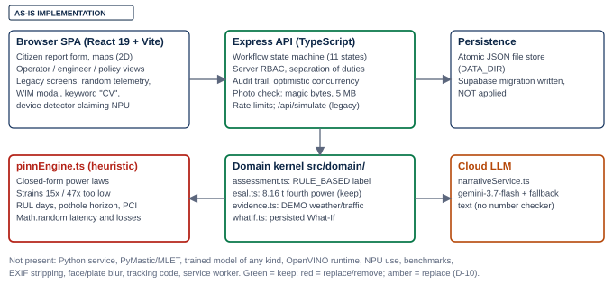
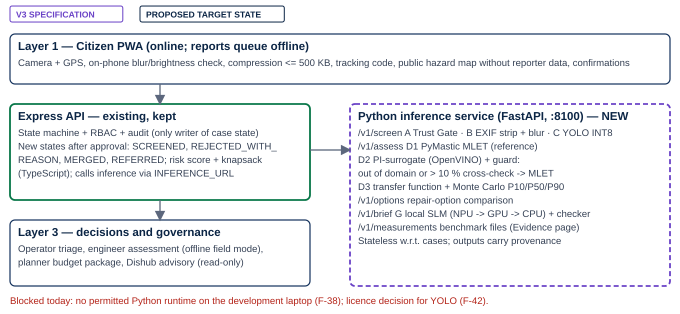
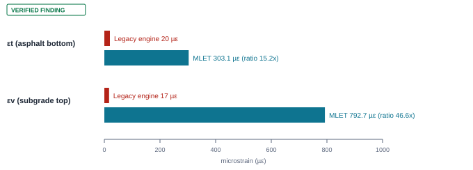
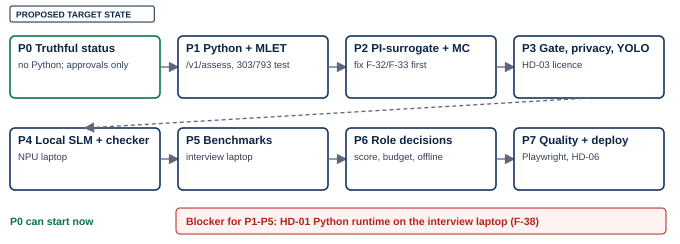

<!-- GENERATED FILE: assembled by _build/build.mjs from _build/report-body.md and the seven registers (Appendices A-G). Edit the sources, not this file. -->

**PAVEMENT-PINN v3**

**Consolidated Forensic Audit, Reference-Code Comparison & Development Baseline**

Document ID PAVEMENT-PINN-V3-BASELINE-001 · Version 1.0 · 2026-10-15 · Commit `4a9b4fc` · Branch `feature/m1-report-ownership` · Status: Issued for team review — project status against v3: NOT v3-COMPLIANT (19 open P0 items)

Inputs: PAVEMENT-PINN v3 Dokumen Induk (65 pp.), AGENTS.md, pavement_pinn_v3_code.zip, PAVEMENT-PINN-AUDIT-001. Internal engineering document; not approved by Intel or any government agency.

# Document Control

Table 0.1 — Document metadata

| Field | Value |
|---|---|
| Document ID | PAVEMENT-PINN-V3-BASELINE-001 |
| Title | PAVEMENT-PINN v3 — Consolidated Forensic Audit, Reference-Code Comparison & Development Baseline |
| Version / date | 1.0 · 2026-10-15 |
| Repository | `pavement-pinn` (local folder `…/Intel AI Global Impact Festival 2026/Projects/pavement-pinn`) |
| Branch / commit | `feature/m1-report-ownership` · `4a9b4fc49ec6e1d583648b2eaaa26293577add2e` |
| Working tree | 24 modified, 1 deleted, 10 untracked paths from another session's demo-authentication work (unchanged since AUDIT-001), plus the audit folders. Nothing was staged, committed, stashed, reset or overwritten by this baseline |
| Inputs | `AGENTS.md` (sha256 `06a7635c…4b535`); *PAVEMENT-PINN v3 Dokumen Induk*, 65 pages, v3.0 dated 15 Oct 2026 (sha256 `1cdc4229…b6ab`); `pavement_pinn_v3_code.zip` (sha256 `664c6a7f…2b88`); AUDIT-001 v1.0 (2026-10-14) and its registers |
| Method | Read-only repository inspection; full reading of AGENTS.md and the 65-page PDF (text layer); isolated, non-executed inspection of the ZIP; independent numerical checks with the AUDIT-001 layered-elastic solver and JavaScript ports (`evidence/`) |
| Not done | No Python executed (blocked by machine policy, F-38); no `npm test`/`npm run lint` re-run (code identical to the audited state, see §1.4); no build, deploy, migration, dependency installation or Git state change |
| Status | Baseline issued for team review. Overall project status against v3: **NOT v3-COMPLIANT** — 19 open P0 items |
| Classification | Internal engineering document of the project team. Not approved by, and not affiliated with, Intel or any government agency |
| Companion files | Appendices A–G as separate Markdown registers in this folder; `evidence/`; this PDF and its generated Markdown master |

Table 0.2 — Status labels used in this report

| Label | Meaning |
|---|---|
| [AS-IS IMPLEMENTATION] | What the repository actually contains today, from source inspection |
| [V3 SPECIFICATION] | What the v3 Dokumen Induk or AGENTS.md requires; not evidence that it exists |
| [REFERENCE ZIP] | Candidate code from the other team's package; not executed here |
| [VERIFIED FINDING] | Established by evidence collected or re-checked in this baseline |
| [PROPOSED TARGET STATE] | Recommended future state; does not exist |
| [TERBUKTI] / [TARGET] / [RENCANA] / [DILARANG] | v3 §1.1 claim legend: proven in this repository / measurable goal not yet measured / not built / prohibited claim |

# Chapter 0 — Executive Summary

**Central question.** Given the repository's actual state, the 14 October forensic audit, the v3 specification and the reference team's code, what should be kept, corrected, integrated, redesigned, tested and built next?

**Short answer.** Keep the workflow backbone; remove every unmeasured number first; then build the physics path in a separate Python service using the reference code only after the team reproduces it and fixes the defects found here. Nothing in the AI or physics stack of v3 exists in this repository yet, and the machine used for this baseline cannot run Python at all, which is now the main schedule risk.

Table 0.3 — Executive summary

| Area | Finding | Label |
|---|---|---|
| Repository state | Code unchanged since AUDIT-001: no file in `src/`, `server/`, `tests/` is newer than the audit register | [VERIFIED FINDING] |
| Previous audit | 31 findings re-validated: 22 confirmed open, 7 superseded by v3 but still shipped, 1 partially resolved (F-15: decided in v3, not implemented), 1 blocked. None fixed, none regressed | [VERIFIED FINDING] |
| Prohibited claims | Six of the eight v3 §1.5 prohibited claims are still visible in the current build (PINN solver, unmeasured latency/NPU, WIM/FWD validation, "aman/melebihi batas ijin", days-to-pothole, agency names) | [VERIFIED FINDING] |
| Structural engine | The current engine is a heuristic formula, not a solver and not a network. Its strains are 15× (εt) and 47× (εv) below layered-elastic theory on the v3 reference case | [VERIFIED FINDING] |
| MLET reference case | The v3 reference values (εt 303 µε, εv 793 µε at 10 t; 274/663 at 8.16 t; exact ×3 similarity) are reproduced to 0.1 % by the audit's independent solver | [VERIFIED FINDING] |
| Reference ZIP | 11 safe files; core math (AI transfer functions, life index, ESAL example, priority example, knapsack property, number checker examples) re-derived and correct. Five design defects found before any training: missing d/a feature (F-32), physically wrong monotonicity signs (F-33), incomplete validation (F-34), no guardrail code (F-35), Monte Carlo seeding/zero-growth issues (F-36) | [VERIFIED FINDING] |
| "DIUJI" status | Reported by the other team; not inherited. No reference file was executed here | [REFERENCE ZIP] |
| Surrogate / PINN | No trained surrogate, dataset, weights or metrics exist anywhere. All surrogate accuracy numbers in v3 are "contoh dokumen" | [TARGET] |
| Benchmarks | None exist; any latency/NPU figure would be fabricated | [RENCANA] |
| Privacy | Stored citizen photos keep EXIF/GPS metadata; no blurring; no deletion job (F-46) | [VERIFIED FINDING] |
| Environment | Python is blocked by Windows Application Control (F-38); all Python phases blocked on this machine | [VERIFIED FINDING] |
| Recommendation | Start with Phase 0 "Truthful status" (pure TypeScript, needs only approvals); resolve HD-01 (Python runtime) in parallel; do not train or benchmark anything until R1-02 reproduces the reference tests on the team's own Intel machine | [PROPOSED TARGET STATE] |

What must not be claimed today: that the project is v3-compliant; that a PINN or PI-surrogate exists or was trained; that the reference code passed tests in this repository; any latency, NPU, accuracy or energy figure; field (FWD/WIM) validation; that the system is offline-capable.

# Chapter 1 — Audit Provenance and Document Authority

## 1.1 Source hierarchy

Table 1.1 — Sources and their authority

| Source | Role in this baseline | Authority |
|---|---|---|
| A — Current repository | Object of the audit; the only evidence of what exists | Highest for "what is" |
| B — AUDIT-001 (2026-10-14) and registers | Historical baseline; every finding re-validated (Appendix C) | Historical; superseded by new evidence |
| C1 — v3 Dokumen Induk (65 pp.) | Target specification; decisions D-01–D-18 | Highest for "what should be" (D-01) |
| C2 — AGENTS.md | Operational rules for agents; defers to the PDF on conflict | Below the PDF |
| C3 — Reference ZIP | Candidate implementation; quality checked independently | Lowest; never proof of existence |

## 1.2 Conflicts found between sources

Table 1.2 — Source conflicts and their resolution in this baseline

| Conflict | Sources | Resolution |
|---|---|---|
| Strain under-prediction "14 hingga 77 kali" vs "15 sampai 47 kali" | v3 §0 p. 4 vs v3 §4.4 p. 21 and AGENTS §0 | Report the reference-case ratios 15×/47× with the case named (F-41) |
| Severity of F-06, F-12–F-16, F-19, F-20 (P1 in AUDIT-001, P0 in v3) | AUDIT-001 vs v3 §4.10 | v3 governs (D-01); both recorded (Appendix C, Table C.1) |
| Monotonicity sign for εt vs E1/E3 | ZIP `SIGNS` has −1; v3 §4.4 candidate list omits it | Neither is adopted; independent check shows violations (F-33) |
| Austroads equation with SF factor | v3 §4.4 shows SF; ZIP omits it | Open (HD-04, F-49) |
| Workflow state names | v3 Fig. 3.2 vs current spec v2.2 §24 lifecycle | Open (HD-02, F-39); current states kept |
| Decision IDs D-01… vs D-001… | v3 vs `docs/DECISION_LOG.md` | Prefix `V3-` proposed (Appendix G) |
| Python service vs "no FastAPI yet" | v3 D-04 vs existing D-001 | v3 governs; D-001 marked superseded in part after approval |
| Commit trailers | AGENTS §6 (`Assisted-by:`) vs the repository owner's attribution rule | Open (HD-08) |
| "Trust Gate rejects out-of-corridor" vs "REFERRED" | ZIP `trust_gate.py` vs v3 §4.1 | Specification wins; F-43 |

## 1.3 Method

1. Read-only reconnaissance: repository root, branch, commit, `git status` (including ignored files), recent log, CI workflows, test inventory, existing project instructions (none at repository root; the user-level memory notes were consulted), and the user's running development server on port 3000 (left untouched).
2. Recovery of AUDIT-001 from `docs/audit/forensic-2026-10-14/` and re-validation of each finding (Appendix C).
3. Full reading of AGENTS.md and of all 65 PDF pages via `pdftotext -layout` and `-raw` (the table of §4.10 and §1.3 needed raw order). Page images could not be rendered (no `pdftoppm`); diagrams were read from their text layer.
4. ZIP listed, hashed and extracted into an isolated temporary directory; every file read; nothing executed.
5. Independent numerical checks (`evidence/v3check.mjs`, `evidence/v3check2.mjs`; Node v24.16.0; run log `evidence/evidence-run.log`).
6. Comparative assessment, registers, this report, and an automated PDF QA pass.

## 1.4 Why the test suite was not re-run

AUDIT-001 ran `npm test` (226/226 pass) and `npm run lint` (clean) on this exact working tree on 2026-10-14 (its tests T-03, T-04). No file under `src/`, `server/` or `tests/` has changed since (Appendix H, T-11). Re-running would produce no new information, so the earlier results are cited. Re-running becomes mandatory with the first code change (Chapter 11).

# Chapter 2 — Previous Audit Findings and Current Status

All 31 AUDIT-001 findings were re-checked against the current code. The full crosswalk with evidence and next action per finding is Appendix C.

Table 2.1 — Status of previous findings

| Status | Count | Meaning for planning |
|---|---|---|
| [CONFIRMED_OPEN] | 22 | Fix as specified in v3 §4.10 |
| [SUPERSEDED_BY_V3] | 7 | Requirement replaced (e.g. anti-spoofing → Trust Gate); the defective code is still shipped and must be removed |
| [PARTIALLY_RESOLVED] | 1 | F-15: v3 decided the source of truth and the corridors; code still Karawang-only and still calls a cloud LLM |
| [BLOCKED] | 1 | F-24: no Supabase credentials |
| [RESOLVED_VERIFIED] | 0 | — |

The five original P0 findings — formula presented as PINN (F-01), fabricated telemetry (F-02), strains one to two orders too low (F-03), fake WIM training (F-04) and invented CV confidence (F-05) — are all still open. F-03 is now confirmed by two independent solvers (PyMastic as reported by v3, and the audit solver re-run here).

# Chapter 3 — V3 Specification Traceability

Appendix A maps every v3 decision (D-01–D-18), role feature (W1–W7, O1–O6, E1–E7, K1–K6), module (A–H), API endpoint, prohibited claim (§1.5) and demo Definition-of-Done item (§8.4) to the current code.

Table 3.1 — Traceability summary

| Group | Items | [TERBUKTI] | [RENCANA] / [TARGET] | [DILARANG] present |
|---|---|---|---|---|
| Decisions D-01–D-18 | 18 | 0 | 18 | 8 contradicted by shipped text (D-02, D-05, D-06, D-07, D-11, D-12, D-13, D-14) |
| Role features | 27 (incl. admin) | 2 (O3 review with reason; O5 separation of duties) | 23 | 2 (K1 constants, K5 PDF) |
| Modules A–H | 10 rows | 0 | 10 | — |
| API contracts | 5 + data model | 0 | 6 | — |
| Prohibited claims | 8 | — | — | 6 present, 2 not observed |
| Demo DoD | 6 | 0 | 6 | DoD-1 fails today |

The parts of the current system that v3 explicitly builds on — state machine, server-side RBAC, separation of duties, audit trail, honest status vocabulary in the new domain layer, `esal.ts` with the 8.16 t axle, persisted What-If — remain sound and are the reason this baseline recommends no rewrite of the workflow layer.

# Chapter 4 — Reference ZIP Technical Assessment

Appendix B lists every file with reported status, independent evidence, compatibility and disposition. Key points:

- **Safety.** 11 plain-text files, no unsafe paths, links, binaries or network/shell calls; extracted only to an isolated temporary directory. One risky default: `np.load(..., allow_pickle=True)` on a dataset file.
- **What holds up.** `mlet_strains` produces the reference strains that an independent solver reproduces (M-01–M-03); the Asphalt Institute constants, the life-index closed form, the ESAL example, the priority example and the knapsack property are correct (M-09, M-13, M-17–M-19).
- **What does not.** The surrogate feature set cannot represent the dual-tyre geometry it is trained on (F-32); two of six monotonicity constraints contradict layered-elastic results (F-33); the D-04 guardrail exists only in prose (F-35); training lacks OOD and ablation (F-34); Monte Carlo seeding and zero growth are mishandled (F-36); the number checker rejects English decimals and citation years and accepts swapped values (F-37); the Trust Gate drops out-of-corridor photos instead of referring them (F-43); YOLO is AGPL-3.0 (F-42).
- **Status.** The other team's "DIUJI" applies to their environment. In this repository every reference component is [RENCANA] until R1-02.

Table 4.1 — Disposition summary

| Disposition | Components |
|---|---|
| [INTEGRATE_REFERENCE] (after R1-02) | `mlet_strains`, `life_index_years`, `priority_score`, `test_core.py` as pytest |
| [ADAPT] | `allowable_reps`, ESAL functions, knapsack, number checker, `trust_gate.py`, `gen_mlet_dataset.py`, `mc_life.py`, `slm_brief.py`, `bench_tools.py` |
| [INVESTIGATE] → team rewrite | `train_pi_surrogate.py` |
| [DEFER] | `train_yolo.py` (licence decision and local photos first) |

# Chapter 5 — Current-versus-Target Architecture





## 5.1 Component comparison

Table 5.1 — Component-by-component comparison and disposition

| Component | Current [AS-IS IMPLEMENTATION] | v3 target [V3 SPECIFICATION] | Class today | Disposition |
|---|---|---|---|---|
| Frontend | React 19 + Vite SPA, Leaflet/MapLibre 2D | Same + PWA/Service Worker, ID/EN | Production-capable (non-PWA) | [KEEP] + [ADAPT] |
| Workflow API | Express, state machine (11 states), RBAC, audit, optimistic concurrency, file store | Same + 4 new states, routing | Production-capable | [KEEP]; states [INVESTIGATE] (HD-02) |
| Identity | Server-signed sessions; credential login being added in the working tree | Real identity for internal roles (D-18) | Partial | [ADAPT] |
| Photo intake | Magic bytes, 5 MB, duplicate hint 30 m/7 d; EXIF kept | Trust Gate + EXIF strip + blur + deletion | Partial | [ADAPT] (keep checks, add Module A/B) |
| Damage classification | Keyword match, constant confidence | YOLO 4 classes OpenVINO INT8 | Mock | [REMOVE] now; Module C later |
| Structural engine | `pinnEngine.ts` heuristic formula | PyMastic MLET + PI-surrogate + guard | Mock/heuristic | [REPLACE] (justified by F-03) |
| Life/deterioration | RUL days, pothole horizon, PCI projection | Indeks Umur P10/P50/P90 | Heuristic, prohibited | [REMOVE] + build Module D3 |
| Traffic load | Demo provider; "Virtual WIM" modal | Counts × VDF (Module E) | Demo/mock | [REMOVE] WIM; [ADAPT] provider |
| ESAL | `esal.ts`, 8.16 t fourth power | Same + counts × VDF | Production-capable | [KEEP] |
| Prioritisation | Workflow buckets | Transparent score + knapsack | None | [INTEGRATE_REFERENCE] (TypeScript) |
| Narrative | Cloud Gemini + fallback | Local SLM on NPU + checker | Cloud dependency | [REPLACE] (D-10) |
| Telemetry/benchmark | `Math.random`, constants, simulated benchmark | `measurements/*.json` only | Fabricated | [REMOVE] then build Evidence page |
| Device detection | Browser guesses NPU | Python `available_devices` | Fabricated | [REPLACE] |
| PDF export | Agency names, no disclaimer | Status block + disclaimer per page | Defective | [ADAPT] |
| Persistence | Atomic JSON file store; Supabase migration unapplied | Supabase or VM + backup | Partial | [DEFER] to HD-06 |
| Tests | 226 node tests; no reference/E2E/pytest | + pytest + MLET reference + Playwright | Partial | [ADAPT] |

## 5.2 End-to-end workflow trace

Table 5.2 — Golden path: current vs target

| Step | Current path | Target path (v3 Fig. 3.2) | Gap |
|---|---|---|---|
| Citizen report | `SUBMIT` → `SUBMITTED`; photo validated (type/size) and stored with EXIF | Compressed photo, on-phone checks, tracking code | Compression, tracking code, EXIF strip |
| Input validation / privacy | `BEGIN_SCREENING` (SYSTEM) → rule screening, duplicate hint, OUT_OF_SCOPE for non-Karawang | `/v1/screen`: EXIF strip → Trust Gate → blur → YOLO | Entire Module A/B/C; corridor config |
| Damage classification | Keyword match (display only) | Versioned YOLO; confidence internal only | Model |
| Operator triage | `SCREENING_PASSED`/`NEEDS_REVIEW` → `VERIFIED` or `CLOSE_INVALID` with reason | `SCREENED` → `TRIAGED` by risk score; REJECTED_WITH_REASON, MERGED, REFERRED | Score, merge, referral, state names |
| Structural assessment | `assessment.ts` RULE_BASED formula, honestly labelled | `/v1/assess`: PyMastic εt/εv, P10/P50/P90, criterion | Python service |
| Engineering review / recommendation | `SUBMIT_INSPECTION`, `RECOMMEND_ACTION` by engineer | Same + option comparison + SLM brief | Options, SLM |
| Human approval | `APPROVE_ACTION` by operations manager; self-approval forbidden | Same (O5) | none — keep |
| Repair | `START_WORK`, `COMPLETE_WORK_ORDER` (internal, not SPK) | Same | none |
| Repair verification | `RESOLVE` by engineer → `CLOSE_RESOLVED` | After-photo + YOLO check + citizen confirmation | After-photo rule, confirmations |

# Chapter 6 — Mathematical and Scientific Verification

Appendix D holds the full register (M-01–M-25) and equations EQ-1 to EQ-7. This chapter states the conclusions.



## 6.1 Engine identity (D-02)

The current engine is a heuristic closed-form formula (M-24). The reference package contains a numerical physics solver wrapper (PyMastic) and an untrained surrogate design. The project therefore has **neither a PINN nor a trained physics-informed surrogate**. After R2 it would have a hybrid: physics solver as reference, surrogate as accelerator, guarded fallback to the solver.

## 6.2 MLET

The reference values are reproduced independently to 0.1 % (M-01, M-02) and elastic similarity is exact (M-03). Contact radius, sign convention and sampling depths are consistent (M-05–M-07). The dual-tyre values (227/876 µε) and the PyMastic unit convention could not be reproduced without Python (M-04, M-05) and remain to be shown by R1-02.

```math EQ-8 | Reference-case contact radius used in M-01 (10 t axle, 4 tyres, q = 0.55 MPa).
a = \sqrt{\frac{10 \times 9806.65 / 4}{\pi \times 0.55}} = 119.1 \, \mathrm{mm}
```

## 6.3 Transfer functions and life index (D-05)

The Asphalt Institute constants match the published form (M-09). The Austroads branch is the 2004 form without the SF/RF factor shown in v3 (M-10, F-49). The criteria differ about 200–300× in $N_d$ (M-11), so the choice must be made, cited and displayed by a human (HD-04). The life-index closed form is correct (M-13); its use in `mc_life.py` breaks for zero growth (F-36). No output may be expressed in days or as a pothole horizon.

## 6.4 Surrogate validation (D-04)


The pipeline MLET → dataset → training → held-out validation → OpenVINO export → cross-check → fallback has no executed step. Two design defects must be fixed before data generation: the d/a ratio (F-32) and the sign table (F-33). The 10 % cross-check fallback is a target acceptance criterion with no code yet (F-35). No surrogate accuracy, FP16/INT8 deviation or timing may be cited (M-22, M-23).

## 6.5 Monte Carlo

Determinism is designed in (hash seed) but not executed. Required changes: common random numbers between dry and wet scenarios, seed tied to the surrogate version, zero-growth branch, provenance fields (F-36). P10/P50/P90 describe the spread of the stated input distributions, which are assumptions — they are not calibrated confidence intervals and must not be presented as such.

## 6.6 Other scientific claims

ESAL uses the 8.16 t standard axle in `esal.ts` (keep) while the legacy engine still uses 10 t (F-08). The VDF values in the v3 example are illustrative, not MDP 2017. The priority score reproduces its documented example; it is a policy instrument, not a learned model, and its validation target (Spearman ≥ 0.6 against blind engineer rankings) is a [TARGET]. Surface severity rules from photos are approximate by design (v3 §4.3). No FWD, deflection, WIM or field data exist: every structural number is at best numerically verified, never field-validated.

# Chapter 7 — Data, Privacy, and Responsible AI

Table 7.1 — Responsible-AI requirements against the current build

| Requirement (v3) | Current state | Gap / finding |
|---|---|---|
| Numerical honesty (D-11, AGENTS rule 1) | 15 `Math.random` call sites in runtime UI/engine code; simulated benchmark; "Latensi <10 ms" text | F-02, F-14, F-20 — Phase 0 |
| Provenance per output (AGENTS rule 3) | New domain layer records provenance and status (`RULE_BASED`, `DEMO`, `SYNTHETIC`); legacy screens do not | F-23; extend to inference outputs (model version, device, units, status) |
| Human authority (§3.5) | AI never transitions state: only `SYSTEM` screening steps, all human decisions role-guarded; separation of duties tested | Keep; inference service must not call the state machine |
| Privacy (D-09) | EXIF kept, no blur, no deletion job, no retention log | F-46 — R3-01, R3-03 |
| Public-map privacy (W5) | Not verified in this baseline | Add public-response field test |
| Rate limit and duplicates | Rate limiting on intelligence and workflow routes; duplicate hint | Add pHash, per-device salted hash |
| GenAI (D-10) | Cloud Gemini call active (key on this machine is invalid, so the fallback text is served) | R4-03; "100 % offline" must never be claimed (§1.5) |
| Licensing (§6.5) | PyMastic Apache-2.0 (attribution needed on adoption); Ultralytics AGPL-3.0 undecided; reference ZIP has no licence | F-42, F-48 — HD-03, HD-09 |
| GenAI disclosure (§6.6) | No disclosure sheet; trailer convention unresolved | HD-08 |
| Prohibited claims (§1.5) | 6 of 8 present | Appendix A, Table A.4 |

Data status: the repository holds no empirical road, deflection, traffic-count or labelled image data. Segment data are reference/demo values and must stay labelled DEFAULT or ASSUMED. PyMastic-generated data, when produced, are SYNTHETIC and must never be presented as field data.

# Chapter 8 — Findings Register and Risk Prioritisation

Appendix E lists 51 findings: the 31 carried over (v3 priorities) and 20 new ones (F-32–F-51).

Table 8.1 — Open findings by severity

| Severity | Carried over | New | Total |
|---|---|---|---|
| [P0] | 18 | 1 | 19 |
| [P1] | 9 | 6 | 15 |
| [P2] | 4 | 10 | 14 |
| [P3] | 0 | 3 | 3 |

Table 8.2 — Top risks for the next milestone

| Rank | Risk | Findings | Mitigation |
|---|---|---|---|
| 1 | False or unmeasured claims seen by judges | F-01, F-02, F-05, F-06, F-14, F-16, F-19, F-20 | Phase 0, CI grep test |
| 2 | Physics path cannot start: no Python | F-38 | HD-01 |
| 3 | Personal data in stored photos | F-46 | R3-01 now, Module B later |
| 4 | Surrogate trained on a flawed design | F-32, F-33, F-35 | R2-01, R2-02, R2-04 before training |
| 5 | Licence exposure from YOLO | F-42 | HD-03 before integration |
| 6 | State-machine change breaks the verified backbone | F-39 | HD-02, mapping first, existing tests untouched |

# Chapter 9 — Integration and Migration Strategy

## 9.1 Boundaries

1. **Express stays the system of record.** It owns cases, RBAC, audit and every state transition. The Python service is stateless with respect to cases; Express calls it via `INFERENCE_URL` (default `http://localhost:8100`) and stores the response as provenance-tagged evidence.
2. **Python owns physics and models.** MLET, transfer functions, Monte Carlo, surrogate and guard, Trust Gate, privacy, YOLO, SLM, benchmarks live in `inference/` with pytest.
3. **TypeScript owns policy logic.** Priority score, budget optimiser and ESAL × VDF go to `src/domain/intelligence/` next to `esal.ts`, so the operator and planner screens stay deterministic and testable in the existing suite.
4. **Fail closed.** If the inference service is down, the UI shows "layanan inferensi tidak tersedia" and no number — never a fallback formula.

## 9.2 Adoption rules for reference files

Table 9.1 — Adoption rules

| Rule | Detail |
|---|---|
| Reproduce first | A reference file is adopted only after its tests run on the team's machine (R1-02) |
| Provenance header | Adopted files carry origin (v3 package, sha256), licence and "adapted by" |
| Team-written science | Training, transfer functions, Monte Carlo, evaluation and benchmarks are written or rewritten by team members (AGENTS §6); AI may review and write tests |
| No silent behaviour change | Legacy tests that encode physically wrong behaviour are marked legacy with approval |
| Dependencies | `requirements.txt` with pins; Ultralytics only after HD-03 |
| Data and models | Gitignored; only hashes, cards and `models/registry.json` committed |

## 9.3 Proposed change sequence

Table 9.2 — Change sequence (each line one or more small PRs)

| Order | Change | Files (indicative) | Gate |
|---|---|---|---|
| 1 | `no-fake-claims.test.ts` (failing first) | `tests/unit/` | G-0 |
| 2 | Remove random telemetry/attribution; "belum diukur" | `pinnEngine.ts`, `CommunityReportsDashboard.tsx`, `LeafletMap.tsx`, `Navbar.tsx`, `FieldEngineerTools.tsx`, dashboards | G-0 |
| 3 | Delete WIM modal/scraper and IR export routes | `features/wim/*`, `services/wim/*`, `openvino*` server files, routes | G-0 |
| 4 | CV "belum diklasifikasi"; device "tidak diketahui"; verdict text removal | `cvDamageClasses.ts`, `deviceDetector.ts`, `pinnEngine.ts` | G-0 |
| 5 | PDF disclaimer; README/package; status labels | `pdfGenerator.ts`, `README.md`, pages | G-0 |
| 6 | Corridor config (Narogong + Karawang) | `config/corridors/`, `screening.ts` | G-0, HD-07 |
| 7 | DECISION_LOG merge | `docs/DECISION_LOG.md` | approval |
| 8 | `inference/` + `/v1/assess` + Express adapter | new folder, `server/` | G-1 |
| 9 | Surrogate pipeline and guard | `inference/training/`, `inference/core/` | G-2 |
| 10 | Screening, privacy, detector; new states | `inference/`, `src/domain/workflow/` | G-3, G-4 |
| 11 | SLM, benchmarks, Evidence page | `inference/genai/`, `inference/bench/`, UI | — |
| 12 | Role features, Playwright, deployment | various | G-5 |

# Chapter 10 — Development Roadmap



Appendix F holds the 52 tasks (R0-01 … R7-04) with source requirement, gap, change, dependencies, tests, acceptance criteria, priority, track and size, plus the approval gates G-0…G-5. Recommended first phase: **M-P0 "Truthful status"** (R0-01–R0-10) — it needs no Python, removes five of the six prohibited claims still on screen (the day-based life and horizon fields go with R1-06) and makes V3-DOD-1 pass. Phases 1–5 are blocked until HD-01 provides a Python runtime on the interview laptop. The v3 seven-day emergency plan cannot be met as written while that blocker is open; calendar estimates are therefore withheld.

# Chapter 11 — Test Plan and Definition of Done

Table 11.1 — Test plan per phase

| Phase | New tests | Gate commands | Definition of done |
|---|---|---|---|
| 0 | `no-fake-claims.test.ts` (grep `Math.random` in runtime paths; forbidden phrases; payload equality); route 404 tests; PDF snapshot; corridor screening test | `npm test`, `npm run lint` | M-P0 exit criteria (Appendix F.5) |
| 1 | pytest: 303/793 ±1 %, 274/663, ×3 similarity, invalid input raises; contract tests `/v1/assess`; Node adapter test; cross-check vs audit solver on axis | + `pytest` | Engineer UI shows PyMastic strains, criterion, "indikatif, bukan desain"; no legacy life fields |
| 2 | Dataset card check; sign-check report; metrics schema (random, OOD, similarity, violation %, ablation); guard tests; MC: P10 ≤ P50 ≤ P90, determinism, dry ≥ wet per sample, g = 0 finite | + `pytest` | `models/pi_surrogate_metrics.json` complete; fallback flagged |
| 3 | EXIF-strip test; gate branch tests; blur recall report; deletion-log test; "no silent drop"; public-response privacy test | + `pytest` | FAR/FRR, recall and mAP per class/condition stored |
| 4 | 50-case checker suite (ID and EN, citations, swapped values); network-off test | + `pytest` | Pass rate and tokens/s per device stored |
| 5 | `measurements/*.json` schema test | + benchmark script on the interview laptop | Evidence page reads only `/v1/measurements` |
| 6 | Score example 83.3; weight-change audit; DP ≥ greedy; budget curve monotone; option monotonicity; merge/SLA/REFERRED tests | all | §3.4 acceptance criteria |
| 7 | Playwright golden path | all + Playwright | v3 §8.4 DoD all ticked |

Non-negotiable for every phase: no existing test deleted or weakened; tolerances of reference tests never widened to make them pass; failures recorded with their output.

# Chapter 12 — Readiness and Unresolved Decisions

Table 12.1 — Readiness

| Item | Ready? | Note |
|---|---|---|
| Phase 0 implementation | Ready after approval | Pure TypeScript; change plan per PR (> 3 files) |
| Phase 1–5 implementation | Blocked | F-38 / HD-01 |
| Reference code adoption | Not ready | Reproduce first (R1-02); fix F-32–F-37, F-43 |
| Surrogate training | Not ready | HD-05, R2-02 sign check |
| YOLO integration | Not ready | HD-03 licence; local photos |
| State-machine extension | Needs approval | HD-02 |
| Persistence/deployment | Needs decision | HD-06 |
| Pitch claims | Restricted | Only [TERBUKTI] items; see Chapter 0 list of things that must not be claimed |

Open human decisions HD-01 to HD-09 are listed with options in Appendix G, Table G.2. This baseline did not take any of them.

**Readiness statement.** The project is not v3-compliant. It has a sound, tested workflow core and a clear, evidence-based path. The single most valuable next action is Phase 0; the single biggest risk is the missing Python runtime.

# Appendix A — V3 Requirement Traceability Matrix

Document PAVEMENT-PINN-V3-BASELINE-001 · Version 1.0 · 2026-10-15. Page numbers are the PDF's own footers ("Halaman N / 65") of *PAVEMENT-PINN v3 Dokumen Induk* (sha256 `1cdc4229…b6ab`).

**Claim status of the current repository** (v3 §1.1): [TERBUKTI] runs in this repository with evidence; [TARGET] a measurable threshold not yet measured; [RENCANA] not built; [DILARANG] the current build shows a claim v3 forbids. Requirement IDs are v3's own where it has them (D-xx, W1…K6); other rows get stable IDs: `V3-MOD-*` module criteria, `V3-API-*` endpoints, `V3-PC-*` prohibited claims (§1.5), `V3-DOD-*` demo Definition of Done (§8.4), `V3-RAI-*` responsible-AI items, `V3-BEN-*` benchmark protocol.

<!-- landscape-start -->

## A.1 Decisions D-01 to D-18 (§1.3, pp. 7–8)


Table A.1 — Decision traceability

| ID | Decision (abridged) | Existing implementation (evidence) | Status | Evidence needed | Acceptance criterion |
|---|---|---|---|---|---|
| D-01 | v3 document governs over blueprint v1, finalist doc v2 and spec v2.2; copy decisions to `docs/DECISION_LOG.md` | `docs/DECISION_LOG.md` still cites spec v2.2 as top source (l.4-6); IDs collide (F-40) | [RENCANA] | Merged log approved by team | DECISION_LOG lists V3-D-01…18 and marks superseded entries |
| D-02 | "PINN" = physics-informed neural surrogate; say it is not a PDE-residual PINN | Legacy UI/README still say PINN solver (F-01); new domain layer honest (`assessment.ts:4-8,17`) | [DILARANG] on legacy screens | grep CI test | No "Physics-Informed Neural Network/PINN Solver" text outside roadmap-labelled copy |
| D-03 | Corridor 1 Narogong, corridor 2 Karawang, corridors as configuration | Karawang hard-coded (`karawangPilot.ts`); Narogong reports flagged OUT_OF_SCOPE (`screening.ts:83`) | [RENCANA] | `config/corridors/*.json`, test | Narogong report not OUT_OF_SCOPE; adding a corridor needs no code change |
| D-04 | MLET via PyMastic as reference; PI-surrogate for batches; fallback when out of domain or > 10 % cross-check | None (heuristic engine) | [RENCANA] | `/v1/assess` tests, guard tests (F-35) | 303/793 ±1 %; guard tests pass |
| D-05 | Selectable, cited transfer function; Indeks Umur P10/P50/P90 in years, "indikatif, bukan desain"; no pothole horizon | RUL days and pothole horizon still computed (F-07) | [DILARANG] (horizon) / [RENCANA] (life index) | Criterion decision HD-04 | UI shows criterion + label; no day-based field in any API |
| D-06 | No PCI projection; record observed condition; ASTM D6433 only from a distress survey | PCI projection in `pinnEngine.ts` (F-07) | [DILARANG] | grep/API test | No projected PCI field |
| D-07 | YOLO 4 classes (RDD2022 + local), OpenVINO INT8, confidence only from a versioned model | Keyword classifier with constant confidence (F-05) | [DILARANG] | Model registry + test | Confidence displayed only when `modelStatus=REAL` and version set |
| D-08 | Photo Trust Gate with measured FAR/FRR | Magic bytes, 5 MB, duplicate hint 30 m/7 d (`photoValidation.ts`, `screening.ts`) | [RENCANA] | ROC + FAR/FRR report | FAR/FRR stored per check |
| D-09 | Blur faces/plates, strip EXIF server-side before storage, raw photo deleted ≤ 7 days | Not done; EXIF kept (F-46) | [RENCANA] | Tests + deletion log | See R3-01 |
| D-10 | Local SLM on NPU, structured input, numbers by code, checker, template; cloud calls off | Cloud Gemini call (`narrativeService.ts:9`) with fallback | [RENCANA] | `/v1/brief` tests; network-off demo | No outbound LLM call; checker pass rate measured |
| D-11 | All performance numbers from `measurements/*.json`; otherwise "belum diukur" | Random/constant telemetry (F-02, F-14) | [DILARANG] | `no-fake-claims.test.ts` | Evidence page reads only `/v1/measurements` |
| D-12 | Remove "Virtual WIM"; traffic load from classified counts × MDP 2017 VDF (normal vs actual) | Demo traffic provider (F-25); WIM modal (F-04) | [DILARANG] (WIM) / [RENCANA] | Counts + VDF table with source | Recomputable from the count form |
| D-13 | Dishub panel advisory only; no rerouting orders or dynamic tonnage limits | Advisory panel absent; legacy engine text still issues a dynamic tonnage limit and a "Tindakan langsung" order (`pinnEngine.ts:279`) | [DILARANG] (legacy text) / [RENCANA] (panel, P2) | UI review + grep | No action buttons; no tonnage limit or order text |
| D-14 | Material recommendation → repair-option comparison (patch, AC-WC, PMA) with editable moduli; remove "PMA ≥ 8.5 cm" | PCI look-up overlay (F-18) | [DILARANG] | `/v1/options` test | Thicker/stiffer option never gives lower life |
| D-15 | Quality audit → neutral early-damage investigation flag (≥ 3 reports + engineer confirmation) | Not present | [RENCANA] (P2) | Word-list test | Flag text free of accusatory words |
| D-16 | 2D map + strain section from real MLET grid; remove 3D twin and pore-pressure animation | 2D section from a div with an unused base layer (F-29) | [RENCANA] | Visual review | Section geometry equals model inputs |
| D-17 | Segment stores managing authority; automatic routing; citizen sees responsible agency | Not present | [RENCANA] | Segment config + routing test | Out-of-authority report becomes REFERRED with target agency |
| D-18 | Citizen PWA live on a public URL; Supabase applied or one VM with daily backup; real identity for internal roles | GitHub Pages workflow exists for the static demo; file store; credential login being added in the uncommitted working tree (D-034) | [RENCANA] | HD-06 decision, deployment log | Public URL serving the pilot; backups verified |

<!-- landscape-end -->

<!-- landscape-start -->

## A.2 Role features (§3.4, pp. 15–17)


Table A.2 — Role feature traceability

| ID | Prio | Feature | Existing implementation (evidence) | Status | Acceptance criterion (v3) |
|---|---|---|---|---|---|
| W1 | [P0] | 3-step report from browser camera, GPS accuracy, compression to ≤ 500 KB | Report flow exists (`ReportRoadIssueCard.tsx`, server `POST` with photo validation); no client compression to 1280 px | [RENCANA] (compression) | Median time ≤ 60 s on 10 testers; median upload ≤ 500 KB |
| W2 | [P1] | On-phone blur/brightness check | None | [RENCANA] | ≥ 90 % of 30 synthetic blurred photos rejected on the phone |
| W3 | [P1] | Offline queue (Service Worker + IndexedDB, idempotency key) | No service worker | [RENCANA] | Airplane mode → online: sent exactly once |
| W4 | [P0] | Tracking code + public status page | No tracking code (grep: none) | [RENCANA] | Status equals state machine (integration test) |
| W5 | [P0] | Public hazard map with verified points only, no reporter data | Map exists; public-response privacy not verified in this baseline | [RENCANA] (needs check) | No personal field in public API responses (test) |
| W6 | [P1] | Citizen confirmation "masih ada"/"sudah diperbaiki" | None | [RENCANA] | Confirmation raises component C (unit test) |
| W7 | [P1] | ID/EN, large buttons, WCAG AA | Indonesian UI; no i18n framework | [RENCANA] | Lighthouse accessibility ≥ 90 |
| O1 | [P0] | Queue ordered by risk score with contribution breakdown; editable weights logged | Queue by workflow bucket; no score | [RENCANA] | Order changes with weights; change audited |
| O2 | [P1] | Merge duplicates (≤ 30 m, ≤ 7 days + pHash) | Duplicate hint 30 m/7 d exists (`screening.ts`); no merge, no pHash | [RENCANA] (partial) | ≥ 18 of 20 synthetic pairs merged |
| O3 | [P0] | NEEDS_REVIEW with reasons; accept/reject with reason; nothing dropped silently | `NEEDS_REVIEW`, `REVIEW_ACCEPT`, `CLOSE_INVALID` (reason) exist (`stateMachine.ts:49-51`) | [TERBUKTI] (state machine, tests) — new REJECTED_WITH_REASON not yet | "No silent drop" test |
| O4 | [P1] | Assign + SLA counter per hazard level | Assignment exists (`REQUEST_INSPECTION`, deadline validation `stateMachine.ts:213`); no SLA per hazard | [RENCANA] (SLA) | Late SLA marked red |
| O5 | [P0] | Approve work order; recommender ≠ approver; "bukan SPK" | Separation of duties and internal work order verified by audit (S-01, D-012/D-013) | [TERBUKTI] | "self-approval forbidden" test stays green |
| O6 | [P1] | Authority routing → REFERRED | None | [RENCANA] | Out-of-authority report → REFERRED |
| E1 | [P0] | Offline field mode on the laptop (local YOLO, PyMastic, surrogate, SLM; sync with version check) | Version check (optimistic concurrency) exists; no local inference | [RENCANA] | Wi-Fi off: full inspection works |
| E2 | [P0] | Correct detections → labels with source model version (Module H) | None | [RENCANA] | Correction appears in export |
| E3 | [P0] | Structural assessment: εt/εv from PyMastic, P10/P50/P90, sensitivity, section, provenance | `assessment.ts` RULE_BASED heuristic with honest label; What-If persisted | [RENCANA] | εt/εv equal PyMastic ±1 %; P10 ≤ P50 ≤ P90; "indikatif" visible |
| E4 | [P1] | Compare repair options (life + cost) | What-If exists for engine inputs only | [RENCANA] | Monotonicity test |
| E5 | [P0] | Recommendation + SLM summary, engineer edits and approves | `RECOMMEND_ACTION` exists; summary from cloud/fallback | [RENCANA] (SLM) | All numbers pass checker |
| E6 | [P1] | Repair verification with after-photo | `RESOLVE` by engineer exists; no after-photo requirement found | [RENCANA] | Case cannot be verified without after-photo |
| E7 | [P2] | Early-damage flag | None | [RENCANA] | No accusatory words |
| K1 | [P0] | Corridor KPI dashboard from real data only | Policy view with ILUSTRATIF notice; some constants (F-22) | [DILARANG] where constants shown | Every number traceable to a query (test) |
| K2 | [P1] | Budget package optimisation (knapsack DP + greedy) | None (reference code available, M-19) | [RENCANA] | DP ≥ greedy on 100 random cases |
| K3 | [P1] | Budget scenario curve | None | [RENCANA] | Curve non-increasing in budget |
| K4 | [P1] | Coverage-equity map | Report density module exists (`reportDensity.ts`) | [RENCANA] (partial) | Segments without reports still shown |
| K5 | [P0] | Policy summary + PDF with status block and disclaimer on every page | PDF with agency names, no disclaimer (F-19) | [DILARANG] | PDF snapshot test |
| K6 | [P2] | Dishub load-enforcement advisory panel | None | [RENCANA] | No action buttons |
| ADM | [P1] | Corridor/segment config, model registry, retention settings, audit export | Audit trail exists; no registry/retention UI | [RENCANA] | — |

<!-- landscape-end -->

<!-- landscape-start -->

## A.3 Modules, contracts, governance


Table A.3 — Module, API and governance traceability

| ID | Section/page | Requirement | Existing implementation | Status | Acceptance criterion |
|---|---|---|---|---|---|
| V3-MOD-A | §4.1 pp. 19–20 | Trust Gate checks 1–8 with ROC-calibrated thresholds; FAR ≤ 5 %, FRR ≤ 5 % (blur/dark), screen-photo FAR ≤ 10 % | Magic bytes + size + duplicate hint | [TARGET] | Measured FAR/FRR reported as-is |
| V3-MOD-B | §4.2 p. 20 | Face/plate blur (OpenVINO), EXIF strip → blur → store → delete raw ≤ 7 days; blur recall ≥ 95 % on 50 photos | None (F-46) | [TARGET] | Recall measured; deletion log |
| V3-MOD-C | §4.3 pp. 20–21 | YOLO nano/small, split by location/day, ≥ 100 local test photos, mAP per class/condition, FP32 vs INT8, kappa severity | None | [TARGET] | Metrics file per class and condition |
| V3-MOD-D1 | §4.4 p. 21 | MLET via PyMastic, q in kPa, a-normalised, iteration 20, dual tyres at x = 0, d/2, d | None in repo; reference independently cross-checked (M-01–M-03) | [RENCANA] | 303/793 ±1 %; 274/663; similarity |
| V3-MOD-D2 | §4.4 pp. 22–23 | PI-surrogate (dimensionless I/O, sign-checked monotonicity loss, guardrail); validation: random 20 %, OOD, similarity, violation %, ablation | None; reference has defects F-32–F-35 | [TARGET] | Metrics JSON with all five validations |
| V3-MOD-D3 | §4.4 pp. 23–24 | Transfer function + life index + Monte Carlo 2 000 samples, deterministic seed, Spearman tornado | None | [RENCANA] | P10 ≤ P50 ≤ P90; deterministic; physical direction |
| V3-MOD-E | §4.5 pp. 24–25 | ESAL = Σ counts × VDF (normal/actual), MDP 2017 CESA, P10–P90 | `esal.ts` fourth-power law (8.16 t) only | [RENCANA] | Recomputable from forms; constants with sources |
| V3-MOD-F | §4.6 pp. 25–26 | Transparent score (weights 0.5/0.3/0.1/0.1); blind ranking Spearman ≥ 0.6; knapsack | None | [TARGET] | Example 83.3 reproduces; ρ measured |
| V3-MOD-G | §4.7 p. 26 | SLM INT4 on NPU → GPU → CPU; placeholders; checker; template after 2 fails; label "Disusun AI…"; no cloud | Cloud Gemini | [RENCANA] | Pass rate on 50 cases; tokens/s per device |
| V3-MOD-H | §4.8 p. 26 | Active learning; `models/registry.json`; promote only if fixed local test mAP does not drop | None | [RENCANA] | Registry committed; promotion rule tested |
| V3-API-1 | §4.9 p. 27 | `POST /v1/screen` (multipart) → trust, privacy, detections, model versions, device | None | [RENCANA] | Contract test |
| V3-API-2 | §4.9 p. 27 | `POST /v1/assess` → mlet, life_years, damage_used, sensitivity, surrogate {version, in_domain, crosscheck_err}, status_label, device | Express `POST` simulations/assessments (RULE_BASED) | [RENCANA] | Contract test + Express adapter |
| V3-API-3 | §4.9 p. 27 | `POST /v1/options` | None | [RENCANA] | Contract test |
| V3-API-4 | §4.9 p. 27 | `POST /v1/brief` | `POST` narrative (Gemini) | [RENCANA] | Contract test |
| V3-API-5 | §4.9 p. 27 | `GET /v1/measurements` — sole source of the evidence page | None | [RENCANA] | UI reads only this |
| V3-DATA | §4.9 p. 27 | Tables corridors, segments (authority, layers with source), reports (tracking code, salted device hash), photos, trust_checks, detections, assessments, confirmations, priority_snapshots, traffic_counts, measurements | Migration has 17 tables (not applied); different normalisation (`report_cases`, `pinn_predictions`) | [RENCANA] | Schema decision recorded (HD-06) |
| V3-BEN | §5.4 pp. 30–31 | Benchmark protocol: fixed model hash, OpenVINO version, `available_devices`, driver, 50 warm-up, ≥ 1 000 runs, cold start, p50/p95/p99, throughput, memory, deviation vs FP32, power or "tidak diukur" | Simulated benchmark (F-14) | [DILARANG] (simulated values) | `measurements/*.json` with all fields |
| V3-RAI-1 | §6.1 p. 32 | Risk register mitigations (reporter safety warning before camera, equity, no gamification, ...) | Not present | [RENCANA] | Warning text shown before camera |
| V3-RAI-2 | §6.2 pp. 32–33 | Data lifecycle: rejected reports kept 30 days then deleted; deletion via tracking code ≤ 7 days | None | [RENCANA] | Retention job tests |
| V3-RAI-3 | §6.3 p. 33 | Model cards (YOLO, scene classifier, PI-surrogate, SLM) | None | [RENCANA] | Card per registry entry |
| V3-RAI-4 | §6.5 p. 33 | Licences: PyMastic Apache-2.0 attribution; Ultralytics AGPL-3.0 decision; RDD2022; SLM licence | Not applicable yet | [RENCANA] | HD-03 decided before integration |
| V3-RAI-5 | §6.6 p. 34 | Honest GenAI disclosure; commits marked `Assisted-by:` (AGENTS §6) | Not present | [RENCANA] | Disclosure sheet; trailer convention agreed (see HD-08) |

<!-- landscape-end -->

## A.4 Prohibited claims (§1.5, p. 9) and demo Definition of Done (§8.4, p. 39)

Table A.4 — Prohibited claims: where the current build still violates them

| ID | Prohibited claim | Present in current build? (evidence) | Status |
|---|---|---|---|
| V3-PC-1 | "PINN that solves Burmister" / "FEM-equivalent in < 10 ms" | README l.1; legacy screens; "Latensi <10 ms" in `demoAccounts.ts:128` | [DILARANG] present |
| V3-PC-2 | Latency, power, NPU use or quantisation accuracy not from a measurement file | `pinnEngine.ts:217`, `simulatedBenchmark.ts`, `deviceDetector.ts:15` | [DILARANG] present |
| V3-PC-3 | "Validated with FWD/WIM/field data" | WIM-station correlations in `LeafletMap.tsx:362`; FWD badge (F-16) | [DILARANG] present |
| V3-PC-4 | "Jalan ini aman" / "melebihi batas ijin" from model output | `pinnEngine.ts:129` ("melebihi batas ijin"), `:132` ("batas elastis aman"), `:170` ("OPERASIONAL AMAN") | [DILARANG] present |
| V3-PC-5 | Remaining life in days, pothole horizon, APBN savings | `pinnEngine.ts:90-112,188-201` | [DILARANG] present |
| V3-PC-6 | Data from/endorsed by Bina Marga, PUPR, Kemenhub, BMKG or Intel | `pdfGenerator.ts:34,65,163` | [DILARANG] present |
| V3-PC-7 | "Detects rogue contractors", "corruption" | Not found in this baseline's sweep | Not observed |
| V3-PC-8 | "100 % offline" for the whole system | Not found in this baseline's sweep | Not observed |

Table A.5 — Demo Definition of Done (§8.4) against the current build

| ID | Criterion | Current state | Blocking tasks |
|---|---|---|---|
| V3-DOD-1 | No number on screen from a constant or `Math.random` (grep test) | Fails: 15 `Math.random` call sites in 4 runtime files | R0-02 |
| V3-DOD-2 | Phone photo → gate → blur → versioned detection → queue with explainable score | Not possible: no gate, blur, model or score | R3-*, R6-01 |
| V3-DOD-3 | εt/εv from PyMastic, life index P10/P50/P90, criterion, "indikatif" | Not possible: no Python service | F-38, R1-*, R2-* |
| V3-DOD-4 | Wi-Fi off: assess and write summary on NPU | Not possible | R4-*, R6-03 |
| V3-DOD-5 | Evidence page with real benchmarks (device, OpenVINO version, date) | Not possible | R5-* |
| V3-DOD-6 | Local backup recording of the demo | Team task | R7-04 |


<!-- pagebreak -->

# Appendix B — Reference Code Assessment (pavement_pinn_v3_code.zip)

Document PAVEMENT-PINN-V3-BASELINE-001 · Version 1.0 · 2026-10-15.

## B.1 Handling of the archive

- **Isolation.** The ZIP (17 199 bytes, sha256 `664c6a7f…2b88`) was listed with `unzip -lv` before extraction: 11 entries, all under `pavement_pinn_v3_code/`, no absolute paths, no `..` components, no symbolic links, no binaries, no model or dataset files. It was extracted into the session's temporary scratch directory, **never into the repository**. Hashes of the archive, the v3 PDF, `AGENTS.md` and of every extracted file are in `evidence/reference-inputs.txt`.
- **No execution.** No reference file was executed. Python is blocked on this machine (F-38). All statements below come from reading the code and from the independent checks in Appendix D.
- **Content vs. PDF.** The ZIP files are the code printed in v3 Appendix B (B.1–B.8). B.9 (sign check) exists only in the PDF as a snippet; the `verify_signs` helper referred to in `train_pi_surrogate.py:32` is not in the ZIP.
- **Dependencies declared** (README only, no pins): Python 3.11+, numpy, scipy, opencv-python, PyMastic (git clone, Apache-2.0); for AI modules torch, openvino, nncf, openvino-genai, optimum[openvino], ultralytics.
- **Unsafe operations found:** none. No network calls, no shell execution, no deletion. File writes are limited to `--out` paths, `models/`, `runs/` and `measurements/`. `np.load(..., allow_pickle=True)` in `train_pi_surrogate.py:65` should be `allow_pickle=False` once the `ranges` string field is stored differently (loading an untrusted `.npz` with pickle enabled can execute code).

<!-- landscape-start -->

## B.2 Inventory and disposition


Table B.1 — Reference implementation inventory

| Reference component | Source file (lines) | Intended module | Reported status (v3/README) | Independently reproduced here? | Compatibility with this repository | Disposition |
|---|---|---|---|---|---|---|
| `mlet_strains` (PyMastic wrapper, dual-tyre superposition) | `pavement_core.py` 8-39 | D1 | DIUJI | Reference strains 303/793 and 274/663 µε and ×3 similarity reproduced with the independent audit solver (M-01–M-03); dual case not reproduced (M-04) | New Python service; nothing equivalent exists (current engine is a heuristic) | [INTEGRATE_REFERENCE] after R1-02 passes; replace `assert` (F-51) |
| `allowable_reps` (AI, AUS) | `pavement_core.py` 42-58 | D3 | DIUJI | AI constants match Huang; AUS omits SF/RF, edition unverified (M-09, M-10) | No transfer function exists in the repo (only text thresholds, F-06) | [ADAPT]: criterion choice and citation first (HD-04, F-49) |
| `life_index_years` | `pavement_core.py` 60-68 | D3 | DIUJI | Closed form verified (M-13) | Replaces RUL/horizon (F-07) | [INTEGRATE_REFERENCE] |
| `esal_per_day`, `design_esal` | `pavement_core.py` 71-77 | E | DIUJI | Example 1 360 / 2 930 reproduced (M-17) | Repo `esal.ts` already has the 8.16 t fourth-power law (keep); this adds counts × VDF | [ADAPT]: port to TypeScript next to `esal.ts` or call from Python; VDF tables from MDP 2017 required |
| `priority_score` | `pavement_core.py` 80-94 | F | DIUJI | Example 83.3 reproduced (M-18) | No risk score exists; queue is bucketed by state | [INTEGRATE_REFERENCE] — better in TypeScript (`src/domain/`) because the operator queue and audit log live there; weights editable + audited |
| `knapsack`, `greedy` | `pavement_core.py` 96-120 | F (K2) | DIUJI | Property DP ≥ greedy reproduced on 1 000 cases (M-19) | Nothing exists | [ADAPT]: unit scaling (F-45); TypeScript or Python both fine |
| `check_brief`, `numbers_in` | `pavement_core.py` 123-139 | G | DIUJI | Good/bad examples reproduced; edge-case defects (M-20, F-37) | Repo uses cloud Gemini with fallback text | [ADAPT]: positional slot check, locale, citation years |
| `test_core.py` | 1-43 | D, E, F, G | "ALL TESTS PASSED" | Not run ([BLOCKED], F-38); its assertions were re-derived independently where possible | Becomes `inference/tests/test_core.py` (pytest) | [INTEGRATE_REFERENCE] as pytest; keep the 303/793 tolerance (do not widen) |
| `trust_gate.py` (blur, brightness, pHash, haversine, decide) | 1-44 | A | DIUJI | Not run; logic read; thresholds uncalibrated; REFERRED path missing (F-43) | Repo has magic-byte, size and 30 m / 7 day duplicate hint (`photoValidation.ts`, `screening.ts`) — keep those | [ADAPT] |
| `gen_mlet_dataset.py` | 1-48 | D2 data | DIUJI (small n) | Not run; LHS ranges match v3 §4.4; silent NaN drop (F-44); d/a not stored as a feature (F-32) | Offline tool, no repo coupling | [ADAPT] |
| `mc_life.py` | 1-44 | D2/D3 | DIUJI | Not run; g = 0 defect, seed design (F-36) | Needs a trained predictor | [ADAPT] |
| `train_pi_surrogate.py` | 1-101 | D2 | BELUM DIUJI | Not run; feature defect (F-32), SIGNS defect (F-33), validation gaps (F-34), no guardrail (F-35), `allow_pickle=True` | Offline tool | [INVESTIGATE] → rewrite by the team (AGENTS §6: scientific core written by team members) |
| `train_yolo.py` | 1-42 | C | BELUM DIUJI | Not run; split-by-location not implemented (F-50); AGPL licence (F-42) | Offline tool; model consumed by `/v1/screen` | [DEFER] until HD-03 (licence) and photos exist |
| `slm_brief.py` | 1-51 | G | BELUM DIUJI (helpers tested) | Not run; checker edge cases (F-37); NPU fallback only in a comment | Replaces `narrativeService.ts` (Gemini) | [ADAPT] after R4 hardware check |
| `bench_tools.py` | 1-37 | Evidence page | BELUM DIUJI | Not run; NPU dynamic-shape risk (F-47); protocol fields match v3 §5.4 except memory and throughput | Feeds `/v1/measurements` | [ADAPT] |
| `README.md` | 1-9 | — | — | Read | — | Fold into `inference/README.md` |

<!-- landscape-end -->

## B.3 What "DIUJI" means and why it is not inherited

v3 Appendix B states that "DIUJI" files were run with tests in a Python 3.13 + PyMastic + NumPy/SciPy/OpenCV environment while the document was prepared. That run is the other team's evidence, not this repository's. Under v3 §1.1 a claim becomes TERBUKTI only when it runs **in the team's repository** with stored evidence. Until R1-02 produces a log on the team's own Intel machine, every row above stays at most "independently cross-checked" (for the rows with a [REPRODUCED] check in Appendix D) and the rest stay "not verified".

## B.4 Integration boundary (proposed)

Table B.2 — Where each adopted piece should live

| Piece | Location | Language | Called by | Contract |
|---|---|---|---|---|
| MLET, transfer functions, life index, Monte Carlo, surrogate guard | `inference/core/` | Python | `/v1/assess`, `/v1/options` | v3 §4.9 JSON, every output with provenance + status label |
| Trust Gate, EXIF strip, blur, YOLO | `inference/core/`, `inference/privacy/` | Python | `/v1/screen` | v3 §4.9 |
| SLM brief + checker | `inference/genai/` | Python | `/v1/brief` | v3 §4.9 |
| Benchmarks | `inference/bench/` | Python | CLI → `measurements/*.json`; `/v1/measurements` | v3 §5.4 |
| Priority score, budget optimiser, ESAL × VDF | `src/domain/intelligence/` (beside `esal.ts`) | TypeScript | Express routes, operator/planner views | Deterministic, isomorphic, audited weight changes |
| Workflow transitions | existing `src/domain/workflow/stateMachine.ts` | TypeScript | unchanged | AI never calls `applyCommand`; Express stores inference results as evidence only |

The Express API stays the only writer of case state (AGENTS rule 4). The Python service is stateless with respect to cases: it computes and returns; Express persists and audits.


<!-- pagebreak -->

# Appendix C — Previous Audit Crosswalk (F-01 to F-31)

Document PAVEMENT-PINN-V3-BASELINE-001 · Version 1.0 · 2026-10-15 · Repository commit `4a9b4fc` (branch `feature/m1-report-ownership`, working tree with another session's uncommitted demo-authentication changes, unchanged since the previous audit).

Source of the original findings: PAVEMENT-PINN-AUDIT-001 v1.0 (2026-10-14), `docs/audit/forensic-2026-10-14/PAVEMENT_PINN_Audit_Findings_Register.md`. Source of the v3 actions and re-prioritisation: *PAVEMENT-PINN v3 Dokumen Induk* §4.10 (pp. 27–28) and the decision log §1.3 (pp. 7–8).

## C.1 How the revalidation was done

1. **Change detection.** `find src server tests -newer <audit findings register>` returned no file: no source, server or test file was modified after the audit register was written (2026-10-14 23:13). `git status` shows the same 24 modified, 1 deleted and 10 untracked paths the audit recorded, plus the audit folders themselves. The audited code is therefore the current code.
2. **Spot re-verification.** Every finding whose evidence is a code location was re-checked with a read-only `grep` on 2026-10-15 (commands and hits in Appendix H, T-11). All cited lines still exist with the same content; no finding regressed or was fixed.
3. **Re-classification against v3.** A finding is `SUPERSEDED_BY_V3` when v3 replaces the requirement it was measured against (for example, "anti-spoofing" becomes the Photo Trust Gate). Superseded does not mean closed: the code still contains the defect until the v3 replacement ships, so the *next action* column is what matters.
4. **No status was upgraded to `RESOLVED_VERIFIED`.** No defect has been corrected since the audit.

Status vocabulary: [CONFIRMED_OPEN] defect still present; [PARTIALLY_RESOLVED] decision or part of the fix exists, defect still visible; [SUPERSEDED_BY_V3] original requirement replaced by a v3 decision, replacement not yet built; [BLOCKED] cannot be verified or fixed without an external resource; [RESOLVED_VERIFIED], [REGRESSED], [NOT_REPRODUCIBLE] — none this cycle.

## C.2 Severity changes made by v3

v3 §4.10 assigns its own priorities. Under D-01 the v3 document governs, so the v3 priority is adopted below and the original severity is kept for history.

Table C.1 — Findings whose priority v3 raised

| ID | Audit severity (14 Oct) | v3 priority (§4.10) | Reason implied by v3 |
|---|---|---|---|
| F-06 | [P1] | [P0] | Unsourced "melebihi batas ijin" verdicts are a prohibited claim (§1.5) |
| F-07, F-18, F-22 | [P1] / [P1] / [P2] | [P0] | RUL in days, pothole horizon and APBN savings are prohibited claims (§1.5) |
| F-12, F-14 | [P1] | [P0] | Unmeasured NPU/latency figures are prohibited claims (§1.5, D-11) |
| F-13 | [P1] | [P0] (with F-04) | Fake IR export is part of the fake training story |
| F-15 | [P1] | [P0] | Source-of-truth conflict is the first decision (D-01, D-03) |
| F-16, F-19, F-20 | [P1] | [P0] | "FWD Validated", agency names and random attributions are prohibited claims |
| F-21 | [P2] | [P0] (with F-02) | Determinism is a design principle (§4 "Prinsip 4") |

<!-- landscape-start -->

## C.3 Crosswalk


Table C.2 — Previous findings, current evidence and next action

| ID | Original finding (abridged) | Orig. sev. | Previous evidence | Current evidence (2026-10-15) | Current status | Next action (v3 task) |
|---|---|---|---|---|---|---|
| F-01 | Closed-form formula presented as a trained PINN | [P0] | `pinnEngine.ts` (296 lines, no weights); README l.1 | Unchanged. README l.1 still "Physics-Informed Neural Network Decision Support System"; `assessment.ts:17` labels engine RULE_BASED honestly | [CONFIRMED_OPEN] | R0-01: relabel all legacy "PINN/neural" text until Module D exists; later label "PI-surrogate vX (dilatih dari MLET)" (D-02) |
| F-02 | Fabricated telemetry (loss, latency, power, NPU) | [P0] | `pinnEngine.ts:203-240`, Navbar, dashboards, PDF | `pinnEngine.ts:217` latency jitter, `:238-239` random losses still present; 15 `Math.random` call sites remain in 4 runtime files | [CONFIRMED_OPEN] | R0-02 with `no-fake-claims.test.ts` |
| F-03 | Strains 1–2 orders below layered-elastic theory | [P0] | `evidence/compare-grid.json`: engine 20/17 µε vs reference 303/793 µε | Engine unchanged; v3 §4.4 reports PyMastic 303/793 µε for the same case, matching the audit solver (M-01 in Appendix D) | [CONFIRMED_OPEN] (reconfirmed by a second, independent solver) | R1-03: replace with `/v1/assess` (MLET) |
| F-04 | Simulated WIM scraping + "PINN training" modal | [P0] | `BinaMargaWimPipelineModal.tsx`, `binaMargaWimScraper.ts:70-155` | 7 `Math.random` calls in `binaMargaWimScraper.ts` (l.72-110) | [CONFIRMED_OPEN] | R0-03: delete modal and service; route returns 404 |
| F-05 | CV class/confidence from file-name keywords | [P0] | `cvDamageClasses.ts:24-244` | Unchanged | [CONFIRMED_OPEN] | R0-04: show "belum diklasifikasi" until Module C; confidence only with `modelStatus=REAL` |
| F-06 | Strain limits 180/200/250/350 µε untraceable | [P1] | `pinnEngine.ts:128-132` | `pinnEngine.ts:128-129` still prints "melebihi batas ijin Bina Marga (200 µε)" | [CONFIRMED_OPEN] | R0-05 (text) then R1-05 (cited transfer function, criterion shown) |
| F-07 | RUL/pothole horizon/PCI projection heuristic | [P1] | `pinnEngine.ts:90-112,173-186` | Unchanged | [SUPERSEDED_BY_V3] (D-05, D-06) — defect still shipped | R1-06: remove fields; Indeks Umur P10/P50/P90 replaces them |
| F-08 | Two standard axles (10 t vs 8.16 t) | [P1] | `pinnEngine.ts:54`; `esal.ts:12` | `pinnEngine.ts:54` still `axleLoadTon / 10.0`; `esal.ts:12` `STANDARD_AXLE_TON = 8.16` | [CONFIRMED_OPEN] | R1-07: single constant 8.16 t with citation, cross-module test |
| F-09 | Load model lacks q, a, configuration, ν | [P1] | `pinnEngine.ts:56-80` | Unchanged; v3 reference `mlet_strains` takes q, tyres, dual spacing, ν per layer | [CONFIRMED_OPEN] | R1-03 (input contract of `/v1/assess`) |
| F-10 | Linear moisture/temperature heuristics; no pore pressure | [P1] | `pinnEngine.ts:35-50` | Unchanged | [SUPERSEDED_BY_V3] (§1.4: pore pressure → RENCANA; wet = soaked-CBR factor) | R1-08: remove linear rain factor; wet/dry scenario with editable soaked factor labelled ASSUMED |
| F-11 | `/api/simulate` accepts any input | [P1] | `simulationController.ts` | `server/routes/pinn.routes.ts:7` still registers `API_PATHS.simulate` | [CONFIRMED_OPEN] | R1-09: retire route or full schema validation (400/422) |
| F-12 | Device detector asserts NPU by default | [P1] | `deviceDetector.ts:14-15,46` | `deviceDetector.ts:15` default "Intel® Core™ Ultra Processor with NPU…"; `:54` recommends NPU | [CONFIRMED_OPEN] | R0-06: browser shows "tidak diketahui"; devices only from Python `core.available_devices` (R5-02) |
| F-13 | Hand-written IR XML with custom op | [P1] | `openvinoExportService.ts:15-42` | `openvinoExportService.ts:29` still `type="PhysicsPDEOp" version="custom"` | [CONFIRMED_OPEN] | R0-03: endpoint 404 |
| F-14 | No OpenVINO runtime/benchmark; "< 10 ms", "8.4 ms" | [P1] | repository-wide; `simulatedBenchmark.ts` | `simulatedBenchmark.ts` present; `demoAccounts.ts:128` (uncommitted file of another session) contains "Latensi <10 ms, NPU/CPU" | [CONFIRMED_OPEN] | R0-02 (remove text) and R5-01 (real `measurements/*.json`) |
| F-15 | Blueprint vs code source-of-truth conflict | [P1] | `karawangPilot.ts`; `screening.ts:40,83`; `narrativeService.ts:9` | Decision now exists in v3 (D-01, D-03, D-10) but code unchanged: `screening.ts:83` marks Narogong reports OUT_OF_SCOPE; `narrativeService.ts:9` still `gemini-3.7-flash` | [PARTIALLY_RESOLVED] (decided, not implemented) | R0-07 (corridor config), R4-03 (cloud call off), R0-08 (DECISION_LOG merge) |
| F-16 | No empirical data; "FWD Validated", WIM stations | [P1] | `LeafletMap.tsx:757,988` | `LeafletMap.tsx:26,282-287,362` still builds WIM-station correlations with licence plates | [CONFIRMED_OPEN] | R0-09: remove badges/stations; data inventory |
| F-17 | Anti-spoofing absent | [P1] | repository-wide | Unchanged; photo checks are magic-byte, 5 MB and duplicate hint only (`photoValidation.ts`) | [SUPERSEDED_BY_V3] (D-08 Trust Gate) | R3-02 (Module A with FAR/FRR) |
| F-18 | Overlay/material from PCI look-ups | [P1] | `pinnEngine.ts:115-125` | Unchanged | [SUPERSEDED_BY_V3] (D-14 option comparison) | R1-06 remove; R6-06 option comparison |
| F-19 | "Official" PDF with simulated telemetry, agency names | [P1] | `pdfGenerator.ts:78-163` | `pdfGenerator.ts:163` "…sistem kecerdasan buatan terpadu PUPR, Kemenhub, & Intel OpenVINO" | [CONFIRMED_OPEN] | R0-10: status block + "bukan dokumen resmi" on every page; snapshot test |
| F-20 | Random "PINN contribution" percentages | [P1] | `CommunityReportsDashboard.tsx:259-261`; `LeafletMap.tsx:360-361` | Same lines still call `Math.random` | [CONFIRMED_OPEN] | R0-02 |
| F-21 | Non-deterministic payloads | [P2] | `pinnEngine.ts:217,238-239,284` | Unchanged (`SIM-${Date.now()}` at l.284) | [CONFIRMED_OPEN] | R0-02 (payload equality test) |
| F-22 | Invented economic/Zero-ODOL figures | [P2] | `pinnEngine.ts:188-201` | Unchanged | [SUPERSEDED_BY_V3] (§1.4: APBN savings removed) | R1-06 |
| F-23 | Missing status labels on several pages | [P2] | page list in audit A.2 | Unchanged | [CONFIRMED_OPEN] | R0-11: status-label component + lint-style test |
| F-24 | Supabase migration not applied | [P2] | migration file; `fileCaseStore.ts` | Unchanged; credentials still absent | [BLOCKED] | R7-02 after D-18 choice (Supabase or one VM) |
| F-25 | Demo weather/traffic providers | [P2] | `evidence.ts:56-153` | Unchanged, honestly labelled DEMO | [SUPERSEDED_BY_V3] (D-12 Module E) | R6-08 (Module E from counts × VDF) |
| F-26 | Ageing, sub-standard alert, AC-WC/PMA not implemented | [P2] | repository-wide | Unchanged | [SUPERSEDED_BY_V3] (D-14, D-15) | R6-06, R6-07 |
| F-27 | No reference, CV or E2E tests | [P2] | `tests/` | Unchanged: 226 tests, none compares against an independent reference; no Playwright, no pytest | [CONFIRMED_OPEN] | R1-04 (MLET reference test in CI), R7-01 (Playwright) |
| F-28 | `assessSegment` clamps out-of-range inputs | [P2] | `assessment.ts:120-141` | `assessment.ts:131-132` still clamps | [CONFIRMED_OPEN] | R1-09 (reject, never clamp silently) |
| F-29 | 2D section shows a base the engine ignores | [P3] | `SimulationPanel.tsx:468,495` | Unchanged | [CONFIRMED_OPEN] | R1-10 (section drawn from real inputs + MLET grid, D-16) |
| F-30 | Stale README/labels/package name | [P3] | `README.md:1,262`; `package.json` | README l.1 unchanged; `package.json` name `react-example` | [CONFIRMED_OPEN] | R0-12 |
| F-31 | Unsanitised filename query parameter | [P3] | `openvinoController.ts` [NOT VERIFIED] | Static check: `openvinoController.ts:6,11` interpolate `req.query.device` into `Content-Disposition` without whitelist (not exercised over HTTP) | [CONFIRMED_OPEN] (static) | Removed with R0-03; otherwise whitelist |

<!-- landscape-end -->

## C.4 Summary

Table C.3 — Status counts

| Status | Count | IDs |
|---|---|---|
| [CONFIRMED_OPEN] | 22 | F-01–F-06, F-08, F-09, F-11–F-14, F-16, F-19–F-21, F-23, F-27–F-31 |
| [SUPERSEDED_BY_V3] | 7 | F-07, F-10, F-17, F-18, F-22, F-25, F-26 |
| [PARTIALLY_RESOLVED] | 1 | F-15 |
| [BLOCKED] | 1 | F-24 |
| [RESOLVED_VERIFIED], [REGRESSED], [NOT_REPRODUCIBLE] | 0 | — |

All five original P0 findings (F-01 to F-05) remain open. Under the v3 priorities, 18 findings are P0 work (§4.10), all still open.


<!-- pagebreak -->

# Appendix D — Mathematical Verification Register

Document PAVEMENT-PINN-V3-BASELINE-001 · Version 1.0 · 2026-10-15.

**What was and was not run.** Python is not available on this machine: `python`/`python3` resolve to the Microsoft Store stub, and the only real interpreter (`C:\Users\MSI\.local\bin\python3.11.exe`) is refused by Windows Application Control ("An Application Control policy has blocked this file", os error 4551). PyMastic, NumPy, SciPy, OpenCV, PyTorch and OpenVINO therefore could not run, and **no file of the reference ZIP was executed**. Instead, every claim that could be checked without Python was checked with two kinds of independent evidence:

- the multilayer linear-elastic reference solver written for the 2026-10-14 audit (`docs/audit/forensic-2026-10-14/evidence/mlet.mjs`; Love strain function + Hankel transform; verified against Boussinesq to a relative error of about 2·10⁻¹², see that audit's Appendix B). It evaluates the load axis only (r = 0), so it can reproduce isolated-tyre cases but not dual-tyre superposition;
- line-by-line JavaScript ports of the pure-math functions in `pavement_core.py` (knapsack, greedy, priority score, ESAL, number checker), in `evidence/v3check2.mjs`.

Commands, Node version and raw outputs are in `evidence/evidence-run.log`. Labels: [REPRODUCED] independently reproduced here; [CONSISTENT] agrees with theory or with a hand calculation but the exact figure was not recomputed; [BLOCKED] needs Python/PyMastic/hardware; [FAILED] independent evidence contradicts the claim; [INVESTIGATE] needs a source the team must supply.

## D.1 Governing relations

```math EQ-1 | Contact radius of one tyre (V3 SPECIFICATION §4.4; REFERENCE ZIP pavement_core.py:22-23).
a = \sqrt{\frac{P_{axle} \, g / n_{tyres}}{\pi q}}
```

```math EQ-2 | Elastic similarity: scaling every modulus by k scales every strain by 1/k (V3 SPECIFICATION §4.4 D2).
\varepsilon(k E_1, k E_2, k E_3) = \frac{1}{k} \varepsilon(E_1, E_2, E_3)
```

```math EQ-3 | Asphalt Institute criteria as coded (REFERENCE ZIP pavement_core.py:48-51; Huang 2004). E in psi, strain in in/in.
N_f = 0.0796 \, \varepsilon_t^{-3.291} E_1^{-0.854}, \quad N_d = 1.365 \times 10^{-9} \, \varepsilon_v^{-4.477}
```

```math EQ-4 | Austroads (2004 form) as coded (REFERENCE ZIP pavement_core.py:52-55). Strain in microstrain, E in MPa; SF/RF omitted in code.
N_f = \left(\frac{6918 (0.856 V_b + 1.08)}{E_1^{0.36} \mu\varepsilon_t}\right)^{5}, \quad N_d = \left(\frac{9300}{\mu\varepsilon_v}\right)^{7}
```

```math EQ-5 | Indicative structural life index with geometric traffic growth g (Miner's rule; V3 SPECIFICATION §4.4 D3).
L = \frac{\ln\left(1 + N g / E_{yr}\right)}{\ln(1 + g)}, \quad N = \min(N_f, N_d) (1 - D_{used})
```

```math EQ-6 | PI-surrogate features and targets (REFERENCE ZIP train_pi_surrogate.py:11-18).
x = \left[\ln\frac{h_1}{a}, \ln\frac{h_2}{a}, \ln\frac{E_1}{E_3}, \ln\frac{E_2}{E_3}\right], \quad y = \left[\ln\frac{\varepsilon_t E_3}{q}, \ln\frac{\varepsilon_v E_3}{q}\right]
```

```math EQ-7 | Transparent priority score (V3 SPECIFICATION §4.6; REFERENCE ZIP pavement_core.py:84-94).
S = 100 (w_H H + w_S S_{str} + w_C C + w_Q Q), \quad C = 1 - e^{-n/2}, \quad S_{str} = \min\left(1, \max\left(0, 1 - \frac{L_{50}}{10}\right)\right)
```

<!-- landscape-start -->

## D.2 Register


Table D.1 — Mathematical and numerical verification register

| ID | Item | Source claim | Independent evidence (this baseline) | Result | Status | Open issue / next action |
|---|---|---|---|---|---|---|
| M-01 | MLET reference case: AC 100 mm/2500 MPa, base 150 mm/200 MPa, subgrade 60 MPa (CBR 6 × 10), ν 0.35/0.35/0.45, 10 t axle, 4 isolated tyres, q 0.55 MPa | v3 §4.4: PyMastic εt 303 µε, εv 793 µε; AGENTS: ±1 % | Audit solver: εt 303.12 µε, εv 792.67 µε, a = 119.12 mm (`v3check.mjs`) | Deviation 0.04 % / 0.04 % | [REPRODUCED] (independent solver); PyMastic run itself [BLOCKED] | Team must run `test_core.py` with PyMastic (R1-02) and keep the 303/793 case as a CI test (R1-04) |
| M-02 | Same structure, 8.16 t, 4 isolated tyres | v3 §4.4: 274 / 663 µε | 273.74 / 662.99 µε (`v3check2.mjs`) | < 0.1 % | [REPRODUCED] | Use as second CI fixture |
| M-03 | Elastic similarity (all E × 3 → strains ÷ 3) | v3 §4.4, test_core.py:10-12 | Ratio εt 3.0000, εv 3.0000 | Exact | [REPRODUCED] | Keep as property test for MLET and surrogate |
| M-04 | Dual tyres 8.16 t, spacing 330 mm, superposition at x = 0, d/2, d | v3 §4.4: 227 / 876 µε | Audit solver is axis-only; off-axis superposition not available | Direction consistent with theory (dual lowers εt at the asphalt bottom, raises εv at depth) | [BLOCKED] | Reproduce with PyMastic; add an off-axis capability to an independent checker if a second opinion is wanted |
| M-05 | Units: q in kPa when E in MPa (PyMastic multiplies E by 1000) | AGENTS §4, pavement_core.py:28-29 | Not checkable without PyMastic source; consistent with M-01 agreement (a factor-1000 error would shift strains 1000×) | Indirectly consistent | [CONSISTENT] | Unit test: q = 550 kPa with E in MPa reproduces M-01 |
| M-06 | Sign convention: εt = −Strain_R (compression positive in PyMastic) | pavement_core.py:18,33 | Audit solver uses tension-positive εr; εt = +303 µε at the asphalt bottom | Consistent | [CONSISTENT] | Assert εt > 0 and εv > 0 (already in code, l.37) |
| M-07 | Sampling depths: z = h1 − 0.01 mm (asphalt side), z = h1 + h2 + 0.01 mm (subgrade side) | pavement_core.py:25-26 | Audit used ±0.001 mm with the layer index chosen explicitly; same values | Consistent | [CONSISTENT] | — |
| M-08 | `iteration=20` (40 gives NaN on about 45 % of thick structures; 98.9 % valid at 20) | v3 §4.4 | No PyMastic | — | [BLOCKED] | Record the failure rate and the failed domain in the dataset card (F-44) |
| M-09 | Asphalt Institute fatigue and rutting constants | v3 §4.4 EQ, Huang 2004 [23] | EQ-3 coded exactly as the published form (0.0796, −3.291, −0.854; 1.365·10⁻⁹, −4.477); MPa→psi factor 145.0377 correct | Matches | [CONSISTENT] | Cite edition/page in the UI and DECISION_LOG (D-05) |
| M-10 | Austroads constants | v3 §4.4 "verify against the Austroads/MDP 2017 edition" | Code uses the 2004 subgrade form (9300/µε)^7 and the Shell-type fatigue form without the SF/RF factor that the v3 equation shows | Spec–code mismatch on SF; edition unverified | [INVESTIGATE] | Team must pick and cite the edition (later editions changed the constants); add SF/RF or document its omission (F-49) |
| M-11 | Criteria disagree by about 200× on $N_d$ | v3 §4.4: $N_d$(AI) ≈ 6.7·10⁴ vs $N_d$(AUS) ≈ 1.5·10⁷ (dual 8.16 t) | From v3's dual strains: 6.66·10⁴ vs 1.52·10⁷ (228×); isolated 10 t case: 1.04·10⁵ vs 3.06·10⁷ (294×) | Order of magnitude confirmed | [REPRODUCED] (arithmetic) | Criterion must be chosen, cited and shown (D-05) — human decision HD-04 |
| M-12 | $N_f$ AI vs AUS at the reference case | — | 5.40·10⁵ vs 6.04·10⁵ (1.12×) | Close | [REPRODUCED] (arithmetic) | — |
| M-13 | Life index closed form (EQ-5) | v3 §4.4 D3 | N = 5·10⁶, E = 4·10⁵/yr, g = 4 %: closed form 10.34 yr; explicit year-by-year sum fills 10 whole years | Correct | [REPRODUCED] | `mc_life.py:35` divides by ln(1+g) without the g = 0 branch that `pavement_core.life_index_years` has (F-36) |
| M-14 | Wet subgrade (CBR 6 → 3) cuts rutting life about 4–5× | v3 §2.4, §4.4 Fig. 4.3 | Isolated 8.16 t: εv 663 → 903 µε, $N_d$(AI) ratio 3.98 | Lower end of the claimed range | [CONSISTENT] | Depends on the ASSUMED E3 = 10·CBR and on the soaked factor 0.5 — label both |
| M-15 | "Elastic similarity and load scaling hold exactly by construction" for the surrogate | v3 §4.4 D2 point 1 | Dataset varies P (6–25 t) and q (0.5–0.8 MPa), so a ranges 76.5–197.5 mm, while the dual spacing stays 330 mm. d/a therefore ranges 1.67–4.31 and is **not** among the four features (EQ-6) | Similarity in E holds; the dual-tyre geometry is not captured, so the target is not a function of the inputs | [FAILED] (design defect, analytical) | Add ln(d/a) as a fifth feature or fix P and q to the standard axle used by `mc_life.py` (F-32) |
| M-16 | Monotonicity sign table `SIGNS` | train_pi_surrogate.py:33-36; v3 §4.4 lists candidates and B.9 says enable only signs that hold on 100 % of rows | 54 structures (h1 50–200 mm, E1 1–5 GPa, E2 100–300 MPa, E3 20–150 MPa), +10 % perturbation, isolated tyre, axis: εt vs E1/E3 decreases in 50/54 (**4 violations**); εt vs E2/E3 decreases 54/54; εv vs h1, h2, E1/E3 decrease 54/54; εv vs E2/E3 decreases 41/54 (**13 violations**) | 2 of 6 non-zero entries fail; one of them (εt vs E1/E3) is not even in the v3 candidate list | [FAILED] for 2 entries | Run B.9 with PyMastic on the dual configuration before any penalty is enabled; drop failing entries (F-33) |
| M-17 | ESAL from counts × VDF; MDP-style growth factor R | v3 §4.5 example: 1 360 normal, 2 930 actual, ratio 2.15 | Port: 1 360 / 2 930 / 2.154 | Matches | [REPRODUCED] | VDF values are illustrative, not from MDP 2017 — replace before use (Module E) |
| M-18 | Priority score example: pothole High, AADT_norm 0.8, motorcycles 70 %, unlit, L50 1.5 yr, 3 confirmations | v3 §4.6: 83.3 (50.0 + 25.5 + 7.8) | Port: 83.3 (50.0 + 25.5 + 7.8 + 0); H before clipping = 1.022 | Matches | [REPRODUCED] | Note: for High potholes the "unlit" multiplier saturates at H = 1; document as a policy property |
| M-19 | Knapsack DP ≥ greedy, never over budget | v3 §4.6; test_core.py:29-37 (100 cases) | Port of the same algorithm on 1 000 independent random cases: DP ≥ greedy 1 000/1 000; strictly better 607; over budget 0; back-tracked set value equals DP optimum 1 000/1 000 | Property holds | [REPRODUCED] (port; not the Python test itself) | Memory grows as items × budget/unit (500 items × Rp 500 bn / Rp 1 m = 2.5·10⁸ cells): choose `unit` relative to budget (F-45) |
| M-20 | Number checker accepts the good text, rejects the bad one | test_core.py:38-42 | Port: good → ok; bad → rejected (950, 5, "aman") | Matches | [REPRODUCED] | Edge cases: a criterion name with a year ("Austroads 2004") is rejected; English "0.4" parses as 0 and is rejected; any fact value is accepted in any slot (εt value where εv belongs passes) (F-37) |
| M-21 | Monte Carlo: deterministic seed sha256(segment:version); P10 ≤ P50 ≤ P90; Spearman sensitivity | mc_life.py | Code reading: seed deterministic for a given NumPy; percentile ordering holds by construction; wet scenario uses seed + 1, so dry/wet differ by sampling noise as well as physics; `version` is the literal "v3", not the surrogate version | Not executed | [BLOCKED] (execution); design issues found | Common random numbers for dry/wet; seed includes surrogate version; handle g = 0 (F-36) |
| M-22 | Surrogate accuracy (t MAPE 1.6 %, v 0.9 %, OOD 4.8/5.4 %, 100 000 evaluations in 0.15 s) | v3 §4.4 Gambar 4.2, marked CONTOH DOKUMEN | None: no dataset, no model | — | [BLOCKED] | Status TARGET until the team reproduces it; must not be quoted as a team result (D-11) |
| M-23 | PyMastic ~13 ms per case on Xeon | v3 §4.4 | None | — | [BLOCKED] | Only from `measurements/*.json` (R5-01) |
| M-24 | Identity of the current structural engine | audit F-01 | `pinnEngine.ts` unchanged: closed-form power laws, literal coefficients, 10 t reference axle, `Math.random` telemetry | Heuristic formula; not a solver, not a trained or untrained network | [REPRODUCED] (static) | Replace by MLET + PI-surrogate (D-02, D-04) |
| M-25 | Trust Gate thresholds (Laplacian variance 60 at 640 px, brightness 40–220, GPS 30 m, pHash Hamming ≤ 8) | trust_gate.py; v3 §4.1 "kalibrasi!" | Thresholds are uncalibrated initial values; out-of-corridor returns REJECT whereas v3 §4.1 expects REFERRED inside another agency's area | Not executed | [INVESTIGATE] | ROC on 100 sharp vs 100 blurred photos; REFERRED path (F-43) |

<!-- landscape-end -->

## D.3 Identity of the structural engine (D-02)

Table D.2 — What each candidate engine actually is

| Engine | Where | Class | Trained? | Evidence |
|---|---|---|---|---|
| `runPinnSimulation` | `src/engines/pinn/core/pinnEngine.ts` | Heuristic closed-form formula | No weights exist | Audit F-01, EQ-4/EQ-5 of AUDIT-001; unchanged |
| `mlet_strains` | REFERENCE ZIP `pavement_core.py` | Analytical/numerical physics solver (wrapper around PyMastic) | Not applicable | Agrees with an independent solver on two cases (M-01, M-02) |
| `PISurrogate` | REFERENCE ZIP `train_pi_surrogate.py` | Physics-informed neural surrogate (planned) | Never trained or executed | No dataset, weights, metrics or export exist; feature set incomplete (M-15) |
| `life_mc` | REFERENCE ZIP `mc_life.py` | Monte Carlo wrapper over a predictor | Not applicable | Not executed (M-21) |

Conclusion: the project currently has **no** trained surrogate and **no** running MLET solver. The only physics that has been numerically verified is the reference-case agreement between PyMastic (as reported by the v3 authors) and the audit's own solver. Calling anything in the current build a "PINN" or "PI-surrogate" remains a prohibited claim until R2 exit criteria are met.

## D.4 Unresolved scientific questions (need a human decision or field data)

1. Which transfer-function edition governs (Asphalt Institute 1982 via Huang, Austroads 2004, or the edition adopted by MDP 2017)? The choice changes $N_d$ by about 200× (M-10, M-11). Decision HD-04.
2. Is E3 = 10 × CBR acceptable as the default correlation, and which soaked factor applies to the Narogong subgrade? Both are ASSUMED today (M-14).
3. Should the surrogate cover variable axle loads at all? `mc_life.py` only evaluates the 8.16 t standard axle; restricting the dataset to that axle and q = 0.55 MPa would remove the d/a defect (M-15) and shrink the domain.
4. No FWD, deflection or field data exist, so every structural number is verified numerically, not validated physically. This must stay visible in the UI ("indikatif, bukan desain").


<!-- pagebreak -->

# Appendix E — Consolidated Findings Register

Document PAVEMENT-PINN-V3-BASELINE-001 · Version 1.0 · 2026-10-15.

Finding IDs continue the AUDIT-001 register. F-01 to F-31 keep their original meaning (the v3 document cites them by these IDs); their current status is in Appendix C. New findings from this baseline start at F-32. Severity: [P0] blocks a truthful demo or makes a false claim; [P1] high; [P2] medium; [P3] low. "Origin" says where the defect lives: [AS-IS IMPLEMENTATION] (this repository), [REFERENCE ZIP] (candidate code from the v3 package), [V3 SPECIFICATION] (the document itself), or environment.

## E.1 Open findings carried over from AUDIT-001 (v3 priority)

Table E.1 — Carried-over findings, ordered by v3 priority

| ID | v3 prio | Title | Status | Remediation task |
|---|---|---|---|---|
| F-01 | [P0] | Formula engine presented as PINN | [CONFIRMED_OPEN] | R0-01 |
| F-02, F-21 | [P0] | Random/constant telemetry; non-deterministic payloads | [CONFIRMED_OPEN] | R0-02 |
| F-03, F-09 | [P0] | Strains 15–47× too low; load model incomplete | [CONFIRMED_OPEN] | R1-03 |
| F-04, F-13 | [P0] | Fake WIM training modal; fake IR export | [CONFIRMED_OPEN] | R0-03 |
| F-05 | [P0] | Keyword "CV" with invented confidence | [CONFIRMED_OPEN] | R0-04 |
| F-06 | [P0] | Untraceable strain limits, "melebihi batas ijin" | [CONFIRMED_OPEN] | R0-05, R1-05 |
| F-07, F-18, F-22 | [P0] | RUL days, pothole horizon, PCI projection, overlay look-up, money figures | [SUPERSEDED_BY_V3] (still shipped) | R1-06 |
| F-12 | [P0] | Browser asserts NPU | [CONFIRMED_OPEN] | R0-06, R5-02 |
| F-14 | [P0] | No benchmark; "< 10 ms"/"8.4 ms" text | [CONFIRMED_OPEN] | R0-02, R5-01 |
| F-15 | [P0] | Source-of-truth conflict | [PARTIALLY_RESOLVED] | R0-07, R0-08, R4-03 |
| F-16 | [P0] | "FWD Validated", WIM stations | [CONFIRMED_OPEN] | R0-09 |
| F-19 | [P0] | PDF with agency names, no disclaimer | [CONFIRMED_OPEN] | R0-10 |
| F-20 | [P0] | Random attribution percentages | [CONFIRMED_OPEN] | R0-02 |
| F-08 | [P1] | Two standard axles | [CONFIRMED_OPEN] | R1-07 |
| F-10 | [P1] | Linear rain factor | [SUPERSEDED_BY_V3] | R1-08 |
| F-11, F-28 | [P1] | Unvalidated `/api/simulate`; silent clamping | [CONFIRMED_OPEN] | R1-09 |
| F-17 | [P1] | No photo trust checks | [SUPERSEDED_BY_V3] | R3-02 |
| F-23 | [P1] | Missing status labels | [CONFIRMED_OPEN] | R0-11 |
| F-24 | [P1] | Persistence not applied | [BLOCKED] | R7-02 |
| F-25 | [P1] | Demo weather/traffic | [SUPERSEDED_BY_V3] | R6-08 |
| F-27 | [P1] | No reference/E2E tests | [CONFIRMED_OPEN] | R1-04, R7-01 |
| F-26 | [P2] | Early-damage flag / option comparison absent | [SUPERSEDED_BY_V3] | R6-06, R6-07 |
| F-29, F-30, F-31 | [P2] | Section drawing, stale docs, filename parameter | [CONFIRMED_OPEN] | R1-10, R0-12, R0-03 |

<!-- landscape-start -->

## E.2 New findings from this baseline


Table E.2 — New findings (F-32 to F-51)

| ID | Sev. | Origin | Finding | Evidence | Impact | Remediation | Acceptance criterion |
|---|---|---|---|---|---|---|---|
| F-38 | [P0] | Environment | No permitted Python runtime on the development machine; every Python deliverable (inference service, PyMastic, training, OpenVINO, SLM, benchmarks) is blocked here | `python`/`python3` are Store stubs; `~/.local/bin/python3.11.exe` blocked by Application Control (os error 4551) | Phases R1–R5 cannot start or be verified on this laptop; the v3 "DIUJI" status cannot be reproduced | Human decision HD-01: allow a Python 3.11/3.12 interpreter (policy exception or managed install) on the Intel Core Ultra laptop used for the interview, or name another Intel machine | `python -I -c "import numpy, scipy"` and `PYMASTIC=… python test_core.py` print `ALL TESTS PASSED` on the named machine; log stored in `evidence/03_mlet_verification/` |
| F-46 | [P1] | [AS-IS IMPLEMENTATION] | Citizen photos are stored with EXIF/GPS metadata; no face/plate blurring; no raw-photo deletion job | `server/services/photoValidation.ts:9` ("Not done here: EXIF/GPS metadata stripping"); photo kept inside the report record (l.6) | Personal data (device, exact time, home location) retained, contrary to D-09 and UU 27/2022 minimisation | R3-01: strip EXIF server-side before persistence (until Module B ships); then Module B blur; scheduled deletion ≤ 7 days with log | Test: uploaded JPEG with GPS EXIF is persisted without any APP1/EXIF segment; deletion job log entry per photo |
| F-32 | [P1] | [REFERENCE ZIP] | Surrogate features omit the dual-spacing ratio d/a although the dataset varies a (76.5–197.5 mm) with d fixed at 330 mm | `gen_mlet_dataset.py:11,27-28`; `train_pi_surrogate.py:11-18` | Target is not a function of the four inputs → irreducible error; the "exact by construction" claim of v3 §4.4 is false for dual tyres | Add ln(d/a) as a fifth input, or generate data only at the standard axle and q used by `mc_life.py` (HD-05) | Held-out error does not depend on P or q (stratified MAPE within ±20 % of overall) |
| F-33 | [P1] | [REFERENCE ZIP] [V3 SPECIFICATION] | Monotonicity `SIGNS` contain directions contradicted by layered-elastic results; the εt-vs-E1/E3 sign is not in the v3 candidate list | `train_pi_surrogate.py:33-36`; M-16: 4/54 and 13/54 violations | Penalty would push the surrogate away from physics it is meant to respect | Run B.9 with PyMastic on the dual configuration; enable only 100 %-consistent entries; record the check | `models/sign_check.json` with per-entry counts; only 100 % entries non-zero in `SIGNS` |
| F-35 | [P1] | [REFERENCE ZIP] | The D-04 guardrail (training-domain box, 1-in-50 cross-check against PyMastic, > 10 % → fallback) exists only in prose; no code implements `in_domain`, `crosscheck_err` or fallback | No such symbol in any reference file; `train_pi_surrogate.py` only saves `fmin/fmax` | Surrogate results could be served outside their validity domain | Implement in `/v1/assess` (R2-04) | Tests: out-of-box input → PyMastic result with `surrogate.in_domain=false`; forced 15 % disagreement → fallback flagged |
| F-39 | [P1] | [AS-IS IMPLEMENTATION] vs [V3 SPECIFICATION] | Workflow vocabulary conflict: current `VERIFIED` means "screening passed" (`model.ts:16-28`, spec v2.2 §24), v3 Fig. 3.2 uses `VERIFIED` for "repair verified"; v3 adds `SCREENED`, `TRIAGED`, `REJECTED_WITH_REASON`, `MERGED`, `REFERRED` | `src/domain/workflow/model.ts`, `stateMachine.ts:46-62`; v3 p. 15 | Renaming or adding states touches the verified state machine, RBAC tests and the Supabase schema; a naive rename would invert the meaning of existing records | Keep current state names; add a documented display mapping now; add new states only after approval (HD-02) | Mapping table in DECISION_LOG; existing 226 tests unchanged and green; new-state tests for "no silent drop" |
| F-42 | [P1] | [REFERENCE ZIP] | Ultralytics YOLO is AGPL-3.0; serving it from the inference service obliges source release of that service | `train_yolo.py:33`; v3 §6.5; AGENTS §9 | Licence breach if integrated without a decision | Human decision HD-03: accept AGPL release, buy enterprise licence, or use a permissively licensed detector | Decision recorded before `ultralytics` is added to any requirements file |
| F-34 | [P2] | [REFERENCE ZIP] | Surrogate training script lacks the validation that v3 §4.4 makes mandatory: no OOD split, no plain-MLP ablation, no separate validation split; `mono_penalty_positive` is a 0/1 flag, not a violation rate; `sha256_xml` hashes the FP16 `.bin` | `train_pi_surrogate.py:66,87-99` | Metrics file would not support the v3 claims | Add OOD split (train CBR ≥ 4 and h1 ≤ 180 mm; test CBR < 3 or h1 > 200 mm), ablation, violation percentage, correct hash names | `models/pi_surrogate_metrics.json` has random, OOD and ablation sections and a violation rate in % |
| F-36 | [P2] | [REFERENCE ZIP] | `mc_life.py`: growth g = 0 divides by ln(1+0) = 0; dry and wet use different seeds (seed, seed + 1), so their difference includes sampling noise; seed "version" is the literal "v3", not the surrogate version; output lacks model version/device | `mc_life.py:13-14,27,35,41-44` | NaN/inf life for zero growth; dry→wet comparison not guaranteed monotone; provenance incomplete (AGENTS rule 3) | Reuse the g = 0 branch; common random numbers for scenarios; seed from segment id + surrogate version; add provenance fields | Tests: g = 0 finite; dry ≥ wet for every sample pair; identical inputs → identical output |
| F-37 | [P2] | [REFERENCE ZIP] | Number checker rejects legitimate text (years in criterion names, English decimals, percentages) and accepts a fact value in the wrong slot | M-20 port results; `pavement_core.py:123-139`; `slm_brief.py:9,32` | ID/EN briefs (W7) and criterion citations will fail and fall back to the template; swapped numbers pass | Check placeholders positionally (compare filled slots to their own fact), whitelist citation years, locale-aware parsing | 50-case checker suite including EN text, citations and swapped values |
| F-40 | [P2] | [AS-IS IMPLEMENTATION] vs [V3 SPECIFICATION] | Decision-ID collision and superseded entries: `docs/DECISION_LOG.md` uses D-001…D-034 (e.g. D-012 separation of duties) while v3 uses D-01…D-18 (D-12 traffic load); existing D-001 ("no FastAPI yet") and D-010 ("lifecycle exactly as spec §24") contradict v3 D-04 and Fig. 3.2 | `docs/DECISION_LOG.md:8,61`; v3 §1.3 | Ambiguous references in commits and reviews | Import v3 decisions under a distinct prefix (`V3-D-01`) and mark D-001/D-010 superseded (proposal in Appendix G) | Every decision reference in commits resolves to exactly one entry |
| F-43 | [P2] | [REFERENCE ZIP] | `trust_gate.decide` rejects out-of-corridor photos; v3 §4.1 requires REFERRED when the point lies in another agency's area; GPS-accuracy and scene thresholds are uncalibrated | `trust_gate.py:35-44` | Valid reports for other agencies would be dropped (conflicts with "no silent drop") | Add REFERRED outcome using segment authority (D-17); calibrate thresholds by ROC | Unit tests for each decision branch; ROC report stored |
| F-44 | [P2] | [REFERENCE ZIP] | Dataset generator silently discards failed PyMastic solves and records neither the failure rate per region nor seeds/versions beyond CPU name | `gen_mlet_dataset.py:30-31,44-47` | Training domain silently loses thick structures (v3: 1.1 % fail at iteration 20) → biased coverage and wrong domain box | Save failed rows and count; data card with seed, versions, PyMastic commit | `data/mlet_dual.card.json` lists n_requested, n_valid, failure region, versions |
| F-47 | [P2] | [REFERENCE ZIP] | `bench_tools.py` compiles a dynamic-shape model (`[-1,4]`) on NPU and reports any exception as "not available"; NPU compilation generally needs static shapes, so a shape error would be mis-reported as missing hardware (verify on the target OpenVINO version) | `bench_tools.py:10,32-37`; `train_pi_surrogate.py:96` | Evidence page could state "NPU not available" on a laptop that has one | Reshape to the benchmark batch before compiling on NPU; record the exception text | `measurements/*_npu.json` either has latencies or an explicit error string, never a bare "not available" |
| F-48 | [P2] | [REFERENCE ZIP] | Reference package has no licence file, no pinned dependency versions and no authorship statement for the code itself (the v3 PDF says it was drafted with Claude) | ZIP listing (`evidence/reference-inputs.txt`) | Reproducibility and GenAI disclosure (§6.6) not traceable | Add `requirements.txt` with pins, licence header, provenance note when adopting | Adopted files carry licence + provenance header; pinned lock file committed |
| F-49 | [P2] | [REFERENCE ZIP] [V3 SPECIFICATION] | Austroads branch omits the SF/RF factor shown in the v3 equation and uses 2004 constants while v3 asks for the MDP 2017 edition | `pavement_core.py:52-55`; v3 §4.4 D3 | Criterion "AUS" in the UI would not be the cited method | Decide edition (HD-04); implement exactly with citation | Unit test against a worked example from the cited edition |
| F-50 | [P2] | [REFERENCE ZIP] | `train_yolo.py` states "split by location/day" and per-condition metrics but implements neither; data YAML paths are hard-coded | `train_yolo.py:1-3,21-26,36-42` | Leakage between nearby frames inflates mAP | Implement split by segment/day; per-condition evaluation; configurable paths | Split manifest committed (hashes only); metrics per class and per condition |
| F-41 | [P3] | [V3 SPECIFICATION] | Inconsistent figures inside the v3 package: §0 says legacy strains are "14 hingga 77 kali" too small, §4.4 and AGENTS say "15 sampai 47 kali"; AGENTS Phase 0 lists F-13/F-16 as day-1 work while §4.10 merges F-13 into F-04 | v3 pp. 4, 21; AGENTS §0, §5 | Pitch numbers could contradict each other in front of judges | Use the reference-case ratios 15× (εt) and 47× (εv) with the case stated; record the discrepancy | One figure used consistently in deck, README and UI |
| F-45 | [P3] | [REFERENCE ZIP] | Knapsack memory grows with budget/unit × items (boolean table) | `pavement_core.py:96-113`; M-19 | Large budgets (Rp 500 bn, 500 items) need about 250 MB | Choose `unit` from budget (e.g. budget/20 000) and report rounding | Test with 500 items at the largest pilot budget completes < 2 s and < 100 MB |
| F-51 | [P3] | [REFERENCE ZIP] | `mlet_strains` validates with `assert` (removed under `python -O`) and mutates `sys.path` at call time | `pavement_core.py:16-19` | Silent acceptance of malformed inputs in optimised runs; import side effects | Raise `ValueError`; configure PyMastic path once at service start | Test with mismatched layer arrays raises in all modes |

<!-- landscape-end -->

## E.3 Risk view

Table E.3 — Count by severity (open items only)

| Severity | Carried over (v3 priority) | New | Total |
|---|---|---|---|
| [P0] | 18 (in 13 rows) | 1 (F-38) | 19 |
| [P1] | 9 (F-08, F-10, F-11, F-17, F-23, F-24, F-25, F-27, F-28) | 6 | 15 |
| [P2] | 4 (F-26, F-29, F-30, F-31 — v3 groups F-29/30/31 as P2) | 10 | 14 |
| [P3] | 0 | 3 | 3 |
| Total | 31 | 20 | 51 |

The highest risks for the next milestone are, in order: (1) false or unmeasured claims still on screen (F-01, F-02, F-05, F-06, F-14, F-16, F-19, F-20); (2) no Python runtime, so the verified-physics path cannot even start (F-38); (3) privacy of stored photos (F-46); (4) surrogate design defects that would undermine the "physics-informed" claim before a single epoch runs (F-32, F-33, F-35).


<!-- pagebreak -->

# Appendix F — Development Roadmap

Document PAVEMENT-PINN-V3-BASELINE-001 · Version 1.0 · 2026-10-15. [PROPOSED TARGET STATE] — nothing in this appendix exists yet.

## F.1 Principles

1. **Order follows v3 §8.1/§8.2 and AGENTS §5, adjusted to evidence.** Phase 0 (remove false claims) needs no Python and can start immediately. Phases 1–5 are blocked by F-38 (no permitted Python runtime) and must not start until HD-01 is resolved.
2. **Truthful before bigger.** A smaller system whose every number is computed or measured beats a larger one with placeholders. Optional competition items (RAG, video counting, scene classifier) stay [RENCANA].
3. **Tracks.** Each task is tagged `SCI` (scientific correctness), `INT` (integrity/privacy/governance) or `DEMO` (competition demo value). SCI and INT work is never traded for DEMO work.
4. **Change control.** Each task is one small PR naming its finding ID (`fix(F-02): …`). Any task touching more than three source files, the state machine, RBAC, the database schema or retention policy needs a written change plan and explicit human approval first (AGENTS §6, §9). Phase 0 as a whole touches about 20 files, so it is proposed as a sequence of approved PRs, not one change.
5. **Gates.** After every phase: `npm test`, `npm run lint`, and (from Phase 1) `pytest` green; no existing test deleted or weakened; legacy tests that encode physically wrong behaviour are marked legacy with approval, never silently edited.
6. **Effort.** Sizes are relative (S ≤ 1 day, M 2–3 days, L ≥ 4 days for one developer) and assume the Python environment exists. Calendar dates are deliberately not given: the 7-day emergency plan of v3 §8.2 is not achievable as written while F-38 is open, and the interview date is not stated in the sources.

<!-- landscape-start -->

## F.2 Phase table


Table F.1 — Roadmap tasks

| Task ID | Source requirement | Current gap | Required change | Dependencies | Tests | Acceptance criteria | Priority · track · size |
|---|---|---|---|---|---|---|---|
| R0-01 | F-01, D-02 | "PINN/neural solver" text in README, legacy screens, PDF | Replace with actual status ("mesin rumus RULE_BASED, belum PI-surrogate"); roadmap wording only where labelled | none | grep test in `no-fake-claims.test.ts` | Forbidden phrases only inside roadmap-labelled copy | [P0] · INT · S |
| R0-02 | F-02, F-14, F-20, F-21, D-11 | 15 `Math.random` call sites; "< 10 ms"; random losses/latency/attributions | Remove generators and constants from telemetry/loss/benchmark/attribution paths; show "belum diukur"; ids/time excluded from payload equality | none | `tests/unit/no-fake-claims.test.ts`: grep for `Math.random` in runtime paths = 0; identical input → identical payload | Test green; no telemetry number on screen | [P0] · INT · M |
| R0-03 | F-04, F-13, F-31 | WIM training modal + scraper; fake IR export routes | Delete modal, `binaMargaWimScraper.ts`, `openvinoExportService.ts`; routes 404 | R0-02 | Route test 404; module-boundary test updated with approval | Routes 404; no epoch/loss UI | [P0] · INT · S |
| R0-04 | F-05, D-07 | Keyword CV with constant confidence | Show "belum diklasifikasi" until Module C; no model name/percent for citizens | none | Unit: confidence rendered only if `modelStatus='REAL'` and version | Test green | [P0] · INT · S |
| R0-05 | F-06, V3-PC-4, D-13 | "melebihi batas ijin", "aman", dynamic tonnage limit + direct order text (`pinnEngine.ts:129-132,170,279`) | Remove verdict/order strings; keep numbers labelled RULE_BASED until R1 | none | grep test for forbidden words | No verdict or order text | [P0] · INT · S |
| R0-06 | F-12 | Browser defaults to NPU | Report "tidak diketahui" unless a device query from the inference service says otherwise | none | Unit without WebGL info → "tidak diketahui" | Test green | [P0] · INT · S |
| R0-07 | F-15, D-03 | Karawang hard-coded; Narogong OUT_OF_SCOPE | `config/corridors/narogong.json`, `karawang.json`; screening reads config | Narogong geometry and authority data from team (HD-07) | Screening test: Narogong point in scope | Adding a corridor = config only | [P0] · DEMO · M |
| R0-08 | F-40, D-01 | DECISION_LOG on spec v2.2; ID collision | Merge per Appendix G after approval | Approval | Doc review | Single unambiguous log | [P0] · INT · S |
| R0-09 | F-16 | WIM stations with plates; "FWD Validated" | Remove; add data inventory (source, licence, status) | none | grep test | No unsupported provenance badge | [P0] · INT · S |
| R0-10 | F-19, K5 | PDF names agencies, no disclaimer | Status block + "bukan dokumen resmi" on every page; remove agency names | none | PDF text snapshot test | Disclaimer on each page | [P0] · INT · S |
| R0-11 | F-23 | Status labels missing | One status-label component on every page showing model/engine output | none | Lint-style test over page list | All listed pages labelled | [P1] · INT · M |
| R0-12 | F-30, F-41 | README title/test count, package name, inconsistent ratios | Fix docs; use 15×/47× with the case stated | none | Review | Docs match code | [P2] · INT · S |
| R1-01 | F-38 | No permitted Python runtime | Provision Python 3.11/3.12 + venv on the interview laptop (policy exception or managed install) | HD-01 | `python -I -c "import numpy, scipy"` | Interpreter runs under the machine policy | [P0] · SCI · S (blocker) |
| R1-02 | V3-MOD-D1 | Reference never run by this team | Clone PyMastic (record commit), run `test_core.py`; store log | R1-01 | `ALL TESTS PASSED` | Log in `evidence/03_mlet_verification/` | [P0] · SCI · S |
| R1-03 | F-03, F-09, D-04, V3-API-2 | Heuristic engine called from 8 files (`assessment.ts`, `simulationService.ts`, 6 UI files) | `inference/` FastAPI `/v1/assess` (MLET single + dual, editable spacing); Express adapter via `INFERENCE_URL`; replace `runPinnSimulation` callers | R1-02; approval (> 3 files) | Contract tests; Express adapter test with stub; existing tests unchanged | Engineer UI shows PyMastic εt/εv with criterion and "indikatif, bukan desain" | [P0] · SCI · L |
| R1-04 | F-27 | No independent reference test | pytest: 303/793 ±1 %, 274/663, ×3 similarity; Node test comparing `/v1/assess` with the audit solver on axis cases | R1-03 | CI job | Fails if tolerance broken; tolerance never widened | [P0] · SCI · S |
| R1-05 | F-06, D-05, F-49 | No cited transfer function | One constants module; criterion chosen and cited (HD-04); SF/RF handled | HD-04 | Unit vs worked example of the cited edition | Criterion visible in UI and PDF | [P0] · SCI · M |
| R1-06 | F-07, F-18, F-22, D-05, D-06, D-14 | RUL days, horizon, PCI projection, overlay look-up, money figures | Remove fields from engine, API and UI | R1-03 | API test: legacy fields absent | No day-based life anywhere | [P0] · SCI · M |
| R1-07 | F-08 | 10 t vs 8.16 t | Single `STANDARD_AXLE_TON = 8.16` with citation used everywhere | none | Cross-module test | One constant | [P1] · SCI · S |
| R1-08 | F-10 | Linear rain factor | Dry/wet scenario with editable soaked factor (ASSUMED) | R1-03 | Unit: wet ≤ dry life | Labelled ASSUMED | [P1] · SCI · S |
| R1-09 | F-11, F-28 | `/api/simulate` unvalidated; silent clamping | Retire route (or full schema); reject out-of-range with 400/422 | approval (route removal) | Contract tests 400/422 | No clamped result returned | [P1] · INT · S |
| R1-10 | F-29, D-16 | Section from a div | Draw from real inputs + MLET grid | R1-03 | Visual review + unit on geometry | Drawing equals inputs | [P2] · SCI · M |
| R2-01 | F-32, F-44 | Feature/geometry defect; silent NaN drop | Decide HD-05 (add ln(d/a) or fix axle/q); data card; failure log; generate 5 000–20 000 cases | R1-02, HD-05 | Dataset card check | Card committed (hash only, data gitignored) | [P0] · SCI · M |
| R2-02 | F-33 | Unchecked SIGNS | Run B.9 on the dual configuration with PyMastic | R2-01 | Script output stored | Only 100 %-consistent entries enabled | [P0] · SCI · S |
| R2-03 | F-34, V3-MOD-D2 | Training script incomplete; scientific core must be team-written | Team rewrites training with random, OOD, similarity, violation %, ablation | R2-01, R2-02 | Metrics JSON schema test | `models/pi_surrogate_metrics.json` complete | [P0] · SCI · L |
| R2-04 | F-35, D-04 | No guardrail | In-domain box + 1-in-50 cross-check + fallback inside `/v1/assess` | R2-03 | OOD and forced-disagreement tests | Fallback flagged in output | [P0] · SCI · M |
| R2-05 | F-36, V3-MOD-D3 | MC defects | 2 000 samples, common random numbers, seed from segment + model version, g = 0 branch, Spearman | R2-04 | P10 ≤ P50 ≤ P90; determinism; dry ≥ wet per sample | Tests green | [P0] · SCI · M |
| R2-06 | §5.3 point 2 | No export | OpenVINO FP32/FP16 (+ INT8 via NNCF), deviation vs FP32 and vs PyMastic | R2-03 | Deviation report | INT8 used only if deviation acceptable | [P1] · SCI · S |
| R3-01 | F-46, D-09 | EXIF kept on stored photos | Strip EXIF before persistence (Python service, or an approved Node image library — new dependency needs approval) | approval (dependency) | Upload with GPS EXIF → stored without APP1 | Test green | [P1] · INT · S |
| R3-02 | F-17, F-43, D-08, V3-MOD-A | No trust checks | `/v1/screen` gate with ROC-calibrated thresholds, REFERRED branch | R1-01, photo set | Branch unit tests; FAR/FRR report | Measured FAR/FRR stored | [P0] · INT · M |
| R3-03 | D-09, V3-MOD-B | No blur, no deletion job | Face/plate blur (licensed models), raw deletion ≤ 7 days with log | R3-01 | Recall on 50 photos; deletion test | Recall reported; log entries | [P0] · INT · M |
| R3-04 | D-07, F-42, F-50, V3-MOD-C | No detector | YOLO training with split by segment/day, OpenVINO INT8, metrics per class/condition | HD-03, ≥ 100 local test photos | Metrics JSON | Confidence only from versioned model | [P0] · SCI · L |
| R3-05 | F-39, §3.3 | States SCREENED/REJECTED_WITH_REASON/MERGED/REFERRED absent | Add states via approved state-machine change with mapping; "no silent drop" | HD-02 approval | Existing workflow tests unchanged + new tests | No report disappears without reason | [P1] · INT · M |
| R4-01 | D-10, V3-MOD-G | No local SLM | INT4 export; NPU → GPU → CPU fallback | R1-01, NPU laptop | Startup device test | Runs offline | [P0] · DEMO · M |
| R4-02 | F-37 | Checker edge cases | Positional slot check, locale, citation whitelist, 50-case suite | none | Suite | Pass rate measured | [P0] · INT · S |
| R4-03 | D-10, F-15 | Cloud Gemini call active | Route narrative to `/v1/brief`; remove cloud client | R4-01, R4-02 | Network-off test | No outbound LLM request | [P0] · INT · S |
| R5-01 | F-14, F-47, D-11, V3-BEN | No measurements | `bench_tools.py` fixed for static NPU shapes; run on the interview laptop | R2-06, R3-04, R4-01 | Schema test of `measurements/*.json` | All §5.4 fields present | [P0] · DEMO · M |
| R5-02 | F-12 | Browser guesses devices | Devices only from `core.available_devices` | R1-03 | Unit | Browser never infers NPU | [P0] · INT · S |
| R5-03 | V3-API-5 | No evidence page source | Evidence page reads only `/v1/measurements`; "belum diukur" otherwise | R5-01 | UI test | No hard-coded numbers | [P0] · DEMO · S |
| R6-01 | O1, V3-MOD-F | No risk score | Priority score in `src/domain/intelligence/`, weights editable and audited | R2-05 (S component; 0.5 default until then) | Example 83.3; weight-change audit test | Queue ordered by score with breakdown | [P0] · DEMO · M |
| R6-02 | O2, O4, O6, D-17 | No merge/SLA/referral | pHash merge, SLA per hazard, authority routing | R3-02, R3-05 | 18/20 merge test; SLA test; REFERRED test | Criteria of §3.4 | [P1] · DEMO · M |
| R6-03 | E1, E2, V3-MOD-H | No offline field mode or correction export | Local inference + sync with version check; correction labels | R2-04, R3-04, R4-01 | Wi-Fi-off E2E | Full inspection offline | [P0] · DEMO · L |
| R6-04 | W3, W4, W6, W7, V3-RAI-1 | No tracking code, offline queue, confirmations, EN, safety warning | Tracking code + status page; SW queue; confirmations; ID/EN; warning before camera | R3-05 | Integration + Lighthouse | Criteria of §3.4 | [P0]/[P1] · DEMO · L |
| R6-05 | K2–K5 | No optimiser/equity/disclaimed PDF | Knapsack (unit scaling F-45), scenario curve, equity map, summary + PDF | R6-01 | DP ≥ greedy; curve monotone | Criteria of §3.4 | [P1] · DEMO · M |
| R6-06 | E4, D-14, F-26 | No option comparison | `/v1/options` with editable moduli and unit costs | R2-05 | Monotonicity test | Thicker/stiffer never lower life | [P1] · SCI · M |
| R6-07 | E7, D-15, F-26 | No early-damage flag | Neutral flag, ≥ 3 reports + engineer confirmation | R6-06 | Word-list test | No accusatory words | [P2] · INT · S |
| R6-08 | D-12, F-25, V3-MOD-E | Demo traffic | Counts × MDP 2017 VDF (normal/actual), P10–P90 | traffic survey data | Recompute-from-form test | Constants with sources | [P1] · SCI · M |
| R6-09 | K6, D-13 | No advisory panel | Read-only Dishub panel | R6-08 | UI review | No action buttons | [P2] · DEMO · S |
| R7-01 | F-27 | No E2E | Playwright golden path citizen → operator → engineer → approve → repair → verify | R6-04 (new dev dependency needs approval) | Playwright | Green in CI | [P1] · INT · M |
| R7-02 | F-24, D-18 | Persistence not applied | Supabase or one VM + daily backup (HD-06) | HD-06, credentials | Integration test against chosen store | Backup restore drill | [P1] · INT · M |
| R7-03 | D-18 | No public citizen URL | Deploy PWA | R7-02 | Smoke test | Public URL live | [P1] · DEMO · S |
| R7-04 | V3-DOD-6, §8.3 | No evidence package | `evidence/` folders of §8.3; local demo recording | all | Checklist | Folder complete | [P1] · DEMO · S |

<!-- landscape-end -->

## F.3 Dependency chain

Table F.2 — Critical path

| Step | Depends on | Why |
|---|---|---|
| Phase 0 (R0-01…R0-12) | approvals only | Pure TypeScript/text changes; removes every prohibited claim (V3-DOD-1) |
| R1-01 Python runtime | HD-01 | Every Python task needs it |
| R1-02 → R1-03 → R1-04 | R1-01 | Verified physics before anything trains on it |
| R2-01 → R2-02 → R2-03 → R2-04 → R2-05 | R1-02, HD-05 | Surrogate design defects must be fixed before training (F-32, F-33) |
| R3-04 (detector) | HD-03 licence, local photos | Detector cannot be trained or served before the licence decision |
| R4-01, R5-01 | interview laptop with NPU | Measurements must come from the demo machine (v3 §5.2) |
| R6-* | R2-05, R3-*, R4-* | Role decisions consume the new engines |
| R7-* | R6-* | Golden path covers the finished flow |

## F.4 Human approval gates

Table F.3 — Approval gates

| Gate | Before | Who decides | What is approved |
|---|---|---|---|
| G-0 | Any Phase 0 PR touching > 3 files | Developer + team lead | File list, tests, rollback (revert of the PR) |
| G-1 | R1-03 | Team | `inference/` service, Express adapter, `INFERENCE_URL`, retirement of `/api/simulate` |
| G-2 | R2-03 | Team | Surrogate design (HD-05), sign table, validation plan |
| G-3 | R3-04 | Team + licence owner | HD-03 Ultralytics licence path |
| G-4 | R3-05 | Team | State-machine change (HD-02), schema impact |
| G-5 | R7-02 | Team | Persistence choice (HD-06), retention policy implementation |

## F.5 Next milestone (recommended first phase)

**Milestone M-P0 "Truthful status"** = R0-01 to R0-10 merged.

Exit criteria:

1. `tests/unit/no-fake-claims.test.ts` passes: no `Math.random` in runtime telemetry/loss/benchmark/CV/attribution paths; forbidden phrases of §1.5 absent outside roadmap-labelled copy; identical inputs yield identical payloads apart from ids/timestamps.
2. `/api/openvino/export-*` and the WIM pipeline routes return 404.
3. A report located on Jalan Raya Narogong is in scope (not OUT_OF_SCOPE); Karawang still works; corridors load from `config/corridors/`.
4. Exported PDFs carry the status block and "bukan dokumen resmi" on every page and name no agency.
5. All pre-existing tests still pass (226 at the audit date plus any new ones); `npm run lint` clean.
6. DECISION_LOG merge approved and committed (Appendix G).

In parallel (no code): HD-01 (Python runtime) and HD-03/HD-04 decisions, so Phase 1 can start the day M-P0 closes.


<!-- pagebreak -->

# Appendix G — Decision Log Proposal and Open Human Decisions

Document PAVEMENT-PINN-V3-BASELINE-001 · Version 1.0 · 2026-10-15.

`docs/DECISION_LOG.md` already exists (179 lines, entries D-001 to D-034, with 10 uncommitted lines from another session). It is **not modified** by this baseline. This appendix is the documented plan to update it; the merge happens only after approval (task R0-08, gate G-0).

## G.1 Proposed merge

1. Add a section **"v3 decisions (from PAVEMENT-PINN v3 Dokumen Induk §1.3)"** with entries `V3-D-01` … `V3-D-18`, copied verbatim in Indonesian with the PDF page reference. The `V3-` prefix avoids the collision with the existing three-digit IDs (for example D-012 "Separation of duties" vs v3 D-12 "Beban lalu lintas") — F-40.
2. Change the header's source hierarchy to: v3 Dokumen Induk > AGENTS.md > spec v2.2 > execution brief > existing repository > engineering judgement (D-01).
3. Mark the following existing entries:

Table G.1 — Existing decisions affected by v3

| Existing entry | v3 decision | Proposed marking |
|---|---|---|
| D-001 Keep Express; no FastAPI yet | V3-D-04 (Python inference service) | Superseded in part: Express stays the workflow API; a Python inference service is added |
| D-010 Lifecycle exactly as spec §24 | v3 Fig. 3.2 states | Open until HD-02; keep current states until approved |
| D-020 Engines RULE_BASED, labelled | V3-D-02, V3-D-04 | Remains true until R1-03 ships; then superseded |
| D-021 Traffic/WIM/weather fallbacks | V3-D-12 | Superseded (Virtual WIM removed; counts × VDF) |
| D-022 CV stops at a surface indicator | V3-D-06, V3-D-07 | Consistent; keep |
| D-031 Policy view shows evidence, not money | §1.4 (APBN savings removed) | Consistent; keep |
| D-033 Legacy illustrative screens labelled, not deleted | §1.4 HAPUS list, F-04/F-13 | Superseded for the WIM modal, IR export, telemetry and attribution screens (deleted); other legacy screens stay labelled |
| D-012, D-013 Separation of duties; work order ≠ SPK | v3 O5 | Consistent; keep (v3 builds on them) |

## G.2 Decisions this baseline did not take (need a human)

Table G.2 — Open human decisions

| ID | Question | Options | Why it matters | Blocks |
|---|---|---|---|---|
| HD-01 | Which Intel machine runs Python, and how is it allowed under the Application Control policy? | Policy exception for a managed Python; another team laptop; Intel Tiber AI Cloud for training only | Nothing in Phases 1–5 can run here (F-38); v3 §5.2 requires benchmarks on the interview laptop | R1-01 and everything after |
| HD-02 | Workflow vocabulary: keep current states with a display mapping, or rename to v3 names? | (a) keep + mapping + add four new states; (b) rename with data migration | Current `VERIFIED` ≠ v3 `VERIFIED` (F-39); state machine and RBAC are the verified backbone | R3-05 |
| HD-03 | YOLO licence path | AGPL-3.0 open-source release of the inference service; Ultralytics enterprise licence; permissive detector | Legal exposure when served over a network (F-42) | R3-04 |
| HD-04 | Transfer-function criterion and edition | Asphalt Institute (Huang 2004); Austroads 2004 form; edition adopted by MDP 2017 | $N_d$ differs about 200× (M-11); must be cited and shown | R1-05 |
| HD-05 | Surrogate input domain | Add ln(d/a) as a fifth feature; or restrict data to the 8.16 t standard axle and q = 0.55 MPa | Current design cannot represent dual-tyre geometry (F-32) | R2-01 |
| HD-06 | Persistence for the pilot (D-18 leaves the choice) | Apply Supabase migration; one VM with file store + daily backup | Schema, backups, identity for internal roles (F-24) | R7-02 |
| HD-07 | Narogong corridor data | Geometry, managing authority per segment (SK penetapan status jalan), layer data with sources | D-03, D-17 need real configuration; no such data in the repository | R0-07, R6-02 |
| HD-08 | Commit attribution convention | AGENTS §6 asks for an `Assisted-by: <tool>` trailer to make GenAI disclosure countable; this repository's owner has asked that co-author trailers name Pavement-PINN | Honest GenAI disclosure (v3 §6.6) depends on a consistent, truthful convention | All commits from Phase 0 |
| HD-09 | May the reference ZIP code be adopted, and who rewrites the scientific core? | Adopt with provenance header; team rewrites core modules (AGENTS §6) | No licence/authorship in the ZIP (F-48); judges ask who wrote the science | R1-03, R2-03 |


# Appendix H — Test and Evidence Register

Table H.1 — Commands and checks

| Test ID | Command or procedure | Environment | Result | Evidence | Reproduced? |
|---|---|---|---|---|---|
| T-01 | `git rev-parse --show-toplevel`, `git branch --show-current`, `git rev-parse HEAD`, `git status --porcelain --ignored`, `git log --oneline -12`, `git stash list` | repo root | HEAD `4a9b4fc`; 24 M, 1 D, 10 untracked + audit folders; ignored: `dist/`, `node_modules/`, AUDIT-001 log; no stash | this report, Document Control | Read-only |
| T-02 | `netstat -ano` for ports 3000/8100 | host | 3000 LISTENING (PID 18032, user's server, untouched); 8100 free | — | — |
| T-03 | Tool inventory: `command -v python python3 py pip uv node pdftotext pdftoppm unzip` + `uv python list` | host | Node, pdftotext, unzip, Chrome present; no pdftoppm; Python stubs only; `python3.11.exe` blocked by Application Control (os error 4551) | console | Yes (deterministic) |
| T-04 | `sha256sum` of inputs; `unzip -lv` | inputs | 11 entries, safe paths | `evidence/reference-inputs.txt` | Yes |
| T-05 | `pdftotext -layout` and `-raw` on the v3 PDF | scratch copy | 65 pages, 3 596 lines | — | Yes |
| T-06 | `node evidence/v3check.mjs` | Node v24.16.0 | Reference 303.12/792.67 µε; similarity 3.0000; AI/AUS $N_f$, $N_d$; life closed form; sign check 54 structures | `evidence/evidence-run.log` | Yes (deterministic) |
| T-07 | `node evidence/v3check2.mjs` | Node v24.16.0 | 8.16 t 273.74/662.99 µε; CBR 6→3 $N_d$ ×3.98; knapsack 1 000 cases; priority 83.3; ESAL 1 360/2 930; checker cases | `evidence/evidence-run.log` | Yes (deterministic) |
| T-08 | AUDIT-001 T-03 `npm test` (cited) | same working tree, 2026-10-14 | 226/226 pass | AUDIT-001 Appendix C | Not re-run (no change, §1.4) |
| T-09 | AUDIT-001 T-04 `npm run lint` (cited) | same | exit 0 | AUDIT-001 Appendix C | Not re-run |
| T-10 | Python reference suite `test_core.py` | — | Not run | — | [BLOCKED] (F-38) |
| T-11 | `find src server tests -newer <AUDIT-001 register>`; spot `grep` of 20 finding locations; prohibited-phrase sweep | repo | No newer file; all cited lines present; 6/8 prohibited claims present | Appendix C | Yes |
| T-12 | `npm run lint` after adding this folder (its `.mjs` files fall under `tsc` because of `allowJs`) | repo | See PDF QA summary | `PAVEMENT_PINN_v3_PDF_QA_Summary.md` | Yes |

Table H.2 — Not performed, with reason

| Item | Reason | Status |
|---|---|---|
| PyMastic, NumPy, OpenCV, PyTorch, OpenVINO, Ultralytics runs | No permitted Python runtime | [BLOCKED] |
| Dual-tyre MLET reproduction | Independent solver is axis-only | [BLOCKED] |
| Surrogate training, YOLO training, SLM, benchmarks | No Python, no data, no NPU access verified | [BLOCKED] |
| `npm run build`, deploy, migrations | Would change `dist/` or external state; not needed | Not run (safety) |
| HTTP calls to the user's server | Port 3000 belongs to the user | Not run |
| Playwright golden path | No suite exists | [RENCANA] |

# Appendix I — API and Data-Contract Differences

Table I.1 — Current Express endpoints vs v3 inference contracts

| v3 contract | Closest current endpoint | Difference | Action |
|---|---|---|---|
| `POST /v1/screen` (multipart image, lat, lon, gps_acc, captured_at) | Report submission in `workflow.routes.ts` (photo as URL or base64 data URL) | No trust, privacy or detection outputs; photo inline in the case record | New service; Express forwards photo, stores blurred result only |
| `POST /v1/assess` (layers with h, E, ν, source; subgrade CBR + state; traffic P10–P90 + growth; criterion; n_mc; seed) | Intelligence assessment/What-If routes (`intelligence.routes.ts`); legacy `POST /api/simulate` | Current inputs: axle t, rain, flood, temperature, CBR, AC thickness/modulus; no q, a, ν, base layer, criterion, MC; outputs include legacy life fields | New service; Express adapter; retire `/api/simulate` |
| `POST /v1/options` | none | — | New |
| `POST /v1/brief` (role, facts) → text, checker, model, device, tokens/s | Narrative endpoint (Gemini, fallback) | Free-text prompt to cloud; no checker | Replace |
| `GET /v1/measurements` | `/api/openvino/export-*` (fake), simulated benchmark | Fabricated values | Remove, then new |

Table I.2 — Data model differences (v3 §4.9 vs current)

| v3 table | Current | Note |
|---|---|---|
| corridors, segments (authority, layers with source) | `karawangPilot.ts`, `indonesianRoads.ts` constants; migration tables (unapplied) | Needs config + provenance per layer (HD-07) |
| reports (tracking code, salted device hash) | `report_cases` (file store; migration unapplied) | No tracking code; account-id ownership exists |
| photos (blurred URL, raw URL null after deletion, pHash) | photo inside the case record | Separate storage, deletion |
| trust_checks, detections, assessments, confirmations, priority_snapshots, traffic_counts, measurements | `pinn_predictions` (migration), What-If runs persisted | New tables or JSON collections after HD-06 |
| audit_log (+ weight changes, model promotion, data deletion) | audit trail exists | Extend event types |

# Appendix J — Glossary and Sources

Table J.1 — Glossary

| Term | Meaning |
|---|---|
| MLET | Multilayer linear-elastic theory (Burmister); stresses and strains in a layered pavement under a circular load |
| εt / εv | Horizontal tensile strain at the bottom of the asphalt / vertical compressive strain at the top of the subgrade (µε = 10⁻⁶) |
| PI-surrogate | Neural network imitating MLET, with physics entered through dimensionless variables and derivative penalties; not a PDE-residual PINN |
| PyMastic | Open-source Python layered-elastic solver (Apache-2.0) |
| Transfer function | Empirical law converting strain to allowable load repetitions (fatigue $N_f$, rutting $N_d$) |
| ESAL / VDF / CESA | Equivalent 8.16 t standard axle load / vehicle damage factor / cumulative ESAL |
| Indeks Umur | Indicative structural life index in years (P10/P50/P90), not a design life |
| Trust Gate | Layered photo checks with measured false-accept/false-reject rates |
| FAR / FRR | False accept / false reject rate |
| HD-xx | Open human decision (Appendix G) |
| R-x-yy | Roadmap task (Appendix F) |
| M-xx | Mathematical verification item (Appendix D) |

Table J.2 — Sources

| No. | Source |
|---|---|
| [S1] | *PAVEMENT-PINN v3 Dokumen Induk*, v3.0, 15 Oct 2026, 65 pp. (sha256 `1cdc4229fb…b6ab`) |
| [S2] | `AGENTS.md` — Panduan Agent Coding untuk PAVEMENT-PINN v3 (sha256 `06a7635c…4b535`) |
| [S3] | `pavement_pinn_v3_code.zip` (sha256 `664c6a7f…2b88`) |
| [S4] | PAVEMENT-PINN-AUDIT-001 v1.0, 2026-10-14, `docs/audit/forensic-2026-10-14/` |
| [S5] | Huang, Y. H., *Pavement Analysis and Design*, 2nd ed., Pearson, 2004 (Asphalt Institute criteria), as cited in [S1] ref. [23] |
| [S6] | Austroads, *Guide to Pavement Technology Part 2*; Bina Marga, *Manual Desain Perkerasan Jalan 2017*, as cited in [S1] ref. [24] — edition to be fixed by HD-04 |
| [S7] | PyMastic, github.com/Mostafa-Nakhaei/PyMastic, as cited in [S1] ref. [18] |
| [S8] | Repository `pavement-pinn`, commit `4a9b4fc`, working tree of 2026-10-15 |
